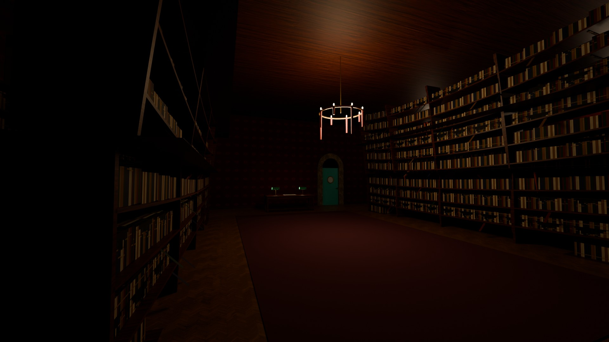
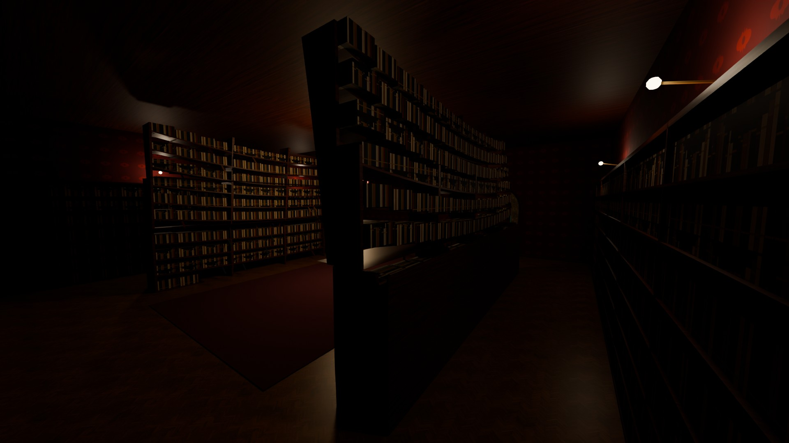
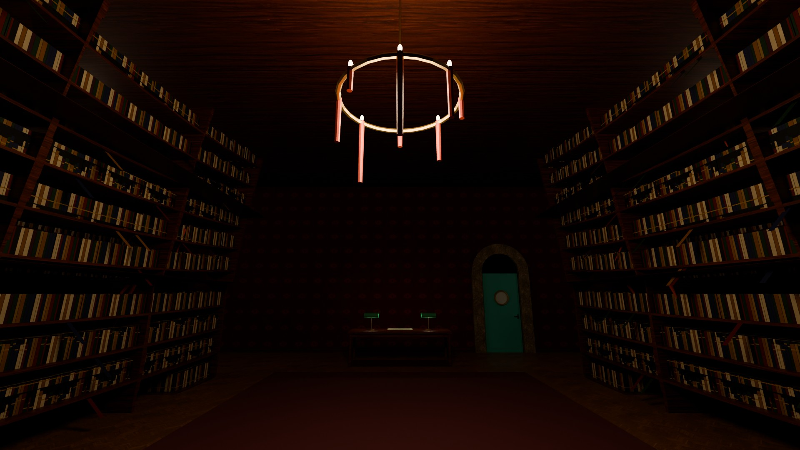

# rdwe_melting_library: The melting library: shelves that sag

Right Door, Wrong Exit, Phase C room 34 (the institution), dressed and lit (`docs/BLENDER_AREAS.md`, section 7, step 2), round its greybox (`tools/blender/build_rdwe_greybox.py`, `c_melting_library()`). 14 m by 14 m, 5 m high. The room, from `ROOMS.md`: Object distortion: two rows of shelves that lean and sag into each other like wax, the books sliding; the arch at the end is the way deeper.

Two rows of tall bookcases that lean into the aisle and slump like wax, their shelves sagging, their books sliding and dripping in strands; oxblood walls lined with ordinary straight shelves (only the middle melts), a reading table with green lamps, a globe, a melting chandelier, and a stone arch round the north door. The shelves are baked where they are (the page does not animate them).

Built in Blender 5.2.1 by `tools/blender/build_rdwe_rooms2.py` (the room's `dress_` function and spec) with the shared kit `tools/blender/rdwe_rooms2_kit.py`, baked on the GPU and graded by `tools/blender/rdwe_rooms2_pack.py`. There are no reference photos: it follows the room's line in `ROOMS.md` and the style of `docs/WORLD.md` (Super Liminal: nearly ordinary, saturated, a little wrong).

| File | What it is |
|---|---|
| `world/rdwe_melting_library.glb` | the art: 2.09 MB, 15044 triangles, 20 materials, 17 nodes (one mesh per material; the door leaves as their own nodes), 9 WebP textures |
| `world/rdwe_melting_library.json` | the layout, written by `tools/blender/export_scene.py` from the `.blend`: 22 colliders, 2 doors, 2 links, 3 spots; the same as `build_rdwe_greybox.py --preview` writes |
| `world/lightmaps/rdwe_melting_library_0.webp` | set `main` (`lightmap`): struct page, 2048 px, about 71.5 px/m |
| `world/lightmaps/rdwe_melting_library_1.webp` | set `main` (`lightmap`): props page, 2048 px, about 30.3 px/m |
| `blender/scenes/rdwe_melting_library.blend` | the saved scene (Git LFS): `Art` (one object per collider, unmerged), `Doors` (the leaves, origin at the hinge), `Layout` (`COL_` boxes, the empties), `Export` (merged by material, with the lightmap UVs), `Lights_*` (one collection per light set, and `Lights_all`) |
| `docs/renders/rdwe_melting_library/` | this README and the three review stills |





Review stills: Cycles, 96 samples adaptive, OIDN, 1920 x 1080 JPEG, AgX medium high contrast. They are Blender's renders with Blender's lights; the page shows the lightmaps (see Brightness).

## The trick's spots (for the page)

- `Spot_book_1` at (0, 0), facing (0, -1): every book has the same first line
- `Spot_book_2` at (0, -3.6), facing (0, -1): the shelves meet overhead here, books dripping from the sag
- `Spot_book_3` at (3, -4.6), facing (0, -1): the arch: the way deeper, the one door that is not melting

## Doors

- `DoorLeaf_arch` (1.06 x 2.24 m): porthole teal paint door, chrome lever. The leaf is built from its look (form, finish, handle), so it is visibly unlike every other door in the set.
- `DoorLeaf_map` (1.06 x 2.24 m): mirror-faced mustard door, no handle. The leaf is built from its look (form, finish, handle), so it is visibly unlike every other door in the set.

## Light

| Set | Material properties | Maps |
|---|---|---|
| `main` | `lightmap`, `lightmap_intensity` | `rdwe_melting_library_0`, `rdwe_melting_library_1` |

Emissive materials (not baked, drawn as they are): `Lamp_Emit`. `Lamp_Emit` is every ordinary lamp's glow.

## Sources and licences

| File (`blender/textures/rdwe_rooms2/`) | Source | Licence | Used by |
|---|---|---|---|
| `concrete_floor_02_diff_1k.jpg` | Poly Haven, Concrete Floor 02 | CC0 | Stone |
| `dark_wood_diff_1k.jpg` | Poly Haven, Dark Wood | CC0 | Ceiling_Dark, Shelf_Wood, Trim_Dark |
| `herringbone_parquet_diff_1k.jpg` | Poly Haven, Herringbone Parquet | CC0 | Floor_Parquet |
| `rough_linen_diff_512.jpg` | Poly Haven, Rough Linen | CC0 | Rug_Red |

Every other material is a flat colour, or a picture the build generates with numpy (fixed seeds, own work, no licence needed): `Book_Spines`, `Brass`, `Chrome`, `Door_Mustard`, `Door_Teal_Paint`, `Glass_Door`, `Globe_Map`, `Mirror`, `Paint_Palette`, `Paper_Oxblood`, `Shade_Green`, `Wax`.
No Meshy, no Higgsfield, nothing bought.

## Brightness

Graded by `rdwe_rooms2_pack.py`: texel = G L / (C + G L), intensity = pi C (C = 1.15), G set so the shell page's median texel in the reference set is 1.6 (shared G); the page shows texture x base colour x texel x intensity / pi. The tables below are `lab_display.py` on the packed GLB.

```
brightness, set main (`lightmap`): lab_display.py (shown = texel x intensity / pi x base colour)
material                m2           map       k    p50    p90    p99     >=1
Shelf_Wood           566.5 rdwe_melting_library_1  3.6128  0.001  0.056  0.117   0.00%
Book_Spines          404.2 rdwe_melting_library_1  3.6128  0.000  0.125  0.525   0.00%
Paper_Oxblood        217.0 rdwe_melting_library_0  3.6128  0.058  0.084  0.132   0.00%
Ceiling_Dark         196.0 rdwe_melting_library_0  3.6128  0.057  0.095  0.134   0.00%
Floor_Parquet        194.8 rdwe_melting_library_0  3.6128  0.123  0.189  0.251   0.00%
Rug_Red               46.1 rdwe_melting_library_1  3.6128  0.108  0.122  0.133   0.00%
Trim_Dark              8.1 rdwe_melting_library_0  3.6128  0.013  0.057  0.079   0.00%
Mirror                 7.6 rdwe_melting_library_1  3.6128  0.000  0.508  0.524   0.00%
Door_Mustard           7.5 rdwe_melting_library_1  3.6128  0.000  0.236  0.608   0.00%
Door_Teal_Paint        5.8 rdwe_melting_library_1  3.6128  0.000  0.276  0.285   0.00%
Stone                  3.9 rdwe_melting_library_1  3.6128  0.086  0.195  0.347   0.00%
Wax                    2.1 rdwe_melting_library_1  3.6128  0.139  0.678  0.690   0.00%
Brass                  1.1 rdwe_melting_library_1  3.6128  0.276  0.713  0.713   0.00%
Paint_Palette          1.1 rdwe_melting_library_1  3.6128  0.056  0.705  0.733   0.00%
Globe_Map              0.3 rdwe_melting_library_1  3.6128  0.110  0.204  0.222   0.00%
Shade_Green            0.3 rdwe_melting_library_1  3.6128  0.235  0.338  0.378   0.00%
Glass_Door             0.2 rdwe_melting_library_1  3.6128  0.318  0.440  0.449   0.00%
Chrome                 0.1 rdwe_melting_library_1  3.6128  0.000  0.000  0.001   0.00%
```

## Gates

```
## python tools/blender/build_rdwe_greybox.py --check .
GATE links: 54 pairs with both sides built (108 sides, the one-way ones included), 2 that loop on their own room, 5 that leave the set; 115 links in the files, every one accounted for
GATE navigable: 43 of 43 rooms reachable from rdwe_dining; 42 can get back to it (no true exit: the finale's one way out is the ending)
GATE overlaps: 0 interpenetrating collider pairs of 35141 checked (none allowed)
GATE clearances: 344 links, arrivals, spots and spawns clear by 0.28 m with a floor under them; 248 door-front points (0.5 and 1 m in) clear
GATE steps: 56 step boxes in 6 flights, one box a step; the highest rise 0.250 m (at most 0.27 m)
GATE corridors: 14 corridor rects, the narrowest 2.00 m (at least 1.6 m), none blocked
GATE extent: the largest room is 50.4 m across (a store floor, about 52 m, at most)
GATE spots: every room has its trick's spot and the ones it needs; 10 SecCam; agent x6, beacon x1, book x3, buttons x3, cake x1, cart x1, change x3, clock x2, computer x4, dark x3, frame x1, grid x6, hide x12, hum x1, lamp x1, lap x1, locker x3, map x3, monitor x2, moon x2, note x1, notes x1, photo x5, scuff x1, seeker x1, statue x3, switch x4, ticket x3, tin x3, trick x21, tv x3, view x6, watch x1, window x1
GATE doors: 124 door leaves, no two with the same look; 103 exits with one Link_ each, 4 arrival-only, 17 that never open; every exit fixed
GATES PASS

## world/rdwe_melting_library.json (export_scene.py, from the .blend) against build_rdwe_greybox.py --preview
SAME (to 2.5 mm): 22 colliders, 2 doors, 2 links, 0 zones, 3 spots, 0 markers, 0 cameras

## node tools/worlddoc.mjs check world/rdwe_melting_library.json
warning: scene rdwe_melting_library is not in the world manifest yet: a new scene to add
  warning: link arch: the manifest has no link from this door yet: a new link to add
  warning: link map: the manifest has no link from this door yet: a new link to add
OK world/rdwe_melting_library.json: 22 colliders, 2 doors, 0 markers, 2 links, 0 zones, 3 spots, 0 errors, 3 warnings

## tools/blender/check_layout.py (rules COVER, STRAY, CLEAR on the Art collection; run on the box)
layout check: scene rdwe_melting_library, 53 visible meshes, 22 colliders
PASS  COVER  Beyond_arch: 1 mesh(es) cover it (1326 sample points, every one within 5 cm of art)
PASS  COVER  Beyond_map: 1 mesh(es) cover it (1326 sample points, every one within 5 cm of art)
PASS  COVER  Globe: 3 mesh(es) cover it (588 sample points, every one within 5 cm of art)
PASS  COVER  Reading_Table: 3 mesh(es) cover it (2025 sample points, every one within 5 cm of art)
PASS  COVER  Room_Ceiling: 9 mesh(es) cover it (63075 sample points, every one within 5 cm of art)
PASS  COVER  Room_Floor: 13 mesh(es) cover it (84100 sample points, every one within 5 cm of art)
PASS  COVER  Room_Wall_E_1: 6 mesh(es) cover it (21573 sample points, every one within 5 cm of art)
PASS  COVER  Room_Wall_N_1: 5 mesh(es) cover it (14994 sample points, every one within 5 cm of art)
PASS  COVER  Room_Wall_N_2: 4 mesh(es) cover it (1044 sample points, every one within 5 cm of art)
PASS  COVER  Room_Wall_N_3: 5 mesh(es) cover it (5814 sample points, every one within 5 cm of art)
PASS  COVER  Room_Wall_S_1: 5 mesh(es) cover it (5814 sample points, every one within 5 cm of art)
PASS  COVER  Room_Wall_S_2: 4 mesh(es) cover it (1044 sample points, every one within 5 cm of art)
PASS  COVER  Room_Wall_S_3: 5 mesh(es) cover it (14994 sample points, every one within 5 cm of art)
PASS  COVER  Room_Wall_W_1: 6 mesh(es) cover it (21573 sample points, every one within 5 cm of art)
PASS  COVER  Shelf_1_1: 3 mesh(es) cover it (13851 sample points, every one within 5 cm of art)
PASS  COVER  Shelf_1_2: 3 mesh(es) cover it (10935 sample points, every one within 5 cm of art)
PASS  COVER  Shelf_1_3: 2 mesh(es) cover it (10935 sample points, every one within 5 cm of art)
PASS  COVER  Shelf_2_1: 3 mesh(es) cover it (13851 sample points, every one within 5 cm of art)
PASS  COVER  Shelf_2_2: 3 mesh(es) cover it (10935 sample points, every one within 5 cm of art)
PASS  COVER  Shelf_2_3: 2 mesh(es) cover it (10935 sample points, every one within 5 cm of art)
PASS  COVER  Wall_Shelves_E: 3 mesh(es) cover it (21978 sample points, every one within 5 cm of art)
PASS  COVER  Wall_Shelves_W: 3 mesh(es) cover it (21978 sample points, every one within 5 cm of art)
PASS  STRAY  15 tall solid mesh(es), each over a collider; 29 decor_* mesh(es) exempt
PASS  CLEAR  links.arch.arrive (3.00, -5.10): clear within 0.28 m
PASS  CLEAR  links.arch.at (3.00, -6.25): clear within 0.28 m
PASS  CLEAR  links.map.arrive (-3.00, 5.10): clear within 0.28 m
PASS  CLEAR  links.map.at (-3.00, 6.25): clear within 0.28 m
PASS  CLEAR  spots.Spot_book_1.at (0.00, 0.00): clear within 0.28 m
PASS  CLEAR  spots.Spot_book_2.at (0.00, -3.60): clear within 0.28 m
PASS  CLEAR  spots.Spot_book_3.at (3.00, -4.60): clear within 0.28 m
PASS: 30 of 30 checks passed

## glb_inspect world/rdwe_melting_library.glb --budget tris=300000,mb=8
materials  20: Book_Spines, Brass, Ceiling_Dark, Chrome, Door_Teal_Paint, Glass_Door, Door_Mustard, Mirror, Floor_Parquet, Globe_Map, Lamp_Emit, Paint_Palette, Paper_Oxblood, Rug_Red, Shade_Green, Shelf_Wood, Stone, Trim_Dark, Void_Black, Wax
textures   9, images: 512x256, 1024x1024, 1024x1024, 128x128, 512x512, 512x512, 1024x1024
bbox       14.0024 x 5.2349 x 15.1 (x, y up, z), min [-7.0012, -0.2349, -7.55]
requires   EXT_texture_webp
pass       tris: 15044 triangles, budget 300000
pass       mb: 2.00 MB, budget 8

## node --test shared/*.test.js
tests 297
pass 297
fail 0

## sizes
world/rdwe_melting_library.glb  2.09 MB
world/rdwe_melting_library.json  0.00 MB
blender/scenes/rdwe_melting_library.blend  0.71 MB
world/lightmaps/rdwe_melting_library_0.webp  0.07 MB
world/lightmaps/rdwe_melting_library_1.webp  0.51 MB
docs/renders/rdwe_melting_library/1_arrival.jpg  0.18 MB
docs/renders/rdwe_melting_library/2_wide.jpg  0.16 MB
docs/renders/rdwe_melting_library/3_detail.jpg  0.25 MB

## privacy grep (user names, absolute paths, session ids, e-mail; the .blend decompressed)
privacy grep: 9 files, 0 with hits

```

Nothing is wired: the manifest, `games/rdwe/`, `index.html`, `shared/` and the tests are untouched.
