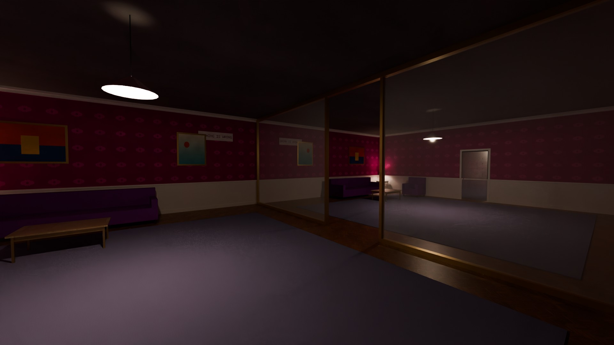
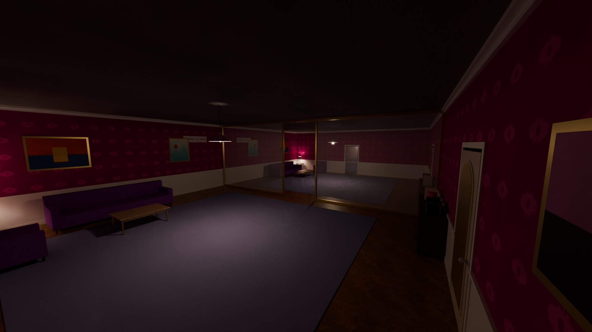
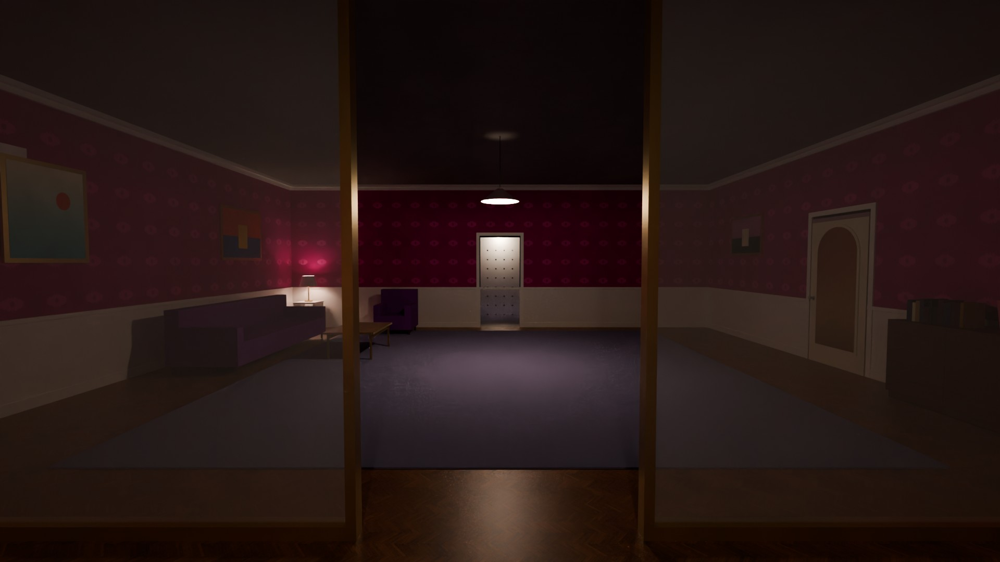

# rdwe_mirror_room: The mirror room: the reflection's door is real

Right Door, Wrong Exit, Phase C room 22 (the teal wing), dressed and lit (`docs/BLENDER_AREAS.md`, section 7, step 2), round its greybox (`tools/blender/build_rdwe_greybox.py`, `c_mirror_room()`). 16 m by 10 m, 3.4 m high. The room, from `ROOMS.md`: Psychological puzzle: the room is doubled across a glass line; the door on your side is the way back, the same door in the reflection is the way on, and the gap in the mirror lets you through.

A magenta sitting room doubled across a glass line at x = 0: the west half is the room, the east half its reflection, built as the west half reflected (so the clock runs the other way and the books and pictures read backwards). The glass is in two gilt-framed panes with a gap in the middle; the reflection's south door is the real way on. Everything east of the glass is the `Mirror_World` group: its own nodes.

Built in Blender 5.2.1 by `tools/blender/build_rdwe_rooms2.py` (the room's `dress_` function and spec) with the shared kit `tools/blender/rdwe_rooms2_kit.py`, baked on the GPU and graded by `tools/blender/rdwe_rooms2_pack.py`. There are no reference photos: it follows the room's line in `ROOMS.md` and the style of `docs/WORLD.md` (Super Liminal: nearly ordinary, saturated, a little wrong).

| File | What it is |
|---|---|
| `world/rdwe_mirror_room.glb` | the art: 1.62 MB, 10282 triangles, 25 materials, 38 nodes (one mesh per material; the door leaves, the reflection as their own nodes), 11 WebP textures |
| `world/rdwe_mirror_room.json` | the layout, written by `tools/blender/export_scene.py` from the `.blend`: 27 colliders, 3 doors, 3 links, 3 spots; the same as `build_rdwe_greybox.py --preview` writes |
| `world/lightmaps/rdwe_mirror_room_0.webp` | set `main` (`lightmap`): struct page, 2048 px, about 69.9 px/m |
| `world/lightmaps/rdwe_mirror_room_1.webp` | set `main` (`lightmap`): props page, 2048 px, about 107.6 px/m |
| `blender/scenes/rdwe_mirror_room.blend` | the saved scene (Git LFS): `Art` (one object per collider, unmerged), `Doors` (the leaves, origin at the hinge), `Layout` (`COL_` boxes, the empties), `Export` (merged by material, with the lightmap UVs), `Lights_*` (one collection per light set, and `Lights_all`) |
| `docs/renders/rdwe_mirror_room/` | this README and the three review stills |





Review stills: Cycles, 96 samples adaptive, OIDN, 1920 x 1080 JPEG, AgX medium high contrast. They are Blender's renders with Blender's lights; the page shows the lightmaps (see Brightness).

## The trick's spots (for the page)

- `Spot_trick_1` at (-2, 0), facing (1, 0): the mirror's gap: step through to the reflection
- `Spot_trick_2` at (3, 0), facing (-1, 0): the far side: the room, mirrored; the clock runs the other way and the books read backwards
- `Spot_trick_3` at (4, 2.2), facing (0, 1): the reflection's door: the same door you came in by, and real

## Doors

- `DoorLeaf_moon` (0.94 x 2.16 m): studded lilac door, chrome lever. The leaf is built from its look (form, finish, handle), so it is visibly unlike every other door in the set.
- `DoorLeaf_reflection` (1.06 x 2.24 m): the door in the reflection: mirror-image of the way you came, real. The leaf is built from its look (form, finish, handle), so it is visibly unlike every other door in the set.
- `DoorLeaf_three` (1.06 x 2.3 m): round-topped cream gloss door, glass knob. The leaf is built from its look (form, finish, handle), so it is visibly unlike every other door in the set.

## Light

| Set | Material properties | Maps |
|---|---|---|
| `main` | `lightmap`, `lightmap_intensity` | `rdwe_mirror_room_0`, `rdwe_mirror_room_1` |

Emissive materials (not baked, drawn as they are): `Lamp_Emit`. `Lamp_Emit` is every ordinary lamp's glow.

## What the page moves (own nodes)

- `Mirror_World_*`: the reflection, merged by material into its own nodes (baked; `page` says what it is)

## Sources and licences

| File (`blender/textures/rdwe_rooms2/`) | Source | Licence | Used by |
|---|---|---|---|
| `dark_wood_diff_1k.jpg` | Poly Haven, Dark Wood | CC0 | Wood_Dark |
| `herringbone_parquet_diff_1k.jpg` | Poly Haven, Herringbone Parquet | CC0 | Floor_Parquet |
| `marble_01_diff_1k.jpg` | Poly Haven, Marble 01 | CC0 | Marble |
| `plastered_wall_04_diff_1k.jpg` | Poly Haven, Plastered Wall 04 | CC0 | Ceiling_White |
| `rough_linen_diff_512.jpg` | Poly Haven, Rough Linen | CC0 | Rug_Pink, Velvet_Magenta |

Every other material is a flat colour, or a picture the build generates with numpy (fixed seeds, own work, no licence needed): `Brass`, `Chrome`, `Clock_Faces`, `Door_Cream_Gloss`, `Door_Lilac`, `Frame_Gilt`, `Glass_Clear`, `Glass_Door`, `Iron`, `Mirror`, `Paint_Palette`, `Paintings`, `Panel_White`, `Paper_Magenta`, `Shade_Pink`, `Signs_Mirror`, `Trim_White`.
No Meshy, no Higgsfield, nothing bought.

## Brightness

Graded by `rdwe_rooms2_pack.py`: texel = G L / (C + G L), intensity = pi C (C = 1.15), G set so the shell page's median texel in the reference set is 0.9 (shared G); the page shows texture x base colour x texel x intensity / pi. The tables below are `lab_display.py` on the packed GLB.

```
brightness, set main (`lightmap`): lab_display.py (shown = texel x intensity / pi x base colour)
material                m2           map       k    p50    p90    p99     >=1
Paper_Magenta        178.4 rdwe_mirror_room_0  3.6128  0.214  0.324  0.462   0.00%
Ceiling_White        170.6 rdwe_mirror_room_0  3.6128  0.116  0.154  0.207   0.00%
Floor_Parquet        170.6 rdwe_mirror_room_0  3.6128  0.000  0.193  0.310   0.00%
Rug_Pink              90.4 rdwe_mirror_room_1  3.6128  0.249  0.352  0.394   0.00%
Panel_White           46.8 rdwe_mirror_room_0  3.1793  0.421  0.665  0.879   0.00%
Trim_White            31.5 rdwe_mirror_room_0  3.2515  0.367  0.627  0.954   0.00%
Velvet_Magenta        28.5 rdwe_mirror_room_1  3.6128  0.116  0.163  0.266   0.00%
Door_Cream_Gloss      22.4 rdwe_mirror_room_1  3.6128  0.000  0.108  0.527   0.00%
Wood_Dark             15.8 rdwe_mirror_room_1  3.6128  0.000  0.073  0.109   0.00%
Brass                 11.8 rdwe_mirror_room_1  3.6128  0.000  0.107  0.694   0.00%
Frame_Gilt            11.5 rdwe_mirror_room_1  3.6128  0.286  0.414  0.505   0.00%
Paintings              5.2 rdwe_mirror_room_1  3.6128  0.267  0.467  0.557   0.00%
Chrome                 4.8 rdwe_mirror_room_1  3.6128  0.000  0.000  0.000   0.00%
Paint_Palette          4.8 rdwe_mirror_room_1  3.6128  0.002  0.310  0.475   0.00%
Door_Lilac             4.3 rdwe_mirror_room_1  3.6128  0.015  0.474  0.491   0.00%
Marble                 2.2 rdwe_mirror_room_1  3.6128  0.322  0.347  0.384   0.00%
Shade_Pink             1.1 rdwe_mirror_room_1  3.6128  0.329  0.936  1.020   2.16%
Signs_Mirror           0.7 rdwe_mirror_room_1  3.6128  0.428  0.465  0.525   0.00%
Iron                   0.4 rdwe_mirror_room_1  3.6128  0.039  0.066  0.094   0.00%
Mirror                 0.3 rdwe_mirror_room_1  3.6128  0.002  0.400  0.429   0.00%
Clock_Faces            0.1 rdwe_mirror_room_1  3.6128  0.426  0.463  0.520   0.00%
Glass_Door             0.1 rdwe_mirror_room_1  3.6128  0.007  0.264  0.357   0.00%
```

## Gates

```
## python tools/blender/build_rdwe_greybox.py --check .
GATE links: 54 pairs with both sides built (108 sides, the one-way ones included), 2 that loop on their own room, 5 that leave the set; 115 links in the files, every one accounted for
GATE navigable: 43 of 43 rooms reachable from rdwe_dining; 42 can get back to it (no true exit: the finale's one way out is the ending)
GATE overlaps: 0 interpenetrating collider pairs of 35141 checked (none allowed)
GATE clearances: 344 links, arrivals, spots and spawns clear by 0.28 m with a floor under them; 248 door-front points (0.5 and 1 m in) clear
GATE steps: 56 step boxes in 6 flights, one box a step; the highest rise 0.250 m (at most 0.27 m)
GATE corridors: 14 corridor rects, the narrowest 2.00 m (at least 1.6 m), none blocked
GATE extent: the largest room is 50.4 m across (a store floor, about 52 m, at most)
GATE spots: every room has its trick's spot and the ones it needs; 10 SecCam; agent x6, beacon x1, book x3, buttons x3, cake x1, cart x1, change x3, clock x2, computer x4, dark x3, frame x1, grid x6, hide x12, hum x1, lamp x1, lap x1, locker x3, map x3, monitor x2, moon x2, note x1, notes x1, photo x5, scuff x1, seeker x1, statue x3, switch x4, ticket x3, tin x3, trick x21, tv x3, view x6, watch x1, window x1
GATE doors: 124 door leaves, no two with the same look; 103 exits with one Link_ each, 4 arrival-only, 17 that never open; every exit fixed
GATES PASS

## world/rdwe_mirror_room.json (export_scene.py, from the .blend) against build_rdwe_greybox.py --preview
SAME (to 2.5 mm): 27 colliders, 3 doors, 3 links, 0 zones, 3 spots, 0 markers, 0 cameras

## node tools/worlddoc.mjs check world/rdwe_mirror_room.json
warning: scene rdwe_mirror_room is not in the world manifest yet: a new scene to add
  warning: link moon: the manifest has no link from this door yet: a new link to add
  warning: link reflection: the manifest has no link from this door yet: a new link to add
  warning: link three: the manifest has no link from this door yet: a new link to add
OK world/rdwe_mirror_room.json: 27 colliders, 3 doors, 0 markers, 3 links, 0 zones, 3 spots, 0 errors, 4 warnings

## tools/blender/check_layout.py (rules COVER, STRAY, CLEAR on the Art collection; run on the box)
layout check: scene rdwe_mirror_room, 80 visible meshes, 27 colliders
PASS  COVER  Armchair_E: 3 mesh(es) cover it (891 sample points, every one within 5 cm of art)
PASS  COVER  Armchair_W: 3 mesh(es) cover it (891 sample points, every one within 5 cm of art)
PASS  COVER  Beyond_moon: 1 mesh(es) cover it (1200 sample points, every one within 5 cm of art)
PASS  COVER  Beyond_reflection: 1 mesh(es) cover it (1326 sample points, every one within 5 cm of art)
PASS  COVER  Beyond_three: 1 mesh(es) cover it (1326 sample points, every one within 5 cm of art)
PASS  COVER  Coffee_Table_E: 3 mesh(es) cover it (702 sample points, every one within 5 cm of art)
PASS  COVER  Coffee_Table_W: 3 mesh(es) cover it (702 sample points, every one within 5 cm of art)
PASS  COVER  Glass_N: 5 mesh(es) cover it (3010 sample points, every one within 5 cm of art)
PASS  COVER  Glass_S: 5 mesh(es) cover it (3010 sample points, every one within 5 cm of art)
PASS  COVER  Lamp_Table_E: 3 mesh(es) cover it (288 sample points, every one within 5 cm of art)
PASS  COVER  Lamp_Table_W: 3 mesh(es) cover it (288 sample points, every one within 5 cm of art)
PASS  COVER  Room_Ceiling: 13 mesh(es) cover it (51975 sample points, every one within 5 cm of art)
PASS  COVER  Room_Floor: 22 mesh(es) cover it (69300 sample points, every one within 5 cm of art)
PASS  COVER  Room_Wall_E_1: 5 mesh(es) cover it (10605 sample points, every one within 5 cm of art)
PASS  COVER  Room_Wall_N_1: 7 mesh(es) cover it (17325 sample points, every one within 5 cm of art)
PASS  COVER  Room_Wall_S_1: 5 mesh(es) cover it (3990 sample points, every one within 5 cm of art)
PASS  COVER  Room_Wall_S_2: 4 mesh(es) cover it (432 sample points, every one within 5 cm of art)
PASS  COVER  Room_Wall_S_3: 9 mesh(es) cover it (7350 sample points, every one within 5 cm of art)
PASS  COVER  Room_Wall_S_4: 4 mesh(es) cover it (468 sample points, every one within 5 cm of art)
PASS  COVER  Room_Wall_S_5: 5 mesh(es) cover it (3990 sample points, every one within 5 cm of art)
PASS  COVER  Room_Wall_W_1: 5 mesh(es) cover it (4830 sample points, every one within 5 cm of art)
PASS  COVER  Room_Wall_W_2: 4 mesh(es) cover it (429 sample points, every one within 5 cm of art)
PASS  COVER  Room_Wall_W_3: 5 mesh(es) cover it (4830 sample points, every one within 5 cm of art)
PASS  COVER  Sideboard_E: 4 mesh(es) cover it (1260 sample points, every one within 5 cm of art)
PASS  COVER  Sideboard_W: 4 mesh(es) cover it (1260 sample points, every one within 5 cm of art)
PASS  COVER  Sofa_E: 3 mesh(es) cover it (3410 sample points, every one within 5 cm of art)
PASS  COVER  Sofa_W: 3 mesh(es) cover it (3410 sample points, every one within 5 cm of art)
PASS  STRAY  26 tall solid mesh(es), each over a collider; 41 decor_* mesh(es) exempt
PASS  CLEAR  links.moon.arrive (-6.10, 0.00): clear within 0.28 m
PASS  CLEAR  links.moon.at (-7.25, 0.00): clear within 0.28 m
PASS  CLEAR  links.reflection.arrive (4.00, 3.10): clear within 0.28 m
PASS  CLEAR  links.reflection.at (4.00, 4.25): clear within 0.28 m
PASS  CLEAR  links.three.arrive (-4.00, 3.10): clear within 0.28 m
PASS  CLEAR  links.three.at (-4.00, 4.25): clear within 0.28 m
PASS  CLEAR  spots.Spot_trick_1.at (-2.00, 0.00): clear within 0.28 m
PASS  CLEAR  spots.Spot_trick_2.at (3.00, 0.00): clear within 0.28 m
PASS  CLEAR  spots.Spot_trick_3.at (4.00, 2.20): clear within 0.28 m
PASS: 37 of 37 checks passed

## glb_inspect world/rdwe_mirror_room.glb --budget tris=300000,mb=8
materials  25: Brass, Ceiling_White, Clock_Faces, Chrome, Door_Lilac, Iron, Door_Cream_Gloss, Glass_Door, Mirror, Floor_Parquet, Frame_Gilt, Glass_Clear, Lamp_Emit, Marble, Paint_Palette, Paintings, Rug_Pink, Shade_Pink, Signs_Mirror, Trim_White, Velvet_Magenta, Wood_Dark, Panel_White, Paper_Magenta, Void_Black
textures   11, images: 1024x1024, 1024x1024, 1024x1024, 1024x1024, 128x128, 1024x512, 512x512, 1024x1024, 512x512
bbox       16.75 x 3.45 x 10.75 (x, y up, z), min [-8.55, -0.05, -5.2]
requires   EXT_texture_webp
pass       tris: 10282 triangles, budget 300000
pass       mb: 1.55 MB, budget 8

## node --test shared/*.test.js
tests 297
pass 297
fail 0

## sizes
world/rdwe_mirror_room.glb  1.62 MB
world/rdwe_mirror_room.json  0.01 MB
blender/scenes/rdwe_mirror_room.blend  0.82 MB
world/lightmaps/rdwe_mirror_room_0.webp  0.16 MB
world/lightmaps/rdwe_mirror_room_1.webp  0.28 MB
docs/renders/rdwe_mirror_room/1_arrival.jpg  0.11 MB
docs/renders/rdwe_mirror_room/2_wide.jpg  0.11 MB
docs/renders/rdwe_mirror_room/3_detail.jpg  0.11 MB

## privacy grep (user names, absolute paths, session ids, e-mail; the .blend decompressed)
privacy grep: 9 files, 0 with hits

```

Nothing is wired: the manifest, `games/rdwe/`, `index.html`, `shared/` and the tests are untouched.
