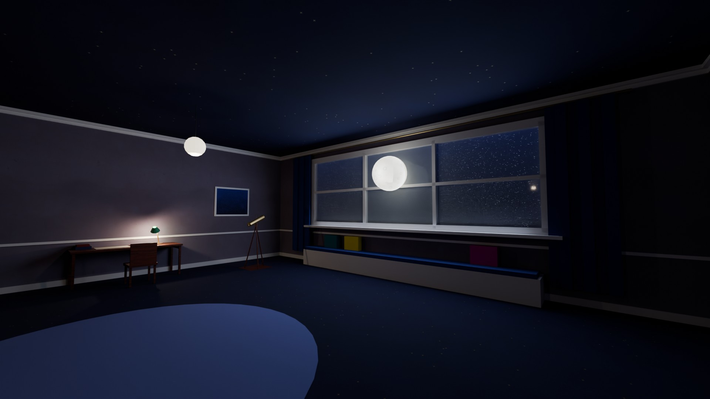
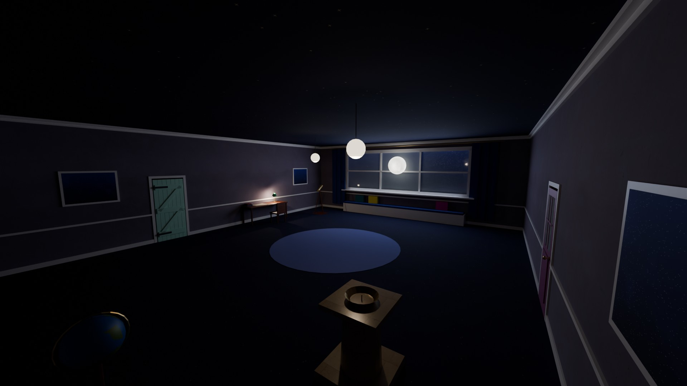
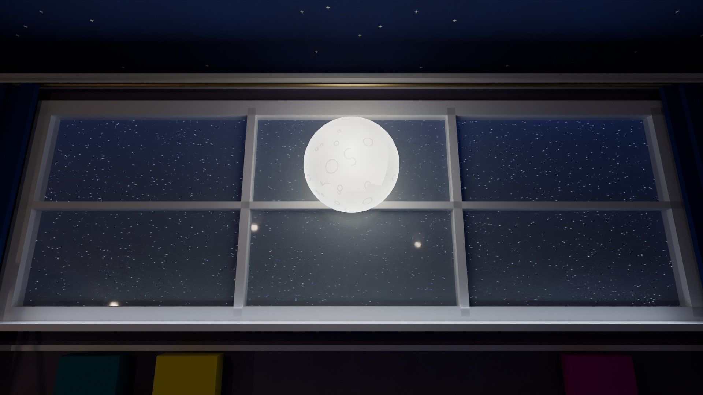

# rdwe_moon_window: The moon in the window: pick it up

Right Door, Wrong Exit, Phase C room 21 (the teal wing), dressed and lit (`docs/BLENDER_AREAS.md`, section 7, step 2), round its greybox (`tools/blender/build_rdwe_greybox.py`, `c_moon_window()`). 10 m by 12 m, 3.6 m high. The room, from `ROOMS.md`: Object distortion (Super Liminal's trick): the moon in the window can be picked up; held close it is a ball, set on the pedestal it is the size of the room and the west door opens.

A night study under a navy, star-painted ceiling: lilac walls, a big mullioned window on the north wall full of night sky and the moon, a window seat, a brass telescope on its tripod, a desk with a lamp, star charts, a bookcase, a globe, a round rug, and the white pedestal where the moon goes. The moon is its own object (the page picks it up and rescales it); it is not baked.

Built in Blender 5.2.1 by `tools/blender/build_rdwe_rooms2.py` (the room's `dress_` function and spec) with the shared kit `tools/blender/rdwe_rooms2_kit.py`, baked on the GPU and graded by `tools/blender/rdwe_rooms2_pack.py`. There are no reference photos: it follows the room's line in `ROOMS.md` and the style of `docs/WORLD.md` (Super Liminal: nearly ordinary, saturated, a little wrong).

| File | What it is |
|---|---|
| `world/rdwe_moon_window.glb` | the art: 1.04 MB, 8748 triangles, 23 materials, 22 nodes (one mesh per material; the door leaves, the moving objects as their own nodes), 14 WebP textures |
| `world/rdwe_moon_window.json` | the layout, written by `tools/blender/export_scene.py` from the `.blend`: 19 colliders, 2 doors, 2 links, 3 spots; the same as `build_rdwe_greybox.py --preview` writes |
| `world/lightmaps/rdwe_moon_window_0.webp` | set `main` (`lightmap`): struct page, 2048 px, about 78.3 px/m |
| `world/lightmaps/rdwe_moon_window_1.webp` | set `main` (`lightmap`): props page, 1024 px, about 32.2 px/m |
| `blender/scenes/rdwe_moon_window.blend` | the saved scene (Git LFS): `Art` (one object per collider, unmerged), `Doors` (the leaves, origin at the hinge), `Layout` (`COL_` boxes, the empties), `Export` (merged by material, with the lightmap UVs), `Lights_*` (one collection per light set, and `Lights_all`) |
| `docs/renders/rdwe_moon_window/` | this README and the three review stills |





Review stills: Cycles, 96 samples adaptive, OIDN, 1920 x 1080 JPEG, AgX medium high contrast. They are Blender's renders with Blender's lights; the page shows the lightmaps (see Brightness).

## The trick's spots (for the page)

- `Spot_moon_1` at (0, -4), facing (0, -1): pick up the moon: its size is how far away you hold it
- `Spot_moon_2` at (0, -1), facing (0, -1): hold the moon at arm's length: a ball; walk it to the window and it is the moon again
- `Spot_switch_1` at (3, 1.8), facing (0, 1): the pedestal: the moon goes here; set it down and it fills the room, and the west door opens

## Doors

- `DoorLeaf_hall` (0.86 x 2.1 m): half-glazed plum door, brass knob. The leaf is built from its look (form, finish, handle), so it is visibly unlike every other door in the set.
- `DoorLeaf_sill` (0.86 x 2.04 m): ledged and braced mint paint door, ring pull. The leaf is built from its look (form, finish, handle), so it is visibly unlike every other door in the set.

## Light

| Set | Material properties | Maps |
|---|---|---|
| `main` | `lightmap`, `lightmap_intensity` | `rdwe_moon_window_0`, `rdwe_moon_window_1` |

Emissive materials (not baked, drawn as they are): `Lamp_Emit`, `Moon_Glow`, `Shade_Paper`, `Window_Night`. `Lamp_Emit` is every ordinary lamp's glow.

## What the page moves (own nodes)

- `Moon` (not baked, `unbaked: true`; origin at its pivot): the page picks it up: its scale is how far away you hold it; set on the pedestal it fills the room

## Sources and licences

| File (`blender/textures/rdwe_rooms2/`) | Source | Licence | Used by |
|---|---|---|---|
| `dark_wood_diff_1k.jpg` | Poly Haven, Dark Wood | CC0 | Wood_Dark |
| `marble_01_diff_1k.jpg` | Poly Haven, Marble 01 | CC0 | Marble |
| `plastered_wall_04_diff_1k.jpg` | Poly Haven, Plastered Wall 04 | CC0 | Plaster_Lilac |
| `rough_linen_diff_512.jpg` | Poly Haven, Rough Linen | CC0 | Curtain_Navy, Velvet_Navy |

Every other material is a flat colour, or a picture the build generates with numpy (fixed seeds, own work, no licence needed): `Brass`, `Carpet_Stars`, `Ceiling_Navy`, `Door_Mint_Paint`, `Door_Plum`, `Glass_Clear`, `Glass_Door`, `Globe_Map`, `Iron`, `Moon_Glow`, `Paint_Palette`, `Shade_Green`, `Shade_Paper`, `Star_Chart`, `Trim_White`, `Window_Night`.
No Meshy, no Higgsfield, nothing bought.

## Brightness

Graded by `rdwe_rooms2_pack.py`: texel = G L / (C + G L), intensity = pi C (C = 1.15), G set so the shell page's median texel in the reference set is 1.7 (shared G); the page shows texture x base colour x texel x intensity / pi. The tables below are `lab_display.py` on the packed GLB.

```
brightness, set main (`lightmap`): lab_display.py (shown = texel x intensity / pi x base colour)
material                m2           map       k    p50    p90    p99     >=1
Plaster_Lilac        149.1 rdwe_moon_window_0  3.6128  0.153  0.207  0.240   0.00%
Ceiling_Navy         120.0 rdwe_moon_window_0  3.6128  0.033  0.048  0.055   0.00%
Carpet_Stars         111.0 rdwe_moon_window_0  3.6128  0.032  0.043  0.049   0.00%
Paint_Palette         66.0 rdwe_moon_window_1  3.6128  0.000  0.049  0.486   0.00%
Trim_White            41.9 rdwe_moon_window_0  3.1793  0.443  0.662  0.861   0.00%
Wood_Dark             24.4 rdwe_moon_window_1  3.6128  0.004  0.082  0.154   0.00%
Curtain_Navy          15.1 rdwe_moon_window_1  3.6128  0.060  0.133  0.164   0.00%
Door_Mint_Paint       12.2 rdwe_moon_window_1  3.6128  0.000  0.515  0.584   0.00%
Door_Plum              6.3 rdwe_moon_window_1  3.6128  0.000  0.275  0.290   0.00%
Velvet_Navy            3.7 rdwe_moon_window_1  3.6128  0.169  0.254  0.271   0.00%
Marble                 3.6 rdwe_moon_window_1  3.6128  0.108  0.335  0.387   0.00%
Star_Chart             2.7 rdwe_moon_window_1  3.6128  0.100  0.193  0.291   0.00%
Glass_Door             1.2 rdwe_moon_window_1  3.6128  0.002  0.549  0.566   0.00%
Brass                  1.0 rdwe_moon_window_1  3.6128  0.261  0.553  0.707   0.00%
Globe_Map              0.5 rdwe_moon_window_1  3.6128  0.106  0.245  0.261   0.00%
Iron                   0.2 rdwe_moon_window_1  3.6128  0.055  0.083  0.091   0.00%
Shade_Green            0.1 rdwe_moon_window_1  3.6128  0.282  0.328  0.338   0.00%
```

## Gates

```
## python tools/blender/build_rdwe_greybox.py --check .
GATE links: 54 pairs with both sides built (108 sides, the one-way ones included), 2 that loop on their own room, 5 that leave the set; 115 links in the files, every one accounted for
GATE navigable: 43 of 43 rooms reachable from rdwe_dining; 42 can get back to it (no true exit: the finale's one way out is the ending)
GATE overlaps: 0 interpenetrating collider pairs of 35141 checked (none allowed)
GATE clearances: 344 links, arrivals, spots and spawns clear by 0.28 m with a floor under them; 248 door-front points (0.5 and 1 m in) clear
GATE steps: 56 step boxes in 6 flights, one box a step; the highest rise 0.250 m (at most 0.27 m)
GATE corridors: 14 corridor rects, the narrowest 2.00 m (at least 1.6 m), none blocked
GATE extent: the largest room is 50.4 m across (a store floor, about 52 m, at most)
GATE spots: every room has its trick's spot and the ones it needs; 10 SecCam; agent x6, beacon x1, book x3, buttons x3, cake x1, cart x1, change x3, clock x2, computer x4, dark x3, frame x1, grid x6, hide x12, hum x1, lamp x1, lap x1, locker x3, map x3, monitor x2, moon x2, note x1, notes x1, photo x5, scuff x1, seeker x1, statue x3, switch x4, ticket x3, tin x3, trick x21, tv x3, view x6, watch x1, window x1
GATE doors: 124 door leaves, no two with the same look; 103 exits with one Link_ each, 4 arrival-only, 17 that never open; every exit fixed
GATES PASS

## world/rdwe_moon_window.json (export_scene.py, from the .blend) against build_rdwe_greybox.py --preview
SAME (to 2.5 mm): 19 colliders, 2 doors, 2 links, 0 zones, 3 spots, 0 markers, 0 cameras

## node tools/worlddoc.mjs check world/rdwe_moon_window.json
warning: scene rdwe_moon_window is not in the world manifest yet: a new scene to add
  warning: link hall: the manifest has no link from this door yet: a new link to add
  warning: link sill: the manifest has no link from this door yet: a new link to add
OK world/rdwe_moon_window.json: 19 colliders, 2 doors, 0 markers, 2 links, 0 zones, 3 spots, 0 errors, 3 warnings

## tools/blender/check_layout.py (rules COVER, STRAY, CLEAR on the Art collection; run on the box)
layout check: scene rdwe_moon_window, 54 visible meshes, 19 colliders
PASS  COVER  Beyond_hall: 1 mesh(es) cover it (1080 sample points, every one within 5 cm of art)
PASS  COVER  Beyond_sill: 1 mesh(es) cover it (1080 sample points, every one within 5 cm of art)
PASS  COVER  Bookcase: 3 mesh(es) cover it (3565 sample points, every one within 5 cm of art)
PASS  COVER  Desk: 4 mesh(es) cover it (1512 sample points, every one within 5 cm of art)
PASS  COVER  Desk_Chair: 3 mesh(es) cover it (360 sample points, every one within 5 cm of art)
PASS  COVER  Globe: 3 mesh(es) cover it (588 sample points, every one within 5 cm of art)
PASS  COVER  Pedestal: 2 mesh(es) cover it (891 sample points, every one within 5 cm of art)
PASS  COVER  Room_Ceiling: 9 mesh(es) cover it (39375 sample points, every one within 5 cm of art)
PASS  COVER  Room_Floor: 14 mesh(es) cover it (52500 sample points, every one within 5 cm of art)
PASS  COVER  Room_Wall_E_1: 5 mesh(es) cover it (6327 sample points, every one within 5 cm of art)
PASS  COVER  Room_Wall_E_2: 4 mesh(es) cover it (480 sample points, every one within 5 cm of art)
PASS  COVER  Room_Wall_E_3: 5 mesh(es) cover it (6327 sample points, every one within 5 cm of art)
PASS  COVER  Room_Wall_N_1: 7 mesh(es) cover it (11655 sample points, every one within 5 cm of art)
PASS  COVER  Room_Wall_S_1: 6 mesh(es) cover it (11655 sample points, every one within 5 cm of art)
PASS  COVER  Room_Wall_W_1: 7 mesh(es) cover it (8547 sample points, every one within 5 cm of art)
PASS  COVER  Room_Wall_W_2: 4 mesh(es) cover it (510 sample points, every one within 5 cm of art)
PASS  COVER  Room_Wall_W_3: 5 mesh(es) cover it (4107 sample points, every one within 5 cm of art)
PASS  COVER  Telescope: 3 mesh(es) cover it (1024 sample points, every one within 5 cm of art)
PASS  COVER  Window_Seat: 4 mesh(es) cover it (2562 sample points, every one within 5 cm of art)
PASS  STRAY  17 tall solid mesh(es), each over a collider; 29 decor_* mesh(es) exempt
PASS  CLEAR  links.hall.arrive (3.10, 0.00): clear within 0.28 m
PASS  CLEAR  links.hall.at (4.25, 0.00): clear within 0.28 m
PASS  CLEAR  links.sill.arrive (-3.10, 2.00): clear within 0.28 m
PASS  CLEAR  links.sill.at (-4.25, 2.00): clear within 0.28 m
PASS  CLEAR  spots.Spot_moon_1.at (0.00, -4.00): clear within 0.28 m
PASS  CLEAR  spots.Spot_moon_2.at (0.00, -1.00): clear within 0.28 m
PASS  CLEAR  spots.Spot_switch_1.at (3.00, 1.80): clear within 0.28 m
PASS: 27 of 27 checks passed

## glb_inspect world/rdwe_moon_window.glb --budget tris=300000,mb=8
materials  23: Brass, Carpet_Stars, Ceiling_Navy, Curtain_Navy, Door_Plum, Glass_Door, Door_Mint_Paint, Iron, Glass_Clear, Globe_Map, Lamp_Emit, Marble, Moon_Glow, Paint_Palette, Plaster_Lilac, Shade_Green, Shade_Paper, Star_Chart, Trim_White, Velvet_Navy, Void_Black, Window_Night, Wood_Dark
textures   14, images: 512x512, 512x512, 512x512, 512x256, 1024x1024, 512x512, 128x128, 1024x1024, 256x512, 512x1024, 1024x1024
bbox       11.1 x 3.65 x 12.0182 (x, y up, z), min [-5.55, -0.05, -6.0182]
requires   EXT_texture_webp
pass       tris: 8748 triangles, budget 300000
pass       mb: 0.99 MB, budget 8

## node --test shared/*.test.js
tests 297
pass 297
fail 0

## sizes
world/rdwe_moon_window.glb  1.04 MB
world/rdwe_moon_window.json  0.00 MB
blender/scenes/rdwe_moon_window.blend  1.16 MB
world/lightmaps/rdwe_moon_window_0.webp  0.14 MB
world/lightmaps/rdwe_moon_window_1.webp  0.18 MB
docs/renders/rdwe_moon_window/1_arrival.jpg  0.12 MB
docs/renders/rdwe_moon_window/2_wide.jpg  0.11 MB
docs/renders/rdwe_moon_window/3_detail.jpg  0.19 MB

## privacy grep (user names, absolute paths, session ids, e-mail; the .blend decompressed)
privacy grep: 9 files, 0 with hits

```

Nothing is wired: the manifest, `games/rdwe/`, `index.html`, `shared/` and the tests are untouched.
