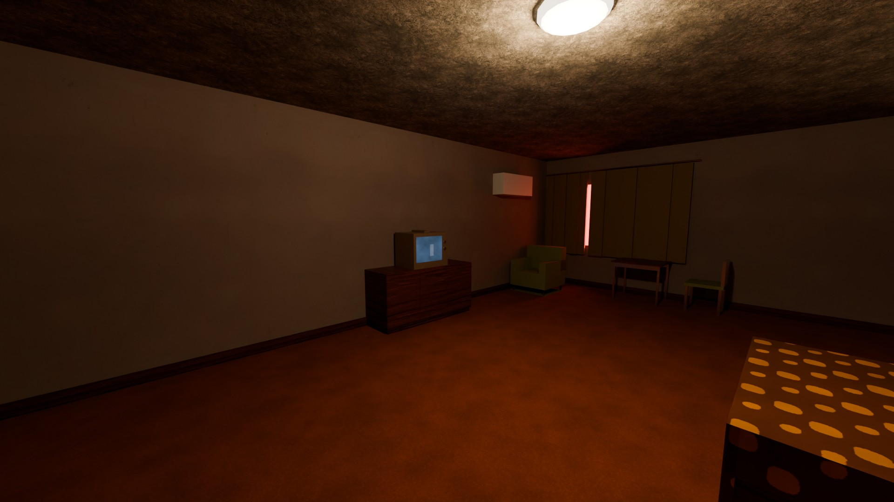
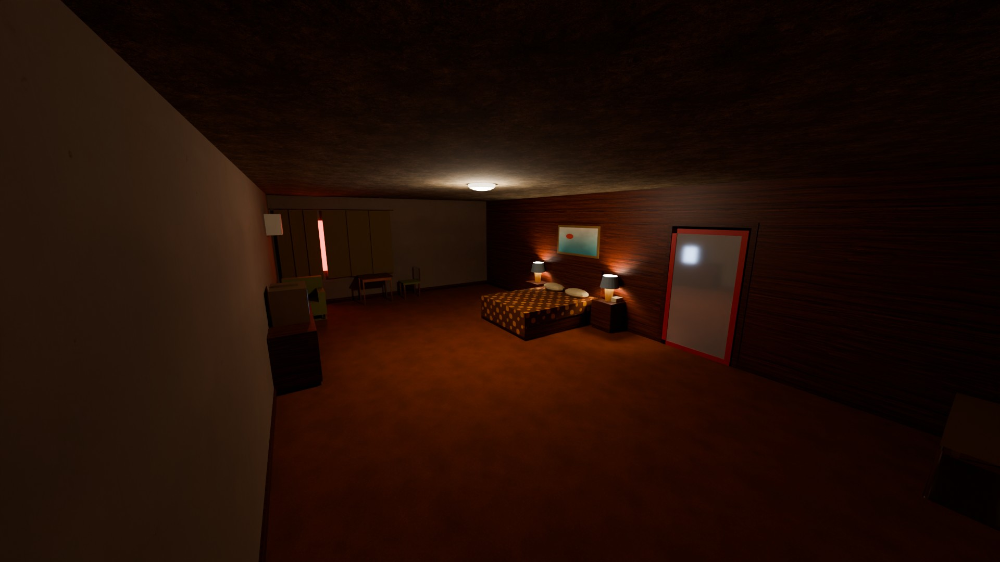
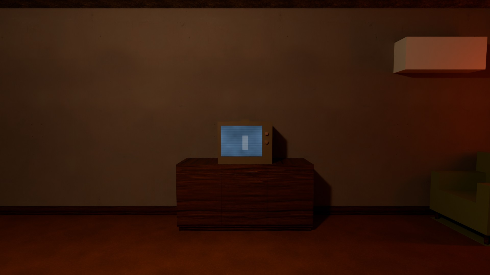

# rdwe_motel_room: The motel room: the TV shows this room

Right Door, Wrong Exit, Phase C room 29 (the institution), dressed and lit (`docs/BLENDER_AREAS.md`, section 7, step 2), round its greybox (`tools/blender/build_rdwe_greybox.py`, `c_motel_room()`). 6 m by 10 m, 2.8 m high. The room, from `ROOMS.md`: Environmental storytelling: a motel room whose TV shows this room from the corner, with you in it, a second late.

A roadside motel room, 1974: wood panelling behind the bed, peach walls, an orange shag carpet, a popcorn ceiling. The bed under a seascape, two nightstands with lamps and a phone, a dresser with the TV (its screen is the page's: this room from the corner, a second late), an armchair, a table by the curtained window with the VACANCY sign's red through it, a luggage rack with a case.

Built in Blender 5.2.1 by `tools/blender/build_rdwe_rooms2.py` (the room's `dress_` function and spec) with the shared kit `tools/blender/rdwe_rooms2_kit.py`, baked on the GPU and graded by `tools/blender/rdwe_rooms2_pack.py`. There are no reference photos: it follows the room's line in `ROOMS.md` and the style of `docs/WORLD.md` (Super Liminal: nearly ordinary, saturated, a little wrong).

| File | What it is |
|---|---|
| `world/rdwe_motel_room.glb` | the art: 1.03 MB, 2870 triangles, 31 materials, 27 nodes (one mesh per material; the door leaves as their own nodes), 17 WebP textures |
| `world/rdwe_motel_room.json` | the layout, written by `tools/blender/export_scene.py` from the `.blend`: 20 colliders, 2 doors, 2 links, 3 spots; the same as `build_rdwe_greybox.py --preview` writes |
| `world/lightmaps/rdwe_motel_room_0.webp` | set `main` (`lightmap`): struct page, 2048 px, about 122.1 px/m |
| `world/lightmaps/rdwe_motel_room_1.webp` | set `main` (`lightmap`): props page, 1024 px, about 77.8 px/m |
| `blender/scenes/rdwe_motel_room.blend` | the saved scene (Git LFS): `Art` (one object per collider, unmerged), `Doors` (the leaves, origin at the hinge), `Layout` (`COL_` boxes, the empties), `Export` (merged by material, with the lightmap UVs), `Lights_*` (one collection per light set, and `Lights_all`) |
| `docs/renders/rdwe_motel_room/` | this README and the three review stills |





Review stills: Cycles, 96 samples adaptive, OIDN, 1920 x 1080 JPEG, AgX medium high contrast. They are Blender's renders with Blender's lights; the page shows the lightmaps (see Brightness).

## The trick's spots (for the page)

- `Spot_tv_1` at (0.8, 1.2), facing (1, 0): the TV: you, a second ago
- `Spot_tv_2` at (2.6, -4.6), facing (-0.6, 0.8): the corner the TV films from, 2.5 m up: you on the bed, a second late
- `Spot_tv_3` at (-0.55, 0.8), facing (1, 0): sit on the end of the bed and watch: on the screen you are still standing

## Doors

- `DoorLeaf_bathroom` (0.86 x 2.16 m): porthole black lacquer door, no handle. The leaf is built from its look (form, finish, handle), so it is visibly unlike every other door in the set.
- `DoorLeaf_drum` (1.12 x 2.1 m): mirror-faced cherry red door, push plate. The leaf is built from its look (form, finish, handle), so it is visibly unlike every other door in the set.

## Light

| Set | Material properties | Maps |
|---|---|---|
| `main` | `lightmap`, `lightmap_intensity` | `rdwe_motel_room_0`, `rdwe_motel_room_1` |

Emissive materials (not baked, drawn as they are): `Lamp_Emit`, `Neon_Red`, `Screen_TV`, `Shade_Glass`. `Lamp_Emit` is every ordinary lamp's glow.

## Sources and licences

| File (`blender/textures/rdwe_rooms2/`) | Source | Licence | Used by |
|---|---|---|---|
| `Metal048A_color_512.jpg` | ambientCG, Metal048A | CC0 | Steel |
| `concrete_floor_02_diff_1k.jpg` | Poly Haven, Concrete Floor 02 | CC0 | Ceiling_Popcorn |
| `dark_wood_diff_1k.jpg` | Poly Haven, Dark Wood | CC0 | Laminate_Wood, Panel_Wood, Trim_Wood, Wood_Dark |
| `plastered_wall_04_diff_1k.jpg` | Poly Haven, Plastered Wall 04 | CC0 | Plaster_Peach |
| `rough_linen_diff_512.jpg` | Poly Haven, Rough Linen | CC0 | Curtain_Orange, Shade_Linen, Towel_White, Velvet_Mustard |

Every other material is a flat colour, or a picture the build generates with numpy (fixed seeds, own work, no licence needed): `Bedspread`, `Brass`, `Carpet_Shag`, `Ceramic_Orange`, `Chrome`, `Door_Black_Lacquer`, `Door_Cherry_Red`, `Frame_Gilt`, `Glass_Door`, `Leather_Brown`, `Mirror`, `Neon_Red`, `Paint_Palette`, `Paintings`, `Plastic_Beige`, `Plastic_Brown`, `Screen_TV`, `Shade_Glass`.
No Meshy, no Higgsfield, nothing bought.

## Brightness

Graded by `rdwe_rooms2_pack.py`: texel = G L / (C + G L), intensity = pi C (C = 1.15), G set so the shell page's median texel in the reference set is 1.4 (shared G); the page shows texture x base colour x texel x intensity / pi. The tables below are `lab_display.py` on the packed GLB.

```
brightness, set main (`lightmap`): lab_display.py (shown = texel x intensity / pi x base colour)
material                m2           map       k    p50    p90    p99     >=1
Plaster_Peach         82.7 rdwe_motel_room_0  3.6128  0.147  0.207  0.254   0.00%
Ceiling_Popcorn       60.0 rdwe_motel_room_0  3.6128  0.101  0.228  0.420   0.00%
Carpet_Shag           53.6 rdwe_motel_room_0  3.6128  0.169  0.220  0.246   0.00%
Panel_Wood            25.6 rdwe_motel_room_0  3.6128  0.067  0.127  0.187   0.00%
Wood_Dark             19.4 rdwe_motel_room_1  3.6128  0.000  0.092  0.149   0.00%
Curtain_Orange        11.0 rdwe_motel_room_1  3.6128  0.118  0.175  0.283   0.00%
Mirror                 7.5 rdwe_motel_room_1  3.6128  0.000  0.530  0.570   0.00%
Door_Cherry_Red        7.4 rdwe_motel_room_1  3.6128  0.000  0.181  0.505   0.00%
Bedspread              6.9 rdwe_motel_room_1  3.6128  0.125  0.548  0.695   0.00%
Trim_Wood              5.4 rdwe_motel_room_0  3.6128  0.041  0.081  0.112   0.00%
Velvet_Mustard         4.7 rdwe_motel_room_1  3.6128  0.115  0.173  0.221   0.00%
Door_Black_Lacquer     4.6 rdwe_motel_room_1  3.6128  0.000  0.023  0.024   0.00%
Chrome                 2.1 rdwe_motel_room_1  3.6128  0.000  0.000  0.000   0.00%
Plastic_Brown          1.4 rdwe_motel_room_1  3.6128  0.117  0.172  0.194   0.00%
Leather_Brown          0.9 rdwe_motel_room_1  3.6128  0.121  0.186  0.188   0.00%
Plastic_Beige          0.9 rdwe_motel_room_1  3.6128  0.593  0.638  0.665   0.00%
Paint_Palette          0.7 rdwe_motel_room_1  3.6128  0.583  0.724  0.780   0.00%
Paintings              0.7 rdwe_motel_room_1  3.6128  0.453  0.599  0.671   0.00%
Laminate_Wood          0.6 rdwe_motel_room_1  3.6128  0.052  0.083  0.125   0.00%
Shade_Linen            0.5 rdwe_motel_room_1  3.6128  0.167  0.272  0.297   0.00%
Ceramic_Orange         0.4 rdwe_motel_room_1  3.1901  0.795  0.863  0.863   0.00%
Brass                  0.3 rdwe_motel_room_1  3.6128  0.000  0.000  0.000   0.00%
Frame_Gilt             0.3 rdwe_motel_room_1  3.6128  0.571  0.649  0.687   0.00%
Towel_White            0.3 rdwe_motel_room_1  3.6128  0.137  0.149  0.202   0.00%
Glass_Door             0.2 rdwe_motel_room_1  3.6128  0.000  0.349  0.374   0.00%
Steel                  0.1 rdwe_motel_room_1  3.6128  0.000  0.000  0.000   0.00%
```

## Gates

```
## python tools/blender/build_rdwe_greybox.py --check .
GATE links: 54 pairs with both sides built (108 sides, the one-way ones included), 2 that loop on their own room, 5 that leave the set; 115 links in the files, every one accounted for
GATE navigable: 43 of 43 rooms reachable from rdwe_dining; 42 can get back to it (no true exit: the finale's one way out is the ending)
GATE overlaps: 0 interpenetrating collider pairs of 35141 checked (none allowed)
GATE clearances: 344 links, arrivals, spots and spawns clear by 0.28 m with a floor under them; 248 door-front points (0.5 and 1 m in) clear
GATE steps: 56 step boxes in 6 flights, one box a step; the highest rise 0.250 m (at most 0.27 m)
GATE corridors: 14 corridor rects, the narrowest 2.00 m (at least 1.6 m), none blocked
GATE extent: the largest room is 50.4 m across (a store floor, about 52 m, at most)
GATE spots: every room has its trick's spot and the ones it needs; 10 SecCam; agent x6, beacon x1, book x3, buttons x3, cake x1, cart x1, change x3, clock x2, computer x4, dark x3, frame x1, grid x6, hide x12, hum x1, lamp x1, lap x1, locker x3, map x3, monitor x2, moon x2, note x1, notes x1, photo x5, scuff x1, seeker x1, statue x3, switch x4, ticket x3, tin x3, trick x21, tv x3, view x6, watch x1, window x1
GATE doors: 124 door leaves, no two with the same look; 103 exits with one Link_ each, 4 arrival-only, 17 that never open; every exit fixed
GATES PASS

## world/rdwe_motel_room.json (export_scene.py, from the .blend) against build_rdwe_greybox.py --preview
SAME (to 2.5 mm): 20 colliders, 2 doors, 2 links, 0 zones, 3 spots, 0 markers, 0 cameras

## node tools/worlddoc.mjs check world/rdwe_motel_room.json
warning: scene rdwe_motel_room is not in the world manifest yet: a new scene to add
  warning: link bathroom: the manifest has no link from this door yet: a new link to add
  warning: link drum: the manifest has no link from this door yet: a new link to add
OK world/rdwe_motel_room.json: 20 colliders, 2 doors, 0 markers, 2 links, 0 zones, 3 spots, 0 errors, 3 warnings

## tools/blender/check_layout.py (rules COVER, STRAY, CLEAR on the Art collection; run on the box)
layout check: scene rdwe_motel_room, 53 visible meshes, 20 colliders
PASS  COVER  Armchair: 3 mesh(es) cover it (810 sample points, every one within 5 cm of art)
PASS  COVER  Bed: 5 mesh(es) cover it (2618 sample points, every one within 5 cm of art)
PASS  COVER  Beyond_bathroom: 1 mesh(es) cover it (1125 sample points, every one within 5 cm of art)
PASS  COVER  Beyond_drum: 1 mesh(es) cover it (1296 sample points, every one within 5 cm of art)
PASS  COVER  Chair: 3 mesh(es) cover it (360 sample points, every one within 5 cm of art)
PASS  COVER  Luggage_Rack: 3 mesh(es) cover it (396 sample points, every one within 5 cm of art)
PASS  COVER  Nightstand_N: 4 mesh(es) cover it (252 sample points, every one within 5 cm of art)
PASS  COVER  Nightstand_S: 4 mesh(es) cover it (252 sample points, every one within 5 cm of art)
PASS  COVER  Room_Ceiling: 9 mesh(es) cover it (20475 sample points, every one within 5 cm of art)
PASS  COVER  Room_Floor: 17 mesh(es) cover it (27300 sample points, every one within 5 cm of art)
PASS  COVER  Room_Wall_E_1: 6 mesh(es) cover it (8787 sample points, every one within 5 cm of art)
PASS  COVER  Room_Wall_N_1: 6 mesh(es) cover it (3828 sample points, every one within 5 cm of art)
PASS  COVER  Room_Wall_N_2: 4 mesh(es) cover it (210 sample points, every one within 5 cm of art)
PASS  COVER  Room_Wall_N_3: 5 mesh(es) cover it (1218 sample points, every one within 5 cm of art)
PASS  COVER  Room_Wall_S_1: 5 mesh(es) cover it (5655 sample points, every one within 5 cm of art)
PASS  COVER  Room_Wall_W_1: 5 mesh(es) cover it (2262 sample points, every one within 5 cm of art)
PASS  COVER  Room_Wall_W_2: 4 mesh(es) cover it (312 sample points, every one within 5 cm of art)
PASS  COVER  Room_Wall_W_3: 8 mesh(es) cover it (5742 sample points, every one within 5 cm of art)
PASS  COVER  TV_Stand: 4 mesh(es) cover it (1071 sample points, every one within 5 cm of art)
PASS  COVER  Table: 4 mesh(es) cover it (648 sample points, every one within 5 cm of art)
PASS  STRAY  21 tall solid mesh(es), each over a collider; 25 decor_* mesh(es) exempt
PASS  CLEAR  links.bathroom.arrive (1.50, -3.10): clear within 0.28 m
PASS  CLEAR  links.bathroom.at (1.50, -4.25): clear within 0.28 m
PASS  CLEAR  links.drum.arrive (-1.10, -2.00): clear within 0.28 m
PASS  CLEAR  links.drum.at (-2.25, -2.00): clear within 0.28 m
PASS  CLEAR  spots.Spot_tv_1.at (0.80, 1.20): clear within 0.28 m
PASS  CLEAR  spots.Spot_tv_2.at (2.60, -4.60): clear within 0.28 m
PASS  CLEAR  spots.Spot_tv_3.at (-0.55, 0.80): clear within 0.28 m
PASS: 28 of 28 checks passed

## glb_inspect world/rdwe_motel_room.glb --budget tris=300000,mb=8
materials  31: Bedspread, Carpet_Shag, Ceiling_Popcorn, Ceramic_Orange, Chrome, Curtain_Orange, Brass, Door_Black_Lacquer, Glass_Door, Door_Cherry_Red, Mirror, Steel, Frame_Gilt, Laminate_Wood, Lamp_Emit, Leather_Brown, Neon_Red, Paint_Palette, Paintings, Panel_Wood, Plaster_Peach, Plastic_Beige, Plastic_Brown, Screen_TV, Shade_Glass, Shade_Linen, Towel_White, Trim_Wood, Velvet_Mustard, Void_Black, Wood_Dark
textures   17, images: 256x256, 512x512, 1024x1024, 512x512, 512x512, 1024x1024, 128x128, 1024x512, 1024x1024, 256x192
bbox       6.55 x 2.8685 x 10.55 (x, y up, z), min [-3.55, -0.05, -5.55]
requires   EXT_texture_webp
pass       tris: 2870 triangles, budget 300000
pass       mb: 0.98 MB, budget 8

## node --test shared/*.test.js
tests 297
pass 297
fail 0

## sizes
world/rdwe_motel_room.glb  1.03 MB
world/rdwe_motel_room.json  0.00 MB
blender/scenes/rdwe_motel_room.blend  0.84 MB
world/lightmaps/rdwe_motel_room_0.webp  0.09 MB
world/lightmaps/rdwe_motel_room_1.webp  0.09 MB
docs/renders/rdwe_motel_room/1_arrival.jpg  0.19 MB
docs/renders/rdwe_motel_room/2_wide.jpg  0.14 MB
docs/renders/rdwe_motel_room/3_detail.jpg  0.11 MB

## privacy grep (user names, absolute paths, session ids, e-mail; the .blend decompressed)
privacy grep: 9 files, 0 with hits

```

Nothing is wired: the manifest, `games/rdwe/`, `index.html`, `shared/` and the tests are untouched.
