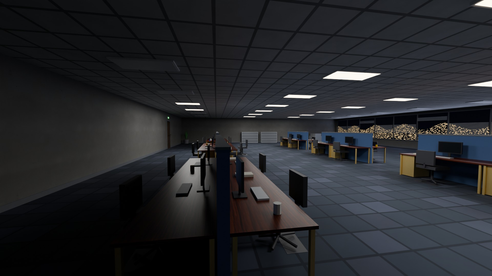
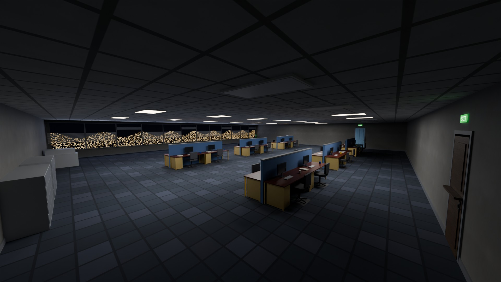
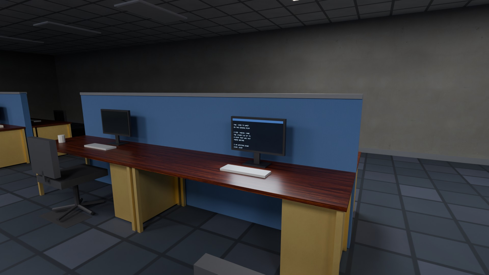

# rdwe_office_night: The office at night: one monitor on

Right Door, Wrong Exit, Phase C room 30 (the institution), dressed and lit (`docs/BLENDER_AREAS.md`, section 7, step 2), round its greybox (`tools/blender/build_rdwe_greybox.py`, `c_office_night()`). 24 m by 20 m, 3 m high. The room, from `ROOMS.md`: Environmental storytelling: an open-plan office after hours, every chair pushed in but one, and one monitor on with the notebook's first entry typed out.

An open-plan office after hours: carpet tiles, grey walls, a tiled ceiling where only the middle rows are still lit, six banks of desks behind blue-grey partitions, every chair pushed in but one, every monitor dark but one (its screen is the notebook's first entry), filing cabinets, a printer, a water cooler, plants, exit signs, and the city at night in the south windows.

Built in Blender 5.2.1 by `tools/blender/build_rdwe_rooms2.py` (the room's `dress_` function and spec) with the shared kit `tools/blender/rdwe_rooms2_kit.py`, baked on the GPU and graded by `tools/blender/rdwe_rooms2_pack.py`. There are no reference photos: it follows the room's line in `ROOMS.md` and the style of `docs/WORLD.md` (Super Liminal: nearly ordinary, saturated, a little wrong).

| File | What it is |
|---|---|
| `world/rdwe_office_night.glb` | the art: 1.62 MB, 14856 triangles, 29 materials, 27 nodes (one mesh per material; the door leaves as their own nodes), 14 WebP textures |
| `world/rdwe_office_night.json` | the layout, written by `tools/blender/export_scene.py` from the `.blend`: 72 colliders, 2 doors, 2 links, 2 spots; the same as `build_rdwe_greybox.py --preview` writes |
| `world/lightmaps/rdwe_office_night_0.webp` | set `main` (`lightmap`): struct page, 2048 px, about 50.3 px/m |
| `world/lightmaps/rdwe_office_night_1.webp` | set `main` (`lightmap`): props page, 2048 px, about 55.5 px/m |
| `blender/scenes/rdwe_office_night.blend` | the saved scene (Git LFS): `Art` (one object per collider, unmerged), `Doors` (the leaves, origin at the hinge), `Layout` (`COL_` boxes, the empties), `Export` (merged by material, with the lightmap UVs), `Lights_*` (one collection per light set, and `Lights_all`) |
| `docs/renders/rdwe_office_night/` | this README and the three review stills |





Review stills: Cycles, 96 samples adaptive, OIDN, 1920 x 1080 JPEG, AgX medium high contrast. They are Blender's renders with Blender's lights; the page shows the lightmaps (see Brightness).

## The trick's spots (for the page)

- `Spot_monitor_1` at (0, -4.6), facing (0, -1): the lit monitor: the notebook's first entry
- `Spot_monitor_2` at (0.9, -3.7), facing (0, -1): the one chair not pushed in: someone was just here

## Doors

- `DoorLeaf_lift` (0.86 x 2.24 m): stable (split) oak door, ring pull. The leaf is built from its look (form, finish, handle), so it is visibly unlike every other door in the set.
- `DoorLeaf_stairs` (0.94 x 2.4 m): six-panel sky blue door, brass knob. The leaf is built from its look (form, finish, handle), so it is visibly unlike every other door in the set.

## Light

| Set | Material properties | Maps |
|---|---|---|
| `main` | `lightmap`, `lightmap_intensity` | `rdwe_office_night_0`, `rdwe_office_night_1` |

Emissive materials (not baked, drawn as they are): `Exit_Sign`, `Lamp_Emit`, `Screen_Monitor`, `Window_City`. `Lamp_Emit` is every ordinary lamp's glow.

## Sources and licences

| File (`blender/textures/rdwe_rooms2/`) | Source | Licence | Used by |
|---|---|---|---|
| `Metal048A_color_512.jpg` | ambientCG, Metal048A | CC0 | Steel |
| `dark_wood_diff_1k.jpg` | Poly Haven, Dark Wood | CC0 | Desk_Top |
| `old_wood_floor_diff_1k.jpg` | Poly Haven, Old Wood Floor | CC0 | Door_Oak |
| `plastered_wall_04_diff_1k.jpg` | Poly Haven, Plastered Wall 04 | CC0 | Paint_Office |
| `rough_linen_diff_512.jpg` | Poly Haven, Rough Linen | CC0 | Fabric_Partition |

Every other material is a flat colour, or a picture the build generates with numpy (fixed seeds, own work, no licence needed): `Blind_Slats`, `Brass`, `Cabinet_Grey`, `Carpet_Tiles`, `Ceiling_Tiles`, `Chair_Black`, `Door_Sky_Blue`, `Exit_Sign`, `Glass_Blue`, `Iron`, `Lamp_Off`, `Paint_Palette`, `Plant_Leaf`, `Plastic_Black`, `Plastic_Grey`, `Plastic_White`, `Pot_Clay`, `Screen_Monitor`, `Screen_Off`, `Trim_Dark`, `Trim_White`, `Window_City`.
No Meshy, no Higgsfield, nothing bought.

## Brightness

Graded by `rdwe_rooms2_pack.py`: texel = G L / (C + G L), intensity = pi C (C = 1.15), G set so the shell page's median texel in the reference set is 1.5 (shared G); the page shows texture x base colour x texel x intensity / pi. The tables below are `lab_display.py` on the packed GLB.

```
brightness, set main (`lightmap`): lab_display.py (shown = texel x intensity / pi x base colour)
material                m2           map       k    p50    p90    p99     >=1
Ceiling_Tiles        480.0 rdwe_office_night_0  3.6128  0.311  0.433  0.575   0.00%
Carpet_Tiles         425.0 rdwe_office_night_0  3.6128  0.073  0.103  0.124   0.00%
Paint_Office         257.0 rdwe_office_night_0  3.6128  0.129  0.177  0.200   0.00%
Steel                 49.5 rdwe_office_night_1  3.6128  0.405  0.828  0.868   0.00%
Trim_Dark             40.8 rdwe_office_night_0  3.6128  0.158  0.220  0.244   0.00%
Desk_Top              38.0 rdwe_office_night_1  3.6128  0.100  0.156  0.212   0.00%
Blind_Slats           37.8 rdwe_office_night_1  3.6128  0.457  0.580  0.693   0.00%
Chair_Black           30.1 rdwe_office_night_1  3.6128  0.056  0.069  0.074   0.00%
Trim_White            26.5 rdwe_office_night_1  2.9697  0.560  0.862  0.870   0.00%
Fabric_Partition      23.3 rdwe_office_night_1  3.6128  0.324  0.363  0.387   0.00%
Lamp_Off              17.5 rdwe_office_night_1  3.6128  0.001  0.575  0.606   0.00%
Cabinet_Grey          17.3 rdwe_office_night_1  3.6128  0.377  0.437  0.497   0.00%
Door_Sky_Blue         14.1 rdwe_office_night_1  3.6128  0.000  0.639  0.719   0.00%
Plastic_Black         11.7 rdwe_office_night_1  3.6128  0.022  0.041  0.048   0.00%
Door_Oak               9.3 rdwe_office_night_1  3.6128  0.000  0.071  0.115   0.00%
Screen_Off             7.2 rdwe_office_night_1  3.6128  0.002  0.030  0.031   0.00%
Plant_Leaf             2.1 rdwe_office_night_1  3.6128  0.046  0.202  0.265   0.00%
Plastic_Grey           2.0 rdwe_office_night_1  3.6128  0.523  0.615  0.626   0.00%
Plastic_White          1.9 rdwe_office_night_1  3.6128  0.565  0.841  0.849   0.00%
Pot_Clay               1.9 rdwe_office_night_1  3.6128  0.111  0.202  0.234   0.00%
Paint_Palette          1.6 rdwe_office_night_1  3.6128  0.685  0.790  0.797   0.00%
Glass_Blue             0.4 rdwe_office_night_1  3.6128  0.707  0.820  0.844   0.00%
Iron                   0.2 rdwe_office_night_1  3.6128  0.000  0.066  0.071   0.00%
Brass                  0.0 rdwe_office_night_1  3.6128  0.001  0.367  0.440   0.00%
```

## Gates

```
## python tools/blender/build_rdwe_greybox.py --check .
GATE links: 54 pairs with both sides built (108 sides, the one-way ones included), 2 that loop on their own room, 5 that leave the set; 115 links in the files, every one accounted for
GATE navigable: 43 of 43 rooms reachable from rdwe_dining; 42 can get back to it (no true exit: the finale's one way out is the ending)
GATE overlaps: 0 interpenetrating collider pairs of 35141 checked (none allowed)
GATE clearances: 344 links, arrivals, spots and spawns clear by 0.28 m with a floor under them; 248 door-front points (0.5 and 1 m in) clear
GATE steps: 56 step boxes in 6 flights, one box a step; the highest rise 0.250 m (at most 0.27 m)
GATE corridors: 14 corridor rects, the narrowest 2.00 m (at least 1.6 m), none blocked
GATE extent: the largest room is 50.4 m across (a store floor, about 52 m, at most)
GATE spots: every room has its trick's spot and the ones it needs; 10 SecCam; agent x6, beacon x1, book x3, buttons x3, cake x1, cart x1, change x3, clock x2, computer x4, dark x3, frame x1, grid x6, hide x12, hum x1, lamp x1, lap x1, locker x3, map x3, monitor x2, moon x2, note x1, notes x1, photo x5, scuff x1, seeker x1, statue x3, switch x4, ticket x3, tin x3, trick x21, tv x3, view x6, watch x1, window x1
GATE doors: 124 door leaves, no two with the same look; 103 exits with one Link_ each, 4 arrival-only, 17 that never open; every exit fixed
GATES PASS

## world/rdwe_office_night.json (export_scene.py, from the .blend) against build_rdwe_greybox.py --preview
SAME (to 2.5 mm): 72 colliders, 2 doors, 2 links, 0 zones, 2 spots, 0 markers, 0 cameras

## node tools/worlddoc.mjs check world/rdwe_office_night.json
warning: scene rdwe_office_night is not in the world manifest yet: a new scene to add
  warning: link lift: the manifest has no link from this door yet: a new link to add
  warning: link stairs: the manifest has no link from this door yet: a new link to add
OK world/rdwe_office_night.json: 72 colliders, 2 doors, 0 markers, 2 links, 0 zones, 2 spots, 0 errors, 3 warnings

## tools/blender/check_layout.py (rules COVER, STRAY, CLEAR on the Art collection; run on the box)
layout check: scene rdwe_office_night, 146 visible meshes, 72 colliders
PASS  COVER  Beyond_lift: 1 mesh(es) cover it (1170 sample points, every one within 5 cm of art)
PASS  COVER  Beyond_stairs: 1 mesh(es) cover it (1296 sample points, every one within 5 cm of art)
PASS  COVER  Chair_0_0_N0: 4 mesh(es) cover it (308 sample points, every one within 5 cm of art)
PASS  COVER  Chair_0_0_N1: 4 mesh(es) cover it (308 sample points, every one within 5 cm of art)
PASS  COVER  Chair_0_0_S0: 4 mesh(es) cover it (308 sample points, every one within 5 cm of art)
PASS  COVER  Chair_0_0_S1: 4 mesh(es) cover it (308 sample points, every one within 5 cm of art)
PASS  COVER  Chair_0_1_N0: 4 mesh(es) cover it (308 sample points, every one within 5 cm of art)
PASS  COVER  Chair_0_1_N1: 4 mesh(es) cover it (308 sample points, every one within 5 cm of art)
PASS  COVER  Chair_0_1_S0: 4 mesh(es) cover it (308 sample points, every one within 5 cm of art)
PASS  COVER  Chair_0_1_S1: 4 mesh(es) cover it (308 sample points, every one within 5 cm of art)
PASS  COVER  Chair_1_0_N0: 4 mesh(es) cover it (308 sample points, every one within 5 cm of art)
PASS  COVER  Chair_1_0_N1: 4 mesh(es) cover it (308 sample points, every one within 5 cm of art)
PASS  COVER  Chair_1_0_S0: 4 mesh(es) cover it (308 sample points, every one within 5 cm of art)
PASS  COVER  Chair_1_1_N0: 4 mesh(es) cover it (308 sample points, every one within 5 cm of art)
PASS  COVER  Chair_1_1_N1: 4 mesh(es) cover it (308 sample points, every one within 5 cm of art)
PASS  COVER  Chair_1_1_S0: 4 mesh(es) cover it (308 sample points, every one within 5 cm of art)
PASS  COVER  Chair_1_1_S1: 4 mesh(es) cover it (308 sample points, every one within 5 cm of art)
PASS  COVER  Chair_2_0_N0: 4 mesh(es) cover it (308 sample points, every one within 5 cm of art)
PASS  COVER  Chair_2_0_N1: 4 mesh(es) cover it (308 sample points, every one within 5 cm of art)
PASS  COVER  Chair_2_0_S0: 4 mesh(es) cover it (308 sample points, every one within 5 cm of art)
PASS  COVER  Chair_2_0_S1: 4 mesh(es) cover it (308 sample points, every one within 5 cm of art)
PASS  COVER  Chair_2_1_N0: 4 mesh(es) cover it (308 sample points, every one within 5 cm of art)
PASS  COVER  Chair_2_1_N1: 4 mesh(es) cover it (308 sample points, every one within 5 cm of art)
PASS  COVER  Chair_2_1_S0: 4 mesh(es) cover it (308 sample points, every one within 5 cm of art)
PASS  COVER  Chair_2_1_S1: 4 mesh(es) cover it (308 sample points, every one within 5 cm of art)
PASS  COVER  Chair_Out: 2 mesh(es) cover it (539 sample points, every one within 5 cm of art)
PASS  COVER  Desk_0_0_N0: 7 mesh(es) cover it (1701 sample points, every one within 5 cm of art)
PASS  COVER  Desk_0_0_N1: 7 mesh(es) cover it (1701 sample points, every one within 5 cm of art)
PASS  COVER  Desk_0_0_S0: 7 mesh(es) cover it (1701 sample points, every one within 5 cm of art)
PASS  COVER  Desk_0_0_S1: 7 mesh(es) cover it (1701 sample points, every one within 5 cm of art)
PASS  COVER  Desk_0_1_N0: 7 mesh(es) cover it (1701 sample points, every one within 5 cm of art)
PASS  COVER  Desk_0_1_N1: 7 mesh(es) cover it (1701 sample points, every one within 5 cm of art)
PASS  COVER  Desk_0_1_S0: 7 mesh(es) cover it (1701 sample points, every one within 5 cm of art)
PASS  COVER  Desk_0_1_S1: 7 mesh(es) cover it (1701 sample points, every one within 5 cm of art)
PASS  COVER  Desk_1_0_N0: 7 mesh(es) cover it (1701 sample points, every one within 5 cm of art)
PASS  COVER  Desk_1_0_N1: 7 mesh(es) cover it (1701 sample points, every one within 5 cm of art)
PASS  COVER  Desk_1_0_S0: 7 mesh(es) cover it (1701 sample points, every one within 5 cm of art)
PASS  COVER  Desk_1_0_S1: 6 mesh(es) cover it (1701 sample points, every one within 5 cm of art)
PASS  COVER  Desk_1_1_N0: 7 mesh(es) cover it (1701 sample points, every one within 5 cm of art)
PASS  COVER  Desk_1_1_N1: 7 mesh(es) cover it (1701 sample points, every one within 5 cm of art)
PASS  COVER  Desk_1_1_S0: 7 mesh(es) cover it (1701 sample points, every one within 5 cm of art)
PASS  COVER  Desk_1_1_S1: 7 mesh(es) cover it (1701 sample points, every one within 5 cm of art)
PASS  COVER  Desk_2_0_N0: 7 mesh(es) cover it (1701 sample points, every one within 5 cm of art)
PASS  COVER  Desk_2_0_N1: 7 mesh(es) cover it (1701 sample points, every one within 5 cm of art)
PASS  COVER  Desk_2_0_S0: 7 mesh(es) cover it (1701 sample points, every one within 5 cm of art)
PASS  COVER  Desk_2_0_S1: 7 mesh(es) cover it (1701 sample points, every one within 5 cm of art)
PASS  COVER  Desk_2_1_N0: 7 mesh(es) cover it (1701 sample points, every one within 5 cm of art)
PASS  COVER  Desk_2_1_N1: 7 mesh(es) cover it (1701 sample points, every one within 5 cm of art)
PASS  COVER  Desk_2_1_S0: 7 mesh(es) cover it (1701 sample points, every one within 5 cm of art)
PASS  COVER  Desk_2_1_S1: 7 mesh(es) cover it (1701 sample points, every one within 5 cm of art)
PASS  COVER  Filing_1: 3 mesh(es) cover it (2058 sample points, every one within 5 cm of art)
PASS  COVER  Filing_2: 3 mesh(es) cover it (2058 sample points, every one within 5 cm of art)
PASS  COVER  Partition_0_0: 11 mesh(es) cover it (1230 sample points, every one within 5 cm of art)
PASS  COVER  Partition_0_1: 11 mesh(es) cover it (1230 sample points, every one within 5 cm of art)
PASS  COVER  Partition_1_0: 11 mesh(es) cover it (1230 sample points, every one within 5 cm of art)
PASS  COVER  Partition_1_1: 11 mesh(es) cover it (1230 sample points, every one within 5 cm of art)
PASS  COVER  Partition_2_0: 11 mesh(es) cover it (1230 sample points, every one within 5 cm of art)
PASS  COVER  Partition_2_1: 11 mesh(es) cover it (1230 sample points, every one within 5 cm of art)
PASS  COVER  Plant_1: 3 mesh(es) cover it (784 sample points, every one within 5 cm of art)
PASS  COVER  Plant_2: 3 mesh(es) cover it (784 sample points, every one within 5 cm of art)
PASS  COVER  Printer: 3 mesh(es) cover it (1980 sample points, every one within 5 cm of art)
PASS  COVER  Room_Ceiling: 9 mesh(es) cover it (150675 sample points, every one within 5 cm of art)
PASS  COVER  Room_Floor: 69 mesh(es) cover it (200900 sample points, every one within 5 cm of art)
PASS  COVER  Room_Wall_E_1: 8 mesh(es) cover it (18693 sample points, every one within 5 cm of art)
PASS  COVER  Room_Wall_N_1: 5 mesh(es) cover it (16647 sample points, every one within 5 cm of art)
PASS  COVER  Room_Wall_N_2: 4 mesh(es) cover it (270 sample points, every one within 5 cm of art)
PASS  COVER  Room_Wall_N_3: 5 mesh(es) cover it (5487 sample points, every one within 5 cm of art)
PASS  COVER  Room_Wall_S_1: 5 mesh(es) cover it (22785 sample points, every one within 5 cm of art)
PASS  COVER  Room_Wall_W_1: 5 mesh(es) cover it (3348 sample points, every one within 5 cm of art)
PASS  COVER  Room_Wall_W_2: 4 mesh(es) cover it (231 sample points, every one within 5 cm of art)
PASS  COVER  Room_Wall_W_3: 5 mesh(es) cover it (14508 sample points, every one within 5 cm of art)
PASS  COVER  Water_Cooler: 3 mesh(es) cover it (350 sample points, every one within 5 cm of art)
PASS  STRAY  71 tall solid mesh(es), each over a collider; 41 decor_* mesh(es) exempt
PASS  CLEAR  links.lift.arrive (6.00, -8.10): clear within 0.28 m
PASS  CLEAR  links.lift.at (6.00, -9.25): clear within 0.28 m
PASS  CLEAR  links.stairs.arrive (-10.10, -6.00): clear within 0.28 m
PASS  CLEAR  links.stairs.at (-11.25, -6.00): clear within 0.28 m
PASS  CLEAR  spots.Spot_monitor_1.at (0.00, -4.60): clear within 0.28 m
PASS  CLEAR  spots.Spot_monitor_2.at (0.90, -3.70): clear within 0.28 m
PASS: 79 of 79 checks passed

## glb_inspect world/rdwe_office_night.glb --budget tris=300000,mb=8
materials  29: Blind_Slats, Cabinet_Grey, Carpet_Tiles, Ceiling_Tiles, Chair_Black, Desk_Top, Door_Oak, Iron, Brass, Door_Sky_Blue, Exit_Sign, Fabric_Partition, Glass_Blue, Lamp_Emit, Lamp_Off, Paint_Office, Paint_Palette, Plant_Leaf, Plastic_Black, Plastic_Grey, Plastic_White, Pot_Clay, Screen_Monitor, Screen_Off, Steel, Trim_Dark, Trim_White, Void_Black, Window_City
textures   14, images: 256x256, 256x256, 1024x1024, 1024x1024, 1024x1024, 512x512, 1024x1024, 128x128, 640x384, 512x512, 1024x256
bbox       24.59 x 3.05 x 20.55 (x, y up, z), min [-12.55, -0.05, -10.55]
requires   EXT_texture_webp
pass       tris: 14856 triangles, budget 300000
pass       mb: 1.54 MB, budget 8

## node --test shared/*.test.js
tests 297
pass 297
fail 0

## sizes
world/rdwe_office_night.glb  1.62 MB
world/rdwe_office_night.json  0.01 MB
blender/scenes/rdwe_office_night.blend  0.66 MB
world/lightmaps/rdwe_office_night_0.webp  0.15 MB
world/lightmaps/rdwe_office_night_1.webp  0.58 MB
docs/renders/rdwe_office_night/1_arrival.jpg  0.20 MB
docs/renders/rdwe_office_night/2_wide.jpg  0.19 MB
docs/renders/rdwe_office_night/3_detail.jpg  0.16 MB

## privacy grep (user names, absolute paths, session ids, e-mail; the .blend decompressed)
privacy grep: 9 files, 0 with hits

```

Nothing is wired: the manifest, `games/rdwe/`, `index.html`, `shared/` and the tests are untouched.
