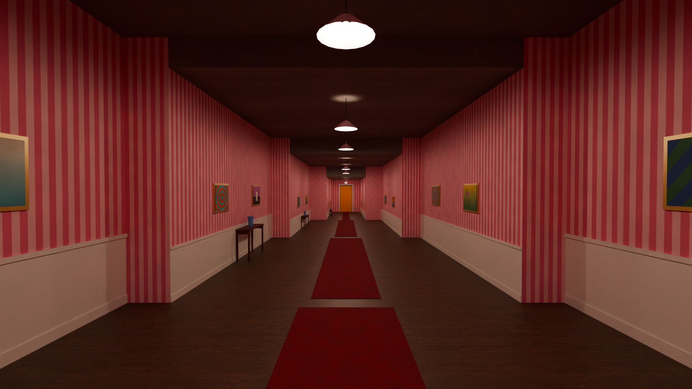
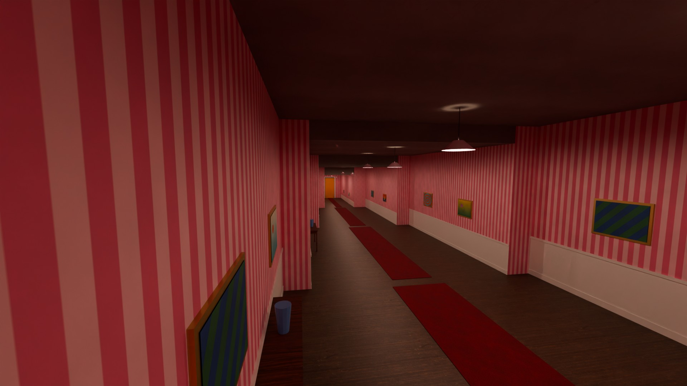
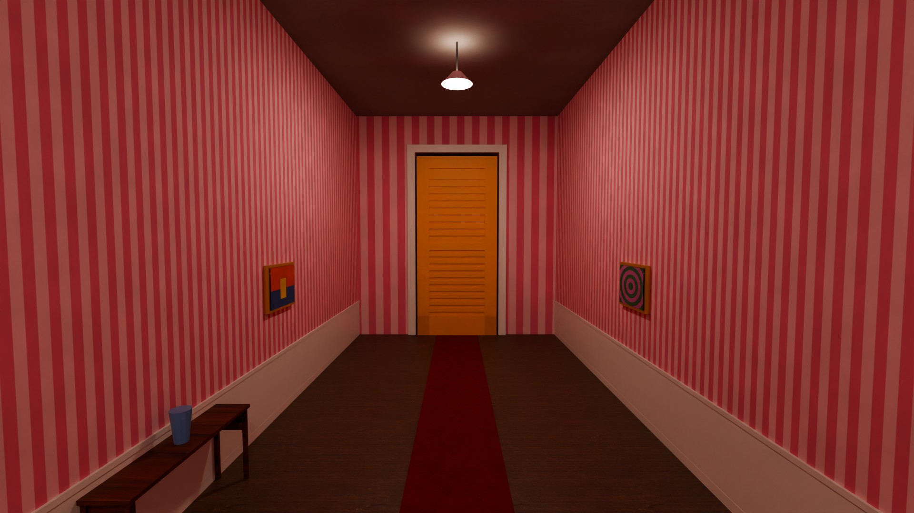

# rdwe_shrink_hall: The shrinking hall: forced perspective

Right Door, Wrong Exit, Phase C room 20 (the teal wing), dressed and lit (`docs/BLENDER_AREAS.md`, section 7, step 2), round its greybox (`tools/blender/build_rdwe_greybox.py`, `c_shrink_hall()`). 6 m by 24 m, 3.6 m high. The room, from `ROOMS.md`: Distorted hall: 24 m that narrows from 6 m to 2 m and lowers to 2.2 m in steps, so from the big end the small door looks far away and is not.

A pink striped hall in four sections, each smaller than the last: the walls close in, the ceiling comes down, and everything scales with them (the stripes, the boards, the dado, the skirting, the pictures, the lamps, the console tables), so from the big end the 24 m look like 60.

Built in Blender 5.2.1 by `tools/blender/build_rdwe_rooms2.py` (the room's `dress_` function and spec) with the shared kit `tools/blender/rdwe_rooms2_kit.py`, baked on the GPU and graded by `tools/blender/rdwe_rooms2_pack.py`. There are no reference photos: it follows the room's line in `ROOMS.md` and the style of `docs/WORLD.md` (Super Liminal: nearly ordinary, saturated, a little wrong).

| File | What it is |
|---|---|
| `world/rdwe_shrink_hall.glb` | the art: 0.81 MB, 3786 triangles, 16 materials, 15 nodes (one mesh per material; the door leaves as their own nodes), 7 WebP textures |
| `world/rdwe_shrink_hall.json` | the layout, written by `tools/blender/export_scene.py` from the `.blend`: 22 colliders, 2 doors, 2 links, 2 spots; the same as `build_rdwe_greybox.py --preview` writes |
| `world/lightmaps/rdwe_shrink_hall_0.webp` | set `main` (`lightmap`): struct page, 2048 px, about 62.7 px/m |
| `world/lightmaps/rdwe_shrink_hall_1.webp` | set `main` (`lightmap`): props page, 1024 px, about 85.2 px/m |
| `blender/scenes/rdwe_shrink_hall.blend` | the saved scene (Git LFS): `Art` (one object per collider, unmerged), `Doors` (the leaves, origin at the hinge), `Layout` (`COL_` boxes, the empties), `Export` (merged by material, with the lightmap UVs), `Lights_*` (one collection per light set, and `Lights_all`) |
| `docs/renders/rdwe_shrink_hall/` | this README and the three review stills |





Review stills: Cycles, 96 samples adaptive, OIDN, 1920 x 1080 JPEG, AgX medium high contrast. They are Blender's renders with Blender's lights; the page shows the lightmaps (see Brightness).

## The trick's spots (for the page)

- `Spot_trick_1` at (0, 8), facing (0, -1): it looks 60 m long from here
- `Spot_trick_2` at (0, -9.4), facing (0, 1): turn round at the small door: the big end looks 60 m away

## Doors

- `DoorLeaf_ames` (1 x 2.1 m): flush lilac door, push plate. The leaf is built from its look (form, finish, handle), so it is visibly unlike every other door in the set.
- `DoorLeaf_small` (0.8 x 1.8 m): louvred orange vinyl door, no handle. The leaf is built from its look (form, finish, handle), so it is visibly unlike every other door in the set.

## Light

| Set | Material properties | Maps |
|---|---|---|
| `main` | `lightmap`, `lightmap_intensity` | `rdwe_shrink_hall_0`, `rdwe_shrink_hall_1` |

Emissive materials (not baked, drawn as they are): `Lamp_Emit`. `Lamp_Emit` is every ordinary lamp's glow.

## Sources and licences

| File (`blender/textures/rdwe_rooms2/`) | Source | Licence | Used by |
|---|---|---|---|
| `Metal048A_color_512.jpg` | ambientCG, Metal048A | CC0 | Steel |
| `dark_wood_diff_1k.jpg` | Poly Haven, Dark Wood | CC0 | Wood_Dark |
| `old_wood_floor_diff_1k.jpg` | Poly Haven, Old Wood Floor | CC0 | Floor_Boards |
| `plastered_wall_04_diff_1k.jpg` | Poly Haven, Plastered Wall 04 | CC0 | Ceiling_Pink |

Every other material is a flat colour, or a picture the build generates with numpy (fixed seeds, own work, no licence needed): `Door_Lilac`, `Door_Orange_Vinyl`, `Frame_Gilt`, `Iron`, `Paintings`, `Paper_Stripe`, `Runner`, `Shade_Pink`, `Trim_White`, `Vase_Blue`.
No Meshy, no Higgsfield, nothing bought.

## Brightness

Graded by `rdwe_rooms2_pack.py`: texel = G L / (C + G L), intensity = pi C (C = 1.15), G set so the shell page's median texel in the reference set is 0.9 (shared G); the page shows texture x base colour x texel x intensity / pi. The tables below are `lab_display.py` on the packed GLB.

```
brightness, set main (`lightmap`): lab_display.py (shown = texel x intensity / pi x base colour)
material                m2           map       k    p50    p90    p99     >=1
Floor_Boards         194.9 rdwe_shrink_hall_0  3.6128  0.000  0.074  0.117   0.00%
Paper_Stripe         172.1 rdwe_shrink_hall_0  3.6128  0.464  0.594  0.690   0.00%
Ceiling_Pink         143.9 rdwe_shrink_hall_0  3.6128  0.098  0.124  0.190   0.00%
Trim_White            61.3 rdwe_shrink_hall_0  3.6128  0.409  0.526  0.591   0.00%
Runner                19.8 rdwe_shrink_hall_1  3.6128  0.117  0.142  0.173   0.00%
Door_Orange_Vinyl      8.3 rdwe_shrink_hall_1  3.6128  0.002  0.596  0.682   0.00%
Door_Lilac             4.5 rdwe_shrink_hall_1  3.6128  0.161  0.500  0.532   0.00%
Paintings              4.1 rdwe_shrink_hall_1  3.6128  0.176  0.419  0.508   0.00%
Wood_Dark              3.1 rdwe_shrink_hall_1  3.6128  0.046  0.087  0.123   0.00%
Frame_Gilt             2.9 rdwe_shrink_hall_1  3.6128  0.317  0.448  0.538   0.00%
Shade_Pink             1.1 rdwe_shrink_hall_1  3.6128  0.305  0.428  0.492   0.00%
Vase_Blue              0.4 rdwe_shrink_hall_1  3.6128  0.187  0.259  0.297   0.00%
Steel                  0.1 rdwe_shrink_hall_1  3.6128  0.004  0.653  0.696   0.00%
Iron                   0.1 rdwe_shrink_hall_1  3.6128  0.051  0.090  0.097   0.00%
```

## Gates

```
## python tools/blender/build_rdwe_greybox.py --check .
GATE links: 54 pairs with both sides built (108 sides, the one-way ones included), 2 that loop on their own room, 5 that leave the set; 115 links in the files, every one accounted for
GATE navigable: 43 of 43 rooms reachable from rdwe_dining; 42 can get back to it (no true exit: the finale's one way out is the ending)
GATE overlaps: 0 interpenetrating collider pairs of 35141 checked (none allowed)
GATE clearances: 344 links, arrivals, spots and spawns clear by 0.28 m with a floor under them; 248 door-front points (0.5 and 1 m in) clear
GATE steps: 56 step boxes in 6 flights, one box a step; the highest rise 0.250 m (at most 0.27 m)
GATE corridors: 14 corridor rects, the narrowest 2.00 m (at least 1.6 m), none blocked
GATE extent: the largest room is 50.4 m across (a store floor, about 52 m, at most)
GATE spots: every room has its trick's spot and the ones it needs; 10 SecCam; agent x6, beacon x1, book x3, buttons x3, cake x1, cart x1, change x3, clock x2, computer x4, dark x3, frame x1, grid x6, hide x12, hum x1, lamp x1, lap x1, locker x3, map x3, monitor x2, moon x2, note x1, notes x1, photo x5, scuff x1, seeker x1, statue x3, switch x4, ticket x3, tin x3, trick x21, tv x3, view x6, watch x1, window x1
GATE doors: 124 door leaves, no two with the same look; 103 exits with one Link_ each, 4 arrival-only, 17 that never open; every exit fixed
GATES PASS

## world/rdwe_shrink_hall.json (export_scene.py, from the .blend) against build_rdwe_greybox.py --preview
SAME (to 2.5 mm): 22 colliders, 2 doors, 2 links, 0 zones, 2 spots, 0 markers, 0 cameras

## node tools/worlddoc.mjs check world/rdwe_shrink_hall.json
warning: scene rdwe_shrink_hall is not in the world manifest yet: a new scene to add
  warning: link ames: the manifest has no link from this door yet: a new link to add
  warning: link small: the manifest has no link from this door yet: a new link to add
OK world/rdwe_shrink_hall.json: 22 colliders, 2 doors, 0 markers, 2 links, 0 zones, 2 spots, 0 errors, 3 warnings

## tools/blender/check_layout.py (rules COVER, STRAY, CLEAR on the Art collection; run on the box)
layout check: scene rdwe_shrink_hall, 106 visible meshes, 22 colliders
PASS  COVER  Beyond_ames: 1 mesh(es) cover it (1152 sample points, every one within 5 cm of art)
PASS  COVER  Beyond_small: 1 mesh(es) cover it (882 sample points, every one within 5 cm of art)
PASS  COVER  Console_1: 4 mesh(es) cover it (850 sample points, every one within 5 cm of art)
PASS  COVER  Console_2: 4 mesh(es) cover it (520 sample points, every one within 5 cm of art)
PASS  COVER  Console_3: 4 mesh(es) cover it (240 sample points, every one within 5 cm of art)
PASS  COVER  Console_4: 4 mesh(es) cover it (84 sample points, every one within 5 cm of art)
PASS  COVER  Narrow_E_1: 5 mesh(es) cover it (15799 sample points, every one within 5 cm of art)
PASS  COVER  Narrow_E_2: 6 mesh(es) cover it (29341 sample points, every one within 5 cm of art)
PASS  COVER  Narrow_E_3: 6 mesh(es) cover it (47397 sample points, every one within 5 cm of art)
PASS  COVER  Narrow_W_1: 7 mesh(es) cover it (15799 sample points, every one within 5 cm of art)
PASS  COVER  Narrow_W_2: 8 mesh(es) cover it (29341 sample points, every one within 5 cm of art)
PASS  COVER  Narrow_W_3: 8 mesh(es) cover it (47397 sample points, every one within 5 cm of art)
PASS  COVER  Room_Ceiling: 15 mesh(es) cover it (47775 sample points, every one within 5 cm of art)
PASS  COVER  Room_Floor: 17 mesh(es) cover it (63700 sample points, every one within 5 cm of art)
PASS  COVER  Room_Wall_E_1: 8 mesh(es) cover it (26751 sample points, every one within 5 cm of art)
PASS  COVER  Room_Wall_N_1: 6 mesh(es) cover it (3219 sample points, every one within 5 cm of art)
PASS  COVER  Room_Wall_N_2: 4 mesh(es) cover it (570 sample points, every one within 5 cm of art)
PASS  COVER  Room_Wall_N_3: 6 mesh(es) cover it (3219 sample points, every one within 5 cm of art)
PASS  COVER  Room_Wall_S_1: 5 mesh(es) cover it (3108 sample points, every one within 5 cm of art)
PASS  COVER  Room_Wall_S_2: 4 mesh(es) cover it (576 sample points, every one within 5 cm of art)
PASS  COVER  Room_Wall_S_3: 5 mesh(es) cover it (3108 sample points, every one within 5 cm of art)
PASS  COVER  Room_Wall_W_1: 10 mesh(es) cover it (26751 sample points, every one within 5 cm of art)
PASS  STRAY  18 tall solid mesh(es), each over a collider; 80 decor_* mesh(es) exempt
PASS  CLEAR  links.ames.arrive (0.00, 10.10): clear within 0.28 m
PASS  CLEAR  links.ames.at (0.00, 11.25): clear within 0.28 m
PASS  CLEAR  links.small.arrive (0.00, -10.10): clear within 0.28 m
PASS  CLEAR  links.small.at (0.00, -11.25): clear within 0.28 m
PASS  CLEAR  spots.Spot_trick_1.at (0.00, 8.00): clear within 0.28 m
PASS  CLEAR  spots.Spot_trick_2.at (0.00, -9.40): clear within 0.28 m
PASS: 29 of 29 checks passed

## glb_inspect world/rdwe_shrink_hall.glb --budget tris=300000,mb=8
materials  16: Ceiling_Pink, Door_Lilac, Steel, Wood_Dark, Door_Orange_Vinyl, Floor_Boards, Frame_Gilt, Iron, Lamp_Emit, Paintings, Paper_Stripe, Runner, Shade_Pink, Trim_White, Vase_Blue, Void_Black
textures   7, images: 1024x1024, 512x512, 1024x1024, 1024x1024, 1024x512, 256x256, 512x512
bbox       6.0 x 3.65 x 25.1 (x, y up, z), min [-3.0, -0.05, -12.55]
requires   EXT_texture_webp
pass       tris: 3786 triangles, budget 300000
pass       mb: 0.77 MB, budget 8

## node --test shared/*.test.js
tests 297
pass 297
fail 0

## sizes
world/rdwe_shrink_hall.glb  0.81 MB
world/rdwe_shrink_hall.json  0.00 MB
blender/scenes/rdwe_shrink_hall.blend  0.81 MB
world/lightmaps/rdwe_shrink_hall_0.webp  0.12 MB
world/lightmaps/rdwe_shrink_hall_1.webp  0.13 MB
docs/renders/rdwe_shrink_hall/1_arrival.jpg  0.21 MB
docs/renders/rdwe_shrink_hall/2_wide.jpg  0.18 MB
docs/renders/rdwe_shrink_hall/3_detail.jpg  0.25 MB

## privacy grep (user names, absolute paths, session ids, e-mail; the .blend decompressed)
privacy grep: 9 files, 0 with hits

```

Nothing is wired: the manifest, `games/rdwe/`, `index.html`, `shared/` and the tests are untouched.
