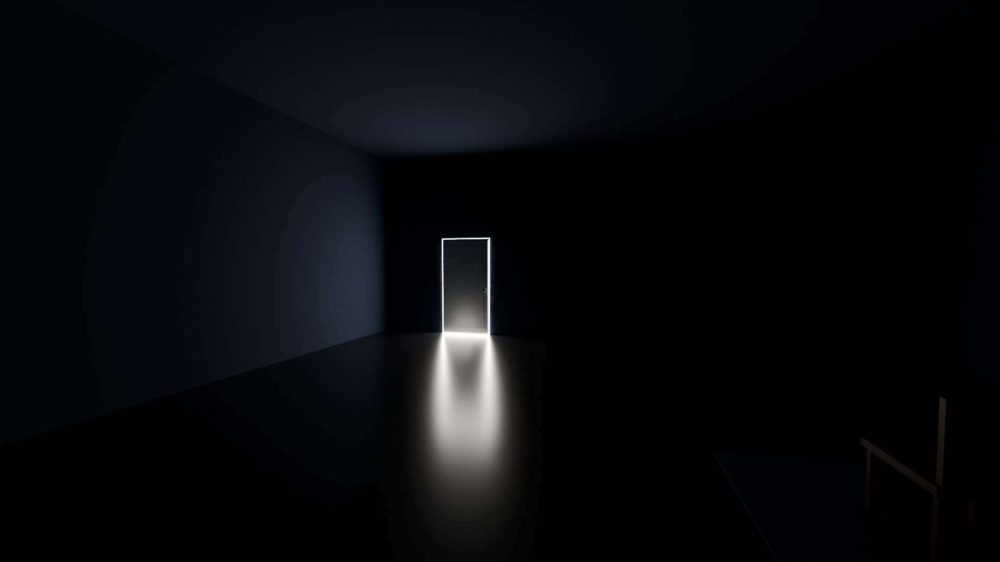
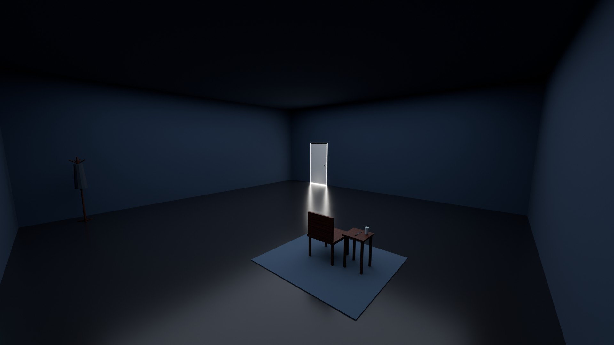
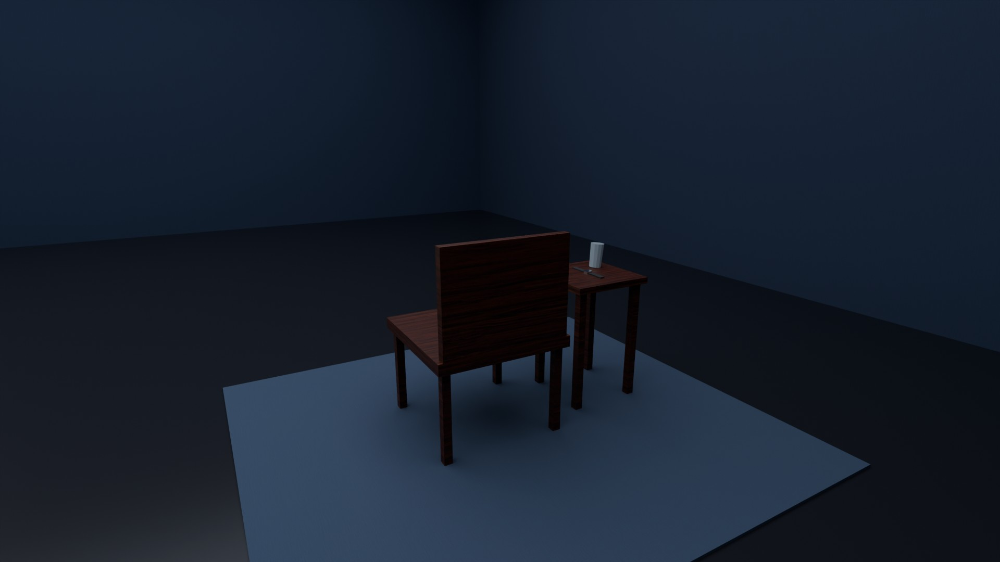

# rdwe_void_room: The void: behind the black doorway

Right Door, Wrong Exit, Phase C room 16 (the teal wing), dressed and lit (`docs/BLENDER_AREAS.md`, section 7, step 2), round its greybox (`tools/blender/build_rdwe_greybox.py`, `c_void_room()`). 10 m by 10 m, 4 m high. The room, from `ROOMS.md`: Environmental storytelling: pitch black behind the teal room's doorway, one chair, and a single door lit at its edges.

Pitch black: charcoal felt walls, a black lacquer floor, one plain chair facing the lit door. The door's outline is the only light in the dark set; the lift set is the black lifting to charcoal (the teal room's door does it too), dim enough to stay a void.

Built in Blender 5.2.1 by `tools/blender/build_rdwe_rooms2.py` (the room's `dress_` function and spec) with the shared kit `tools/blender/rdwe_rooms2_kit.py`, baked on the GPU and graded by `tools/blender/rdwe_rooms2_pack.py`. There are no reference photos: it follows the room's line in `ROOMS.md` and the style of `docs/WORLD.md` (Super Liminal: nearly ordinary, saturated, a little wrong).

| File | What it is |
|---|---|
| `world/rdwe_void_room.glb` | the art: 0.63 MB, 4184 triangles, 13 materials, 12 nodes (one mesh per material; the door leaves as their own nodes), 4 WebP textures |
| `world/rdwe_void_room.json` | the layout, written by `tools/blender/export_scene.py` from the `.blend`: 15 colliders, 2 doors, 2 links, 3 spots; the same as `build_rdwe_greybox.py --preview` writes |
| `world/lightmaps/rdwe_void_room_0.webp` | set `dark` (`lightmap`): struct page, 1024 px, about 48.1 px/m |
| `world/lightmaps/rdwe_void_room_1.webp` | set `dark` (`lightmap`): props page, 1024 px, about 153.7 px/m |
| `world/lightmaps/rdwe_void_room_2.webp` | set `lift` (`lightmap_lift`): struct page, 1024 px, about 48.1 px/m |
| `world/lightmaps/rdwe_void_room_3.webp` | set `lift` (`lightmap_lift`): props page, 1024 px, about 153.7 px/m |
| `blender/scenes/rdwe_void_room.blend` | the saved scene (Git LFS): `Art` (one object per collider, unmerged), `Doors` (the leaves, origin at the hinge), `Layout` (`COL_` boxes, the empties), `Export` (merged by material, with the lightmap UVs), `Lights_*` (one collection per light set, and `Lights_all`) |
| `docs/renders/rdwe_void_room/` | this README and the three review stills |





Review stills: Cycles, 96 samples adaptive, OIDN, 1920 x 1080 JPEG, AgX medium high contrast. They are Blender's renders with Blender's lights; the page shows the lightmaps (see Brightness).

## The trick's spots (for the page)

- `Spot_dark_1` at (0, 1.5), facing (0, -1): no light: only the lit door's outline
- `Spot_dark_2` at (1.9, 1.62), facing (0, -1): the chair faces the lit door: sit, and its outline brightens; stand, and the black comes back
- `Spot_dark_3` at (-3, -1.2), facing (0, -1): halfway to the lit door: the teal room's doorway behind you is gone

## Doors

- `DoorLeaf_lit` (1.06 x 2.1 m): the single lit door: a glowing outline, white. The leaf is built from its look (form, finish, handle), so it is visibly unlike every other door in the set.
- `DoorLeaf_teal` (1 x 2.1 m): studded teal paint door, glass knob. The leaf is built from its look (form, finish, handle), so it is visibly unlike every other door in the set.

## Light

| Set | Material properties | Maps |
|---|---|---|
| `dark` | `lightmap`, `lightmap_intensity` | `rdwe_void_room_0`, `rdwe_void_room_1` |
| `lift` | `lightmap_lift`, `lightmap_lift_intensity` | `rdwe_void_room_2`, `rdwe_void_room_3` |

The first set (`dark`) is `lightmap`, the one the page shows by default; the page swaps to another set by reading its own key. Every set is baked on the same lightmap UVs.

Emissive materials (not baked, drawn as they are): `Edge_Glow`. `Lamp_Emit` is every ordinary lamp's glow.

## Sources and licences

| File (`blender/textures/rdwe_rooms2/`) | Source | Licence | Used by |
|---|---|---|---|
| `dark_wood_diff_1k.jpg` | Poly Haven, Dark Wood | CC0 | Chair_Wood |
| `rough_linen_diff_512.jpg` | Poly Haven, Rough Linen | CC0 | Coat_Wool, Rug_Grey, Void_Felt |

Every other material is a flat colour, or a picture the build generates with numpy (fixed seeds, own work, no licence needed): `Chrome`, `Door_Lit_White`, `Door_Teal_Paint`, `Edge_Glow`, `Glass_Door`, `Iron`, `Rubber`, `Void_Floor`.
No Meshy, no Higgsfield, nothing bought.

## Brightness

Graded by `rdwe_rooms2_pack.py`: texel = G L / (C + G L), intensity = pi C (C = 1.15), G set so the shell page's median texel in the reference set is 0.9 (shared G); the page shows texture x base colour x texel x intensity / pi. The tables below are `lab_display.py` on the packed GLB.

```
brightness, set dark (`lightmap`): lab_display.py (shown = texel x intensity / pi x base colour)
material                m2           map       k    p50    p90    p99     >=1
Void_Felt            271.9 rdwe_void_room_0  3.6128  0.005  0.019  0.045   0.00%
Void_Floor           108.2 rdwe_void_room_0  3.6128  0.001  0.005  0.020   0.00%
Door_Lit_White        11.2 rdwe_void_room_1  3.6128  0.004  0.140  0.658   0.00%
Door_Teal_Paint        4.5 rdwe_void_room_1  3.6128  0.000  0.033  0.034   0.00%
Rug_Grey               4.5 rdwe_void_room_1  3.6128  0.003  0.005  0.006   0.00%
Chair_Wood             2.2 rdwe_void_room_1  3.6128  0.001  0.008  0.012   0.00%
Coat_Wool              0.5 rdwe_void_room_1  3.6128  0.001  0.009  0.010   0.00%
Iron                   0.4 rdwe_void_room_1  3.6128  0.000  0.006  0.006   0.00%
Glass_Door             0.1 rdwe_void_room_1  3.6128  0.004  0.050  0.062   0.00%
Chrome                 0.0 rdwe_void_room_1  3.6128  0.000  0.000  0.000   0.00%
Rubber                 0.0 rdwe_void_room_1  3.6128  0.001  0.002  0.002   0.00%
```
```
brightness, set lift (`lightmap_lift`): lab_display.py (shown = texel x intensity / pi x base colour)
material                m2           map       k    p50    p90    p99     >=1
Void_Felt            271.9 rdwe_void_room_2  3.6128  0.051  0.082  0.090   0.00%
Void_Floor           108.2 rdwe_void_room_2  3.6128  0.024  0.028  0.028   0.00%
Door_Lit_White        11.2 rdwe_void_room_3  3.6128  0.004  0.463  0.617   0.00%
Door_Teal_Paint        4.5 rdwe_void_room_3  3.6128  0.002  0.248  0.257   0.00%
Rug_Grey               4.5 rdwe_void_room_3  3.6128  0.123  0.137  0.146   0.00%
Chair_Wood             2.2 rdwe_void_room_3  3.6128  0.027  0.065  0.100   0.00%
Coat_Wool              0.5 rdwe_void_room_3  3.6128  0.026  0.053  0.057   0.00%
Iron                   0.4 rdwe_void_room_3  3.6128  0.000  0.053  0.055   0.00%
Glass_Door             0.1 rdwe_void_room_3  3.6128  0.188  0.405  0.521   0.00%
Chrome                 0.0 rdwe_void_room_3  3.6128  0.000  0.000  0.000   0.00%
Rubber                 0.0 rdwe_void_room_3  3.6128  0.037  0.040  0.040   0.00%
```

## Gates

```
## python tools/blender/build_rdwe_greybox.py --check .
GATE links: 54 pairs with both sides built (108 sides, the one-way ones included), 2 that loop on their own room, 5 that leave the set; 115 links in the files, every one accounted for
GATE navigable: 43 of 43 rooms reachable from rdwe_dining; 42 can get back to it (no true exit: the finale's one way out is the ending)
GATE overlaps: 0 interpenetrating collider pairs of 35141 checked (none allowed)
GATE clearances: 344 links, arrivals, spots and spawns clear by 0.28 m with a floor under them; 248 door-front points (0.5 and 1 m in) clear
GATE steps: 56 step boxes in 6 flights, one box a step; the highest rise 0.250 m (at most 0.27 m)
GATE corridors: 14 corridor rects, the narrowest 2.00 m (at least 1.6 m), none blocked
GATE extent: the largest room is 50.4 m across (a store floor, about 52 m, at most)
GATE spots: every room has its trick's spot and the ones it needs; 10 SecCam; agent x6, beacon x1, book x3, buttons x3, cake x1, cart x1, change x3, clock x2, computer x4, dark x3, frame x1, grid x6, hide x12, hum x1, lamp x1, lap x1, locker x3, map x3, monitor x2, moon x2, note x1, notes x1, photo x5, scuff x1, seeker x1, statue x3, switch x4, ticket x3, tin x3, trick x21, tv x3, view x6, watch x1, window x1
GATE doors: 124 door leaves, no two with the same look; 103 exits with one Link_ each, 4 arrival-only, 17 that never open; every exit fixed
GATES PASS

## world/rdwe_void_room.json (export_scene.py, from the .blend) against build_rdwe_greybox.py --preview
SAME (to 2.5 mm): 15 colliders, 2 doors, 2 links, 0 zones, 3 spots, 0 markers, 0 cameras

## node tools/worlddoc.mjs check world/rdwe_void_room.json
warning: scene rdwe_void_room is not in the world manifest yet: a new scene to add
  warning: link lit: the manifest has no link from this door yet: a new link to add
  warning: link teal: the manifest has no link from this door yet: a new link to add
OK world/rdwe_void_room.json: 15 colliders, 2 doors, 0 markers, 2 links, 0 zones, 3 spots, 0 errors, 3 warnings

## tools/blender/check_layout.py (rules COVER, STRAY, CLEAR on the Art collection; run on the box)
layout check: scene rdwe_void_room, run on the box (check_layout.check on the Art collection; points: every link arrival and F spot, every Spot_)
PASS: 23 of 23 checks passed

## glb_inspect world/rdwe_void_room.glb --budget tris=300000,mb=8
materials  13: Chair_Wood, Chrome, Coat_Wool, Door_Lit_White, Door_Teal_Paint, Glass_Door, Iron, Edge_Glow, Rubber, Rug_Grey, Void_Black, Void_Felt, Void_Floor
textures   4, images: 1024x1024, 512x512
bbox       10.4 x 4.05 x 11.1 (x, y up, z), min [-5.2, -0.05, -5.55]
requires   EXT_texture_webp
pass       tris: 4184 triangles, budget 300000
pass       mb: 0.60 MB, budget 8

## node --test shared/*.test.js
tests 297
pass 297
fail 0

## sizes
world/rdwe_void_room.glb  0.63 MB
world/rdwe_void_room.json  0.00 MB
blender/scenes/rdwe_void_room.blend  0.24 MB
world/lightmaps/rdwe_void_room_0.webp  0.02 MB
world/lightmaps/rdwe_void_room_1.webp  0.04 MB
world/lightmaps/rdwe_void_room_2.webp  0.02 MB
world/lightmaps/rdwe_void_room_3.webp  0.06 MB
docs/renders/rdwe_void_room/1_arrival.jpg  0.05 MB
docs/renders/rdwe_void_room/2_wide.jpg  0.07 MB
docs/renders/rdwe_void_room/3_detail.jpg  0.07 MB

## privacy grep (user names, absolute paths, session ids, e-mail; the .blend decompressed)
privacy grep: 11 files, 0 with hits

```

Nothing is wired: the manifest, `games/rdwe/`, `index.html`, `shared/` and the tests are untouched.
