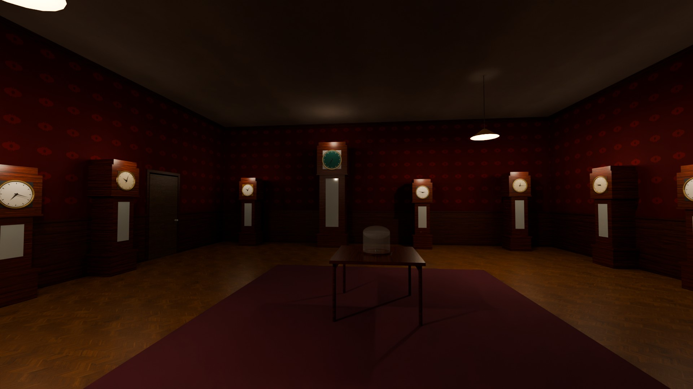
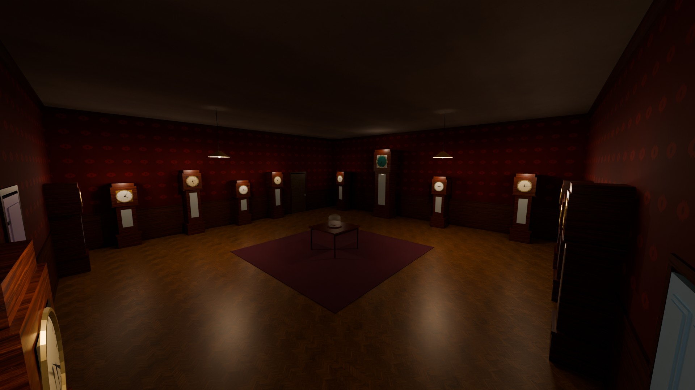
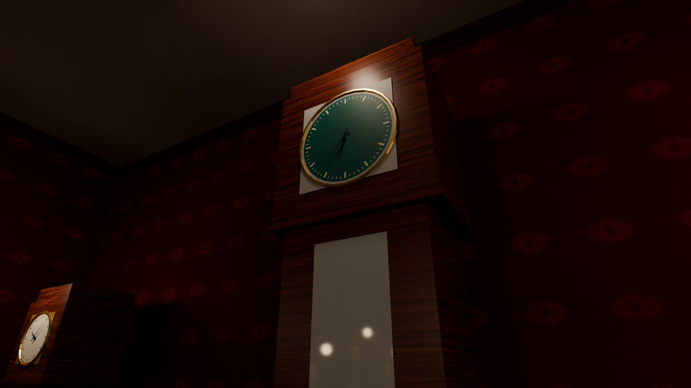

# rdwe_wrong_clock: The clock room: one runs backward

Right Door, Wrong Exit, Phase C room 25 (the teal wing), dressed and lit (`docs/BLENDER_AREAS.md`, section 7, step 2), round its greybox (`tools/blender/build_rdwe_greybox.py`, `c_wrong_clock()`). 12 m by 12 m, 4.5 m high. The room, from `ROOMS.md`: Psychological puzzle: a room of grandfather clocks; the one that runs backward is the teal room's watch, and stopping it opens the north door.

A room of grandfather clocks round oxblood damask and dark panelling, every one at its own hour. Their hands and pendulums are their own objects (the page turns and swings them; not baked). Clock 2, the tall one on the east wall, runs backward: its face is the teal room's wristwatch face, and the watch itself lies under a glass dome on the table in the middle.

Built in Blender 5.2.1 by `tools/blender/build_rdwe_rooms2.py` (the room's `dress_` function and spec) with the shared kit `tools/blender/rdwe_rooms2_kit.py`, baked on the GPU and graded by `tools/blender/rdwe_rooms2_pack.py`. There are no reference photos: it follows the room's line in `ROOMS.md` and the style of `docs/WORLD.md` (Super Liminal: nearly ordinary, saturated, a little wrong).

| File | What it is |
|---|---|
| `world/rdwe_wrong_clock.glb` | the art: 1.72 MB, 13168 triangles, 23 materials, 63 nodes (one mesh per material; the door leaves, the moving objects as their own nodes), 10 WebP textures |
| `world/rdwe_wrong_clock.json` | the layout, written by `tools/blender/export_scene.py` from the `.blend`: 30 colliders, 3 doors, 3 links, 2 spots; the same as `build_rdwe_greybox.py --preview` writes |
| `world/lightmaps/rdwe_wrong_clock_0.webp` | set `main` (`lightmap`): struct page, 2048 px, about 69.3 px/m |
| `world/lightmaps/rdwe_wrong_clock_1.webp` | set `main` (`lightmap`): props page, 2048 px, about 119.0 px/m |
| `blender/scenes/rdwe_wrong_clock.blend` | the saved scene (Git LFS): `Art` (one object per collider, unmerged), `Doors` (the leaves, origin at the hinge), `Layout` (`COL_` boxes, the empties), `Export` (merged by material, with the lightmap UVs), `Lights_*` (one collection per light set, and `Lights_all`) |
| `docs/renders/rdwe_wrong_clock/` | this README and the three review stills |





Review stills: Cycles, 96 samples adaptive, OIDN, 1920 x 1080 JPEG, AgX medium high contrast. They are Blender's renders with Blender's lights; the page shows the lightmaps (see Brightness).

## The trick's spots (for the page)

- `Spot_clock_1` at (4, -1.5), facing (1, 0): the backward clock: stop it to open the north door
- `Spot_clock_2` at (0, 1.2), facing (0, -1): the teal room's wristwatch under a glass dome: its second hand ticks backward too

## Doors

- `DoorLeaf_gallery` (0.9 x 2.4 m): stable (split) lilac door, brass knob. The leaf is built from its look (form, finish, handle), so it is visibly unlike every other door in the set.
- `DoorLeaf_hands` (1 x 2.3 m): flush oak door, glass knob. The leaf is built from its look (form, finish, handle), so it is visibly unlike every other door in the set.
- `DoorLeaf_waiting` (0.86 x 2.04 m): panelled sky blue door, push plate. The leaf is built from its look (form, finish, handle), so it is visibly unlike every other door in the set.

## Light

| Set | Material properties | Maps |
|---|---|---|
| `main` | `lightmap`, `lightmap_intensity` | `rdwe_wrong_clock_0`, `rdwe_wrong_clock_1` |

Emissive materials (not baked, drawn as they are): `Lamp_Emit`. `Lamp_Emit` is every ordinary lamp's glow.

## What the page moves (own nodes)

- `Clock_1_Hour` (not baked, `unbaked: true`; origin at its pivot): turns about the face's centre: the hour hand
- `Clock_1_Minute` (not baked, `unbaked: true`; origin at its pivot): turns about the face's centre: the minute hand
- `Clock_1_Pendulum` (not baked, `unbaked: true`; origin at its pivot): swings about its top (the page)
- `Clock_2_Hour` (not baked, `unbaked: true`; origin at its pivot): runs BACKWARD: the clock to stop (the teal room's watch face)
- `Clock_2_Minute` (not baked, `unbaked: true`; origin at its pivot): runs BACKWARD with it
- `Clock_2_Pendulum` (not baked, `unbaked: true`; origin at its pivot): swings about its top (the page)
- `Clock_3_Hour` (not baked, `unbaked: true`; origin at its pivot): turns about the face's centre: the hour hand
- `Clock_3_Minute` (not baked, `unbaked: true`; origin at its pivot): turns about the face's centre: the minute hand
- `Clock_3_Pendulum` (not baked, `unbaked: true`; origin at its pivot): swings about its top (the page)
- `Clock_4_Hour` (not baked, `unbaked: true`; origin at its pivot): turns about the face's centre: the hour hand
- `Clock_4_Minute` (not baked, `unbaked: true`; origin at its pivot): turns about the face's centre: the minute hand
- `Clock_4_Pendulum` (not baked, `unbaked: true`; origin at its pivot): swings about its top (the page)
- `Clock_5_Hour` (not baked, `unbaked: true`; origin at its pivot): turns about the face's centre: the hour hand
- `Clock_5_Minute` (not baked, `unbaked: true`; origin at its pivot): turns about the face's centre: the minute hand
- `Clock_5_Pendulum` (not baked, `unbaked: true`; origin at its pivot): swings about its top (the page)
- `Clock_6_Hour` (not baked, `unbaked: true`; origin at its pivot): turns about the face's centre: the hour hand
- `Clock_6_Minute` (not baked, `unbaked: true`; origin at its pivot): turns about the face's centre: the minute hand
- `Clock_6_Pendulum` (not baked, `unbaked: true`; origin at its pivot): swings about its top (the page)
- `Clock_7_Hour` (not baked, `unbaked: true`; origin at its pivot): turns about the face's centre: the hour hand
- `Clock_7_Minute` (not baked, `unbaked: true`; origin at its pivot): turns about the face's centre: the minute hand
- `Clock_7_Pendulum` (not baked, `unbaked: true`; origin at its pivot): swings about its top (the page)
- `Clock_8_Hour` (not baked, `unbaked: true`; origin at its pivot): turns about the face's centre: the hour hand
- `Clock_8_Minute` (not baked, `unbaked: true`; origin at its pivot): turns about the face's centre: the minute hand
- `Clock_8_Pendulum` (not baked, `unbaked: true`; origin at its pivot): swings about its top (the page)
- `Clock_9_Hour` (not baked, `unbaked: true`; origin at its pivot): turns about the face's centre: the hour hand
- `Clock_9_Minute` (not baked, `unbaked: true`; origin at its pivot): turns about the face's centre: the minute hand
- `Clock_9_Pendulum` (not baked, `unbaked: true`; origin at its pivot): swings about its top (the page)
- `Clock_10_Hour` (not baked, `unbaked: true`; origin at its pivot): turns about the face's centre: the hour hand
- `Clock_10_Minute` (not baked, `unbaked: true`; origin at its pivot): turns about the face's centre: the minute hand
- `Clock_10_Pendulum` (not baked, `unbaked: true`; origin at its pivot): swings about its top (the page)
- `Clock_11_Hour` (not baked, `unbaked: true`; origin at its pivot): turns about the face's centre: the hour hand
- `Clock_11_Minute` (not baked, `unbaked: true`; origin at its pivot): turns about the face's centre: the minute hand
- `Clock_11_Pendulum` (not baked, `unbaked: true`; origin at its pivot): swings about its top (the page)
- `Clock_12_Hour` (not baked, `unbaked: true`; origin at its pivot): turns about the face's centre: the hour hand
- `Clock_12_Minute` (not baked, `unbaked: true`; origin at its pivot): turns about the face's centre: the minute hand
- `Clock_12_Pendulum` (not baked, `unbaked: true`; origin at its pivot): swings about its top (the page)
- `Clock_13_Hour` (not baked, `unbaked: true`; origin at its pivot): turns about the face's centre: the hour hand
- `Clock_13_Minute` (not baked, `unbaked: true`; origin at its pivot): turns about the face's centre: the minute hand
- `Clock_13_Pendulum` (not baked, `unbaked: true`; origin at its pivot): swings about its top (the page)
- `Clock_14_Hour` (not baked, `unbaked: true`; origin at its pivot): turns about the face's centre: the hour hand
- `Clock_14_Minute` (not baked, `unbaked: true`; origin at its pivot): turns about the face's centre: the minute hand
- `Clock_14_Pendulum` (not baked, `unbaked: true`; origin at its pivot): swings about its top (the page)
- `Watch_Hand` (not baked, `unbaked: true`; origin at its pivot): the wristwatch's second hand, backward

## Sources and licences

| File (`blender/textures/rdwe_rooms2/`) | Source | Licence | Used by |
|---|---|---|---|
| `Metal048A_color_512.jpg` | ambientCG, Metal048A | CC0 | Steel |
| `dark_wood_diff_1k.jpg` | Poly Haven, Dark Wood | CC0 | Clock_Wood, Panel_Dark, Trim_Dark |
| `herringbone_parquet_diff_1k.jpg` | Poly Haven, Herringbone Parquet | CC0 | Floor_Parquet |
| `old_wood_floor_diff_1k.jpg` | Poly Haven, Old Wood Floor | CC0 | Door_Oak |
| `plastered_wall_04_diff_1k.jpg` | Poly Haven, Plastered Wall 04 | CC0 | Ceiling_Dark |
| `rough_linen_diff_512.jpg` | Poly Haven, Rough Linen | CC0 | Rug_Red |

Every other material is a flat colour, or a picture the build generates with numpy (fixed seeds, own work, no licence needed): `Brass`, `Brass_Move`, `Chrome`, `Clock_Faces`, `Door_Lilac`, `Door_Sky_Blue`, `Glass_Clear`, `Glass_Door`, `Hand_Black`, `Iron`, `Leather_Brown`, `Paper_Oxblood`, `Shade_Amber`.
No Meshy, no Higgsfield, nothing bought.

## Brightness

Graded by `rdwe_rooms2_pack.py`: texel = G L / (C + G L), intensity = pi C (C = 1.15), G set so the shell page's median texel in the reference set is 1.6 (shared G); the page shows texture x base colour x texel x intensity / pi. The tables below are `lab_display.py` on the packed GLB.

```
brightness, set main (`lightmap`): lab_display.py (shown = texel x intensity / pi x base colour)
material                m2           map       k    p50    p90    p99     >=1
Paper_Oxblood        203.4 rdwe_wrong_clock_0  3.6128  0.069  0.097  0.177   0.00%
Ceiling_Dark         144.0 rdwe_wrong_clock_0  3.6128  0.121  0.146  0.165   0.00%
Floor_Parquet        132.4 rdwe_wrong_clock_0  3.6128  0.181  0.254  0.324   0.00%
Clock_Wood           106.6 rdwe_wrong_clock_1  3.6128  0.025  0.101  0.158   0.00%
Panel_Dark            54.6 rdwe_wrong_clock_0  3.6128  0.041  0.077  0.108   0.00%
Trim_Dark             26.9 rdwe_wrong_clock_0  3.6128  0.033  0.059  0.085   0.00%
Rug_Red               23.3 rdwe_wrong_clock_1  3.6128  0.110  0.124  0.136   0.00%
Door_Lilac            10.5 rdwe_wrong_clock_1  3.6128  0.000  0.479  0.505   0.00%
Door_Sky_Blue         10.2 rdwe_wrong_clock_1  3.6128  0.000  0.403  0.459   0.00%
Glass_Door             6.9 rdwe_wrong_clock_1  3.6128  0.002  0.500  0.543   0.00%
Door_Oak               4.9 rdwe_wrong_clock_1  3.6128  0.019  0.077  0.126   0.00%
Clock_Faces            2.5 rdwe_wrong_clock_1  3.6128  0.627  0.889  0.941   0.08%
Brass                  1.3 rdwe_wrong_clock_1  3.6128  0.097  0.627  0.669   0.00%
Shade_Amber            0.7 rdwe_wrong_clock_1  3.6128  0.395  0.428  0.445   0.00%
Iron                   0.3 rdwe_wrong_clock_1  3.6128  0.000  0.058  0.090   0.00%
Steel                  0.1 rdwe_wrong_clock_1  3.6128  0.000  0.591  0.606   0.00%
Chrome                 0.0 rdwe_wrong_clock_1  3.6128  0.000  0.000  0.001   0.00%
Leather_Brown          0.0 rdwe_wrong_clock_1  3.6128  0.204  0.234  0.252   0.00%
```

## Gates

```
## python tools/blender/build_rdwe_greybox.py --check .
GATE links: 54 pairs with both sides built (108 sides, the one-way ones included), 2 that loop on their own room, 5 that leave the set; 115 links in the files, every one accounted for
GATE navigable: 43 of 43 rooms reachable from rdwe_dining; 42 can get back to it (no true exit: the finale's one way out is the ending)
GATE overlaps: 0 interpenetrating collider pairs of 35141 checked (none allowed)
GATE clearances: 344 links, arrivals, spots and spawns clear by 0.28 m with a floor under them; 248 door-front points (0.5 and 1 m in) clear
GATE steps: 56 step boxes in 6 flights, one box a step; the highest rise 0.250 m (at most 0.27 m)
GATE corridors: 14 corridor rects, the narrowest 2.00 m (at least 1.6 m), none blocked
GATE extent: the largest room is 50.4 m across (a store floor, about 52 m, at most)
GATE spots: every room has its trick's spot and the ones it needs; 10 SecCam; agent x6, beacon x1, book x3, buttons x3, cake x1, cart x1, change x3, clock x2, computer x4, dark x3, frame x1, grid x6, hide x12, hum x1, lamp x1, lap x1, locker x3, map x3, monitor x2, moon x2, note x1, notes x1, photo x5, scuff x1, seeker x1, statue x3, switch x4, ticket x3, tin x3, trick x21, tv x3, view x6, watch x1, window x1
GATE doors: 124 door leaves, no two with the same look; 103 exits with one Link_ each, 4 arrival-only, 17 that never open; every exit fixed
GATES PASS

## world/rdwe_wrong_clock.json (export_scene.py, from the .blend) against build_rdwe_greybox.py --preview
SAME (to 2.5 mm): 30 colliders, 3 doors, 3 links, 0 zones, 2 spots, 0 markers, 0 cameras

## node tools/worlddoc.mjs check world/rdwe_wrong_clock.json
warning: scene rdwe_wrong_clock is not in the world manifest yet: a new scene to add
  warning: link gallery: the manifest has no link from this door yet: a new link to add
  warning: link hands: the manifest has no link from this door yet: a new link to add
  warning: link waiting: the manifest has no link from this door yet: a new link to add
OK world/rdwe_wrong_clock.json: 30 colliders, 3 doors, 0 markers, 3 links, 0 zones, 2 spots, 0 errors, 4 warnings

## tools/blender/check_layout.py (rules COVER, STRAY, CLEAR on the Art collection; run on the box)
layout check: scene rdwe_wrong_clock, 133 visible meshes, 30 colliders
PASS  COVER  Beyond_gallery: 1 mesh(es) cover it (1215 sample points, every one within 5 cm of art)
PASS  COVER  Beyond_hands: 1 mesh(es) cover it (1248 sample points, every one within 5 cm of art)
PASS  COVER  Beyond_waiting: 1 mesh(es) cover it (1080 sample points, every one within 5 cm of art)
PASS  COVER  Clock_1: 5 mesh(es) cover it (1225 sample points, every one within 5 cm of art)
PASS  COVER  Clock_10: 6 mesh(es) cover it (1323 sample points, every one within 5 cm of art)
PASS  COVER  Clock_11: 6 mesh(es) cover it (1127 sample points, every one within 5 cm of art)
PASS  COVER  Clock_12: 6 mesh(es) cover it (1225 sample points, every one within 5 cm of art)
PASS  COVER  Clock_13: 6 mesh(es) cover it (1225 sample points, every one within 5 cm of art)
PASS  COVER  Clock_14: 6 mesh(es) cover it (1274 sample points, every one within 5 cm of art)
PASS  COVER  Clock_2: 5 mesh(es) cover it (3256 sample points, every one within 5 cm of art)
PASS  COVER  Clock_3: 5 mesh(es) cover it (1176 sample points, every one within 5 cm of art)
PASS  COVER  Clock_4: 5 mesh(es) cover it (1274 sample points, every one within 5 cm of art)
PASS  COVER  Clock_5: 6 mesh(es) cover it (1127 sample points, every one within 5 cm of art)
PASS  COVER  Clock_6: 6 mesh(es) cover it (1323 sample points, every one within 5 cm of art)
PASS  COVER  Clock_7: 6 mesh(es) cover it (1078 sample points, every one within 5 cm of art)
PASS  COVER  Clock_8: 6 mesh(es) cover it (1274 sample points, every one within 5 cm of art)
PASS  COVER  Clock_9: 6 mesh(es) cover it (1176 sample points, every one within 5 cm of art)
PASS  COVER  Room_Ceiling: 11 mesh(es) cover it (46875 sample points, every one within 5 cm of art)
PASS  COVER  Room_Floor: 23 mesh(es) cover it (62500 sample points, every one within 5 cm of art)
PASS  COVER  Room_Wall_E_1: 5 mesh(es) cover it (16698 sample points, every one within 5 cm of art)
PASS  COVER  Room_Wall_N_1: 9 mesh(es) cover it (12144 sample points, every one within 5 cm of art)
PASS  COVER  Room_Wall_N_2: 4 mesh(es) cover it (828 sample points, every one within 5 cm of art)
PASS  COVER  Room_Wall_N_3: 5 mesh(es) cover it (3864 sample points, every one within 5 cm of art)
PASS  COVER  Room_Wall_S_1: 6 mesh(es) cover it (4002 sample points, every one within 5 cm of art)
PASS  COVER  Room_Wall_S_2: 4 mesh(es) cover it (780 sample points, every one within 5 cm of art)
PASS  COVER  Room_Wall_S_3: 8 mesh(es) cover it (12282 sample points, every one within 5 cm of art)
PASS  COVER  Room_Wall_W_1: 6 mesh(es) cover it (7866 sample points, every one within 5 cm of art)
PASS  COVER  Room_Wall_W_2: 4 mesh(es) cover it (726 sample points, every one within 5 cm of art)
PASS  COVER  Room_Wall_W_3: 6 mesh(es) cover it (7866 sample points, every one within 5 cm of art)
PASS  COVER  Watch_Table: 4 mesh(es) cover it (1521 sample points, every one within 5 cm of art)
PASS  STRAY  39 tall solid mesh(es), each over a collider; 59 decor_* mesh(es) exempt
PASS  CLEAR  links.gallery.arrive (-4.10, 0.00): clear within 0.28 m
PASS  CLEAR  links.gallery.at (-5.25, 0.00): clear within 0.28 m
PASS  CLEAR  links.hands.arrive (3.00, -4.10): clear within 0.28 m
PASS  CLEAR  links.hands.at (3.00, -5.25): clear within 0.28 m
PASS  CLEAR  links.waiting.arrive (-3.00, 4.10): clear within 0.28 m
PASS  CLEAR  links.waiting.at (-3.00, 5.25): clear within 0.28 m
PASS  CLEAR  spots.Spot_clock_1.at (4.00, -1.50): clear within 0.28 m
PASS  CLEAR  spots.Spot_clock_2.at (0.00, 1.20): clear within 0.28 m
PASS: 39 of 39 checks passed

## glb_inspect world/rdwe_wrong_clock.glb --budget tris=300000,mb=8
materials  23: Brass, Ceiling_Dark, Chrome, Hand_Black, Brass_Move, Clock_Faces, Clock_Wood, Door_Lilac, Iron, Door_Oak, Glass_Door, Door_Sky_Blue, Steel, Floor_Parquet, Glass_Clear, Lamp_Emit, Leather_Brown, Panel_Dark, Paper_Oxblood, Rug_Red, Shade_Amber, Trim_Dark, Void_Black
textures   10, images: 1024x1024, 1024x1024, 1024x1024, 1024x1024, 512x512, 1024x1024, 512x512, 512x512
bbox       12.55 x 4.55 x 13.1 (x, y up, z), min [-6.55, -0.05, -6.55]
requires   EXT_texture_webp
pass       tris: 13168 triangles, budget 300000
pass       mb: 1.64 MB, budget 8

## node --test shared/*.test.js
tests 297
pass 297
fail 0

## sizes
world/rdwe_wrong_clock.glb  1.72 MB
world/rdwe_wrong_clock.json  0.01 MB
blender/scenes/rdwe_wrong_clock.blend  0.59 MB
world/lightmaps/rdwe_wrong_clock_0.webp  0.11 MB
world/lightmaps/rdwe_wrong_clock_1.webp  0.28 MB
docs/renders/rdwe_wrong_clock/1_arrival.jpg  0.14 MB
docs/renders/rdwe_wrong_clock/2_wide.jpg  0.15 MB
docs/renders/rdwe_wrong_clock/3_detail.jpg  0.11 MB

## privacy grep (user names, absolute paths, session ids, e-mail; the .blend decompressed)
privacy grep: 9 files, 0 with hits

```

Nothing is wired: the manifest, `games/rdwe/`, `index.html`, `shared/` and the tests are untouched.
