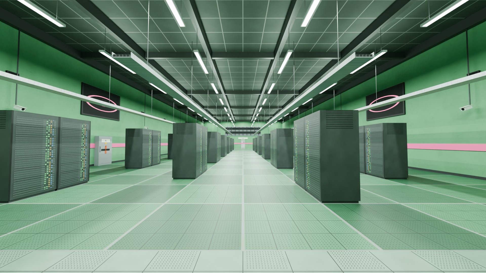
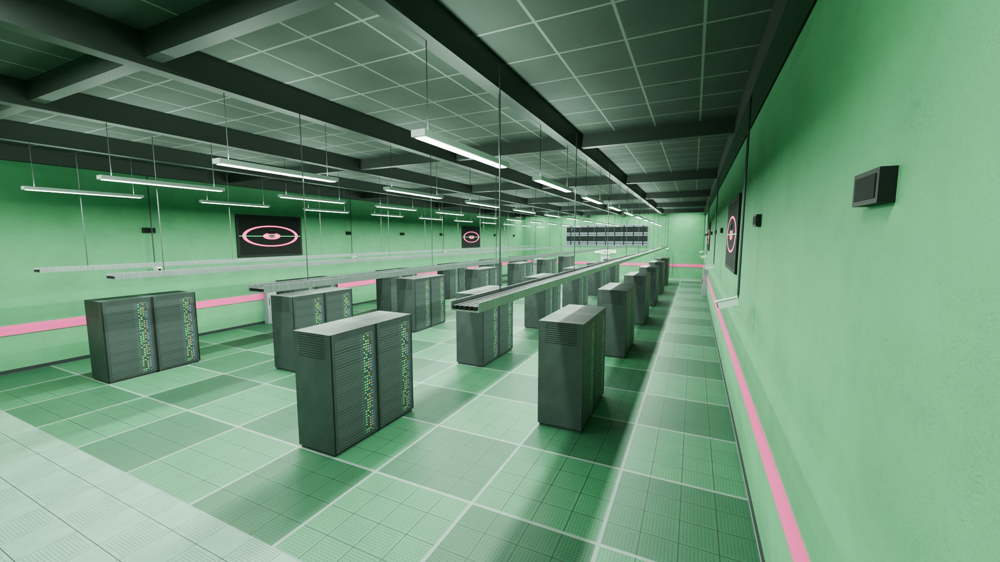
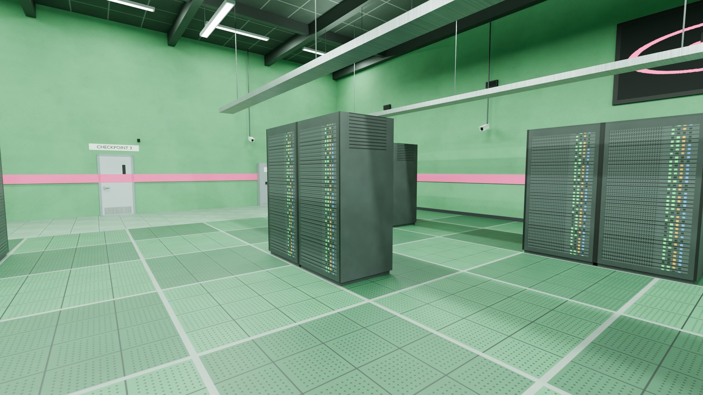
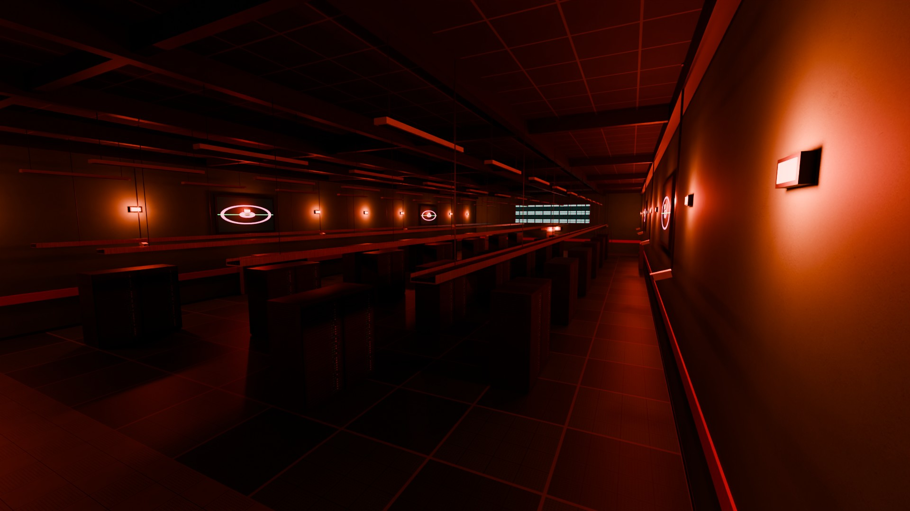
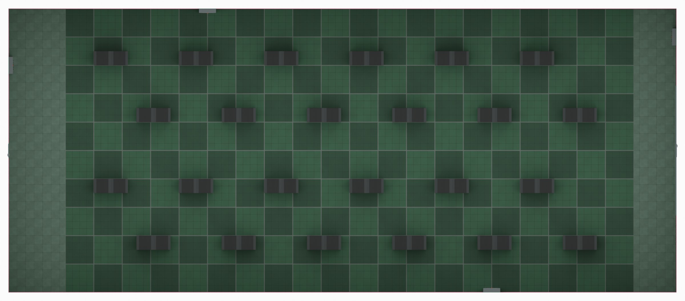

# registrar_hall: dressed and lit (Secret Operations, step 2)

The boss arena: a long green server hall, 7 m high, with the pink stripe at 1.2 to 1.5 m round every wall. Forty-eight server racks in four rows stand on a checker of 200 green raised-floor panels over an 8 m pit; steel beams run under the 50 ceiling panels with strip lights hung from them, cable trays run over the rack rows, and the Registrar's eye looks out of four wall screens. The landings at both ends are fixed floor; the east wall carries the control room's lit window, its sign and the cell's bars. Twelve cameras on poles watch every wall; four breaker cabinets (R1 to R4) stand on the walls.

Built by `tools/blender/build_secretops_dress.py` around the greybox's layout (`tools/blender/build_secretops_greybox.py`): the layout objects are rebuilt from the same model, so `world/registrar_hall.json` is the greybox's file, unchanged. The method, the light sets, the removable parts and the sources are in `docs/renders/registrar_hall/README.md` (shared by all 13 scenes).

| File | What it is |
|---|---|
| `world/registrar_hall.glb` | the art only: 2.27 MB, 16764 triangles, 335 nodes drawn (276 meshes), 29 materials, WebP textures |
| `world/lightmaps/registrar_hall_0.webp`, `_1.webp` | the normal set (`lightmap`): the shell page and the props page |
| `world/lightmaps/registrar_hall_2.webp`, `_3.webp` | the alarm set (`lightmap_night`): the same two pages |
| `world/registrar_hall.json` | the layout, as the greybox wrote it: 317 colliders, 2 doors, 12 cameras, 2 links, 3 zones, 16 spots |
| `blender/scenes/registrar_hall.blend` | the saved scene (Git LFS): `Art` (Props, Separate, and Arch: one box per shell collider, for the layout check only), `Shell`, `Doors`, `Layout`, the two light collections, `Export` |
| `docs/renders/registrar_hall/` | `1_arrival.jpg`, `2_wide.jpg`, `3_detail.jpg` (normal light), `4_alarm.jpg` (the wide view in the alarm set), `plan.jpg`, `bake.json`, `caps.json` |







## Bake

| Map | Set | Page | Size | px/m | Gain G | Shown gain (caps) |
|---|---|---|---|---|---|---|
| `registrar_hall_0` | normal | shell | 2048 | 24.5 | 0.3752 | 1.6814 |
| `registrar_hall_1` | normal | props | 2048 | 26.3 | 0.3752 | 1.6814 |
| `registrar_hall_2` | alarm | shell | 2048 | 24.5 | 5.31275 | 3.2979 |
| `registrar_hall_3` | alarm | props | 2048 | 26.3 | 5.31275 | 3.2979 |

Cycles on the rented GPU (GPU), 512 samples, diffuse direct and indirect, OIDN, 8 px margin; 177 s for both sets. Texel = G L / (C + G L) with C = 1.2 and lightmap intensity pi C, G set so the median wall texel shows 0.34 (normal) or 0.26 (alarm) of its light; `caps.json` then scales each set's intensity so the walls show p50 0.19 (normal) or 0.155 (alarm) and caps any material that would pass p90 0.88 or p99 0.97.

## Brightness (`lab_display.py`, as the page shows it)

Normal set:

```
material                m2           map       k    p50    p90    p99     >=1
Pit_Concrete        2524.0 registrar_hall_0  6.3387  0.028  0.075  0.142   0.00%
Ceiling_Panel        960.0 registrar_hall_0  6.3387  0.031  0.053  0.139   0.00%
Wall_Green           928.4 registrar_hall_0  6.3387  0.190  0.237  0.266   0.00%
Panel_B              640.0 registrar_hall_0  6.3387  0.071  0.116  0.253   0.00%
Panel_A              640.0 registrar_hall_0  6.3387  0.114  0.189  0.250   0.00%
Beam_Steel           515.8 registrar_hall_1  6.3387  0.021  0.046  0.097   0.00%
Steel                198.4 registrar_hall_1  6.3387  0.102  0.300  0.371   0.00%
Cable                152.7 registrar_hall_1  6.3387  0.001  0.004  0.005   0.00%
Ceiling_Server       140.0 registrar_hall_0  6.3387  0.016  0.021  0.061   0.00%
Floor_Server         139.3 registrar_hall_0  6.3387  0.212  0.252  0.317   0.00%
Lamp_Housing          64.0 registrar_hall_1  6.3387  0.128  0.842  0.866   0.00%
Stripe_Pink           48.6 registrar_hall_1  6.3387  0.566  0.626  0.635   0.00%
Plastic_Black         34.5 registrar_hall_1  6.3387  0.000  0.002  0.002   0.00%
Breaker_Paint         32.3 registrar_hall_1  6.3387  0.000  0.216  0.240   0.00%
Steel_Dark            17.2 registrar_hall_1  6.3387  0.013  0.069  0.124   0.00%
Server_Body           15.1 registrar_hall_1  6.3387  0.021  0.063  0.105   0.00%
Skirting              12.1 registrar_hall_1  6.3387  0.025  0.026  0.026   0.00%
Door_Frame             7.0 registrar_hall_1  6.3387  0.179  0.234  0.256   0.00%
Door_Steel             4.4 registrar_hall_1  6.3387  0.000  0.345  0.349   0.00%
Sign_Plate             3.3 registrar_hall_1  6.3387  0.528  0.639  0.716   0.00%
Paint_Orange           0.7 registrar_hall_1  6.3387  0.071  0.444  0.504   0.00%
Cam_Body               0.4 registrar_hall_1  6.3387  0.191  0.513  0.543   0.00%
Paint_Yellow           0.2 registrar_hall_1  6.3387  0.001  0.470  0.497   0.00%
Paint_Dark             0.1 registrar_hall_1  6.3387  0.000  0.013  0.013   0.00%
```

Alarm set (`lightmap_night`):

```
material                m2           map       k    p50    p90    p99     >=1
Pit_Concrete        2524.0 registrar_hall_2 12.4328  0.043  0.114  0.214   0.00%
Ceiling_Panel        960.0 registrar_hall_2 12.4328  0.040  0.113  0.385   0.00%
Wall_Green           928.4 registrar_hall_2 12.4328  0.154  0.276  0.701   0.03%
Panel_B              640.0 registrar_hall_2 12.4328  0.052  0.060  0.311   0.00%
Panel_A              640.0 registrar_hall_2 12.4328  0.089  0.100  0.307   0.00%
Beam_Steel           515.8 registrar_hall_3 12.4328  0.064  0.137  0.203   0.00%
Steel                198.4 registrar_hall_3 12.4328  0.062  0.498  0.824   0.01%
Cable                152.7 registrar_hall_3 12.4328  0.000  0.002  0.004   0.00%
Ceiling_Server       140.0 registrar_hall_2 12.4328  0.055  0.106  0.306   0.00%
Floor_Server         139.3 registrar_hall_2 12.4328  0.245  0.303  0.402   0.00%
Lamp_Housing          64.0 registrar_hall_3  8.8335  0.082  0.647  0.970   0.03%
Stripe_Pink           48.6 registrar_hall_3  5.5910  0.318  0.703  0.970   0.56%
Plastic_Black         34.5 registrar_hall_3 12.4328  0.000  0.009  0.011   0.00%
Breaker_Paint         32.3 registrar_hall_3 12.4328  0.005  0.402  0.729   0.00%
Steel_Dark            17.2 registrar_hall_3 12.4328  0.057  0.153  0.282   0.00%
Server_Body           15.1 registrar_hall_3 12.4328  0.046  0.098  0.150   0.17%
Skirting              12.1 registrar_hall_3 12.4328  0.031  0.036  0.061   0.00%
Door_Frame             7.0 registrar_hall_3 12.4328  0.302  0.534  0.858   0.00%
Door_Steel             4.4 registrar_hall_3 12.4328  0.001  0.609  0.816   0.00%
Sign_Plate             3.3 registrar_hall_3  3.7398  0.357  0.880  0.937   0.00%
Paint_Orange           0.7 registrar_hall_3  9.8828  0.149  0.786  0.970   0.30%
Cam_Body               0.4 registrar_hall_3  4.4646  0.120  0.880  0.889   0.00%
Paint_Yellow           0.2 registrar_hall_3 10.0842  0.001  0.881  0.941   0.00%
Paint_Dark             0.1 registrar_hall_3 12.4328  0.000  0.016  0.022   0.00%
```

## Gates

```
check_layout (Blender): PASS: 322 of 322 checks passed
greybox --check: GATES PASS
layout JSON: IDENTICAL: world/registrar_hall.json is byte for byte the greybox's
worlddoc: OK world/registrar_hall.json: 317 colliders, 2 doors, 0 markers, 2 links, 3 zones, 16 spots, 0 errors, 3 warnings
glb_inspect: pass       tris: 16764 triangles, budget 300000 / pass       mb: 2.17 MB, budget 8
privacy: privacy grep: 15 files, 0 with hits
```


## The method (all 13 Secret Operations scenes)

`tools/blender/build_secretops_dress.py --scenes <id> --stage all` runs, per scene: art, bake, export, check, render. Everything is read from the greybox's model (`build_secretops_greybox.build(scene)`); no coordinate is copied by hand.

- **Layout.** The `COL_` boxes, zones, `Link_`/`Arrive_` and `Spot_` empties, the `SecCam_<nn>` empties with their properties and the `DoorLeaf_*` hinges and properties are made exactly as the greybox makes them, so `export_scene.py` writes the greybox's `world/<scene>.json` again, byte for byte (the gate checks it with `git diff`). No layout changed.
- **The shell** is only what can be seen: every face of a floor, wall, ceiling, lintel, sill, pool, pit or step box that looks into the air (a space, a doorway or a pit), cut where another box meets it, one mesh per material. Each face is a rectangle, packed by hand on a fixed lightmap page (`PAGES` in the script).
- **The dressing** is one model per collider, filling its box exactly (benches, lab benches, crates, pallets, the forklift, pillars with corner guards, steel shelving, guard desks with screens, lockers, Jersey barriers, a planter of plastic shrubs, fume hoods, specimen tanks, breaker cabinets, transformers, server cabinets, glass test cubicles, a bunk, the console, the monitor wall, windows), plus things you walk past or under, named `decor_`: a dark cove skirting, the stripe at hand height, steel door frames, destination signs over the link doors, keycard readers, hazard tape before keycard doors, exit signs on the doors that lead back out, notice boards, stopped clocks, extinguishers, camera poles, ceiling fittings and the alarm lamps. The greybox's `decor_` boxes (the pink stripe, the scanner arches, the cell's bars, the control room's window and sign, the vault sign, the cable tray, the lift panel) are dressed in place.
- **Look.** The laboratory's: its floor vinyl, wall paint and ceiling tile textures, white and pale grey, a coloured stripe at 1.05 to 1.17 m (labs and B2 teal, Corridors A blue, Corridors B amber, checkpoints red; the arena and the control room keep the greybox's pink stripe on green), painted block over concrete in the service spaces, white tile in the pool room and the decon tunnel. Slightly wrong: no one sits at any desk and there are no chairs but the one, the plants are plastic, every clock stopped at 3:33, the hall hums with screens nobody reads.

### What the page changes stays its own object

| Object | How it is built and baked |
|---|---|
| `Rack_<n>` (48, the arena) | one shared mesh (a dark steel cabinet, its front and back an atlas of 1U servers and LEDs), each rack its own node at its collider's centre with `rack` and `hp` |
| `FloorPanel_<x>_<z>` (200) | each its own mesh and lightmap island, `Panel_A` / `Panel_B` in the greybox's checker, `panel_x`, `panel_z`, `under_rack` kept |
| `CeilingPanel_<x>_<z>` (50) | each its own mesh and island (its underside and edges; nothing on top), `ceiling_x`, `ceiling_z` kept |
| `SecCam_<nn>_rig` (every camera) | one shared mesh, origin at the swivel, -Y the way it looks (as its `SecCam_<nn>` empty), tilted down 18 degrees; the pole above it is fixed `decor_` |
| `DoorLeaf_*` | one mesh per kind (plain steel, keycard), origin at the hinge, the greybox's properties; only one leaf of each kind is baked and the others share its light |
| `Chair_control` | its own mesh and island |

**How the removable parts are baked, so nothing missing leaves a shadow behind.** The floor and ceiling panels are rectangles, so they share the hand-packed shell page with the walls (the ceiling panels at 0.45 of its density: far and dark). The shell and the ceiling panels are baked with every floor panel and every rack hidden: the pit is lit as it is once panels have gone, and no rack throws a shadow onto the walls or the landings that would stay after it is shot. The floor panels are baked in a pass of their own with every rack hidden, so no panel holds a rack's shadow (a panel under a rack is lit like its neighbours). The props page is baked with the racks hidden too. The rack mesh is baked once, on its own, its neighbours hidden and the panels under it, so all 48 racks share light that does not depend on which others still stand. A panel's four edges are seen only when a neighbour has gone: they all point at one small square of the shell page whose light is set after the bake to 0.4 of the panels' median, so a hole shows its neighbours' edges as dim steel, not as baked black and not as a lit top. Cycles bakes through joined copies (the shell, the props, the floor panels) rather than 300 separate objects.

### Light: two sets on the same UVs

- **Normal** (`lightmap`, maps 0 and 1): the ceiling fittings on (`Lamp_Emit`: recessed troffers in rooms, continuous strips in corridors, caged battens in service spaces, the arena's strips hung under its beams), each with an area light under it for the bake; the alarm lamps off. Cool white, orange in the breaker room, green-white in the arena, warm and dim in the hidden entry.
- **Alarm** (`lightmap_night`, maps 2 and 3): the fittings off; the red `Emergency_Emit` lamps on: a beacon over every link door, wall lamps round every space about every 7 m, larger lamps over the arena's stripe. Red point lights for the bake.
- **Always on**: the screens (`Screen_Emit`: an atlas of camera feeds, text, a waveform, the base's map, a column of names being filed and the Registrar's eye; `Screen_Window`: the control room seen from the arena) and the green exit signs (`Sign_Emit`). None of these carries a lightmap, nor does `Glass_Clear` or `Water`.

## Sources and licences

| Texture | Used for | Source | Author (Poly Haven) | Licence |
|---|---|---|---|---|
| `blender/textures/laboratory/floor_vinyl_diff.jpg` (from `tiled_floor_001`) | `Floor_Lab`, `Floor_Corridor`, `Floor_Checkpoint` (tinted) | https://polyhaven.com/a/tiled_floor_001 | Dimitrios Savva, Rob Tuytel | CC0 1.0 |
| `blender/textures/laboratory/wall_paint_diff.jpg` (from `white_plaster_02`) | every painted wall (tinted), `Pillar_Paint` | https://polyhaven.com/a/white_plaster_02 | Rob Tuytel | CC0 1.0 |
| `blender/textures/laboratory/ceiling_tile_diff.jpg` (from `polystyrene`) | `Ceiling_Tile` | https://polyhaven.com/a/polystyrene | Dimitrios Savva, Dario Barresi | CC0 1.0 |
| `blender/textures/kit/concrete_floor_02_diff_1k.jpg` | `Floor_Concrete`, `Ceiling_Concrete`, `Floor_Cell`, `Wall_Cell`, `Pit_Concrete`, `Concrete_Prop` | https://polyhaven.com/a/concrete_floor_02 | Rob Tuytel | CC0 1.0 |
| `blender/textures/kit/plywood_diff_1k.jpg` | `Wood_Crate` | https://polyhaven.com/a/plywood | Rob Tuytel | CC0 1.0 |

All five were already in the repo (the laboratory's and the connector kit's); nothing was downloaded. Everything else is own work made by the script with numpy from fixed seeds: white tile, raised-floor tile, the arena's two panel greens and its ceiling tiles, tread plate, brushed steel, hazard stripes, the rack atlas, the camera atlas, the screens' atlas, the control-room window, a notice board and a stopped clock. Text is Blender's built-in font as geometry. No Meshy, no Higgsfield, no purchase, no photograph.

Tools: Blender 5.2.1 LTS with Cycles on the rented GPU (an RTX PRO 5000), OpenImageDenoise through the compositor, the glTF I/O add-on; Pillow and `tools/webp_glb.py` for the WebP step.

## Draw calls: over the 250 budget, on purpose

The arena draws 335 nodes: the static art merged by material is about 25, but the 200 `FloorPanel_`, 50 `CeilingPanel_`, 48 `Rack_` and 12 `SecCam_` rigs must stay separate named objects for the fight (deleted, opened, shot, swept), and each is one primitive. Every other scene is well under 250. If the page needs it under budget, it can batch the panels at load (one instanced mesh per kind, with an index to name table) without any change to this file.
