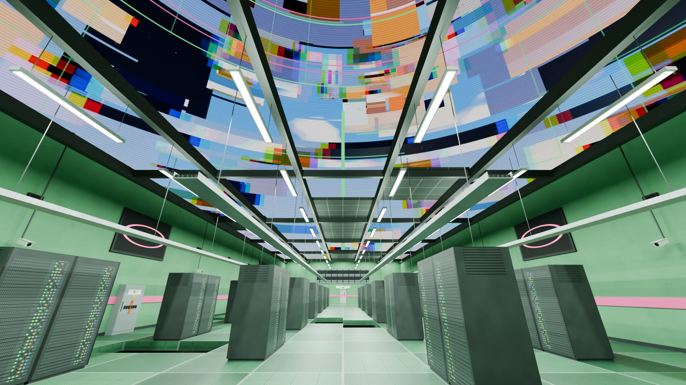
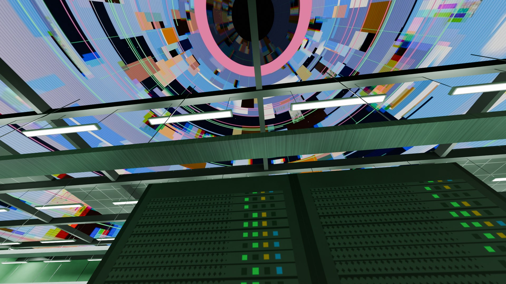
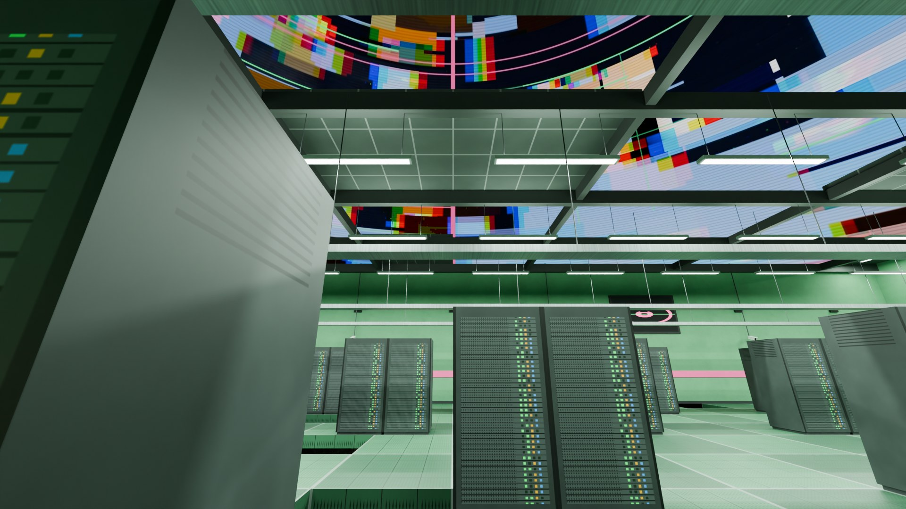
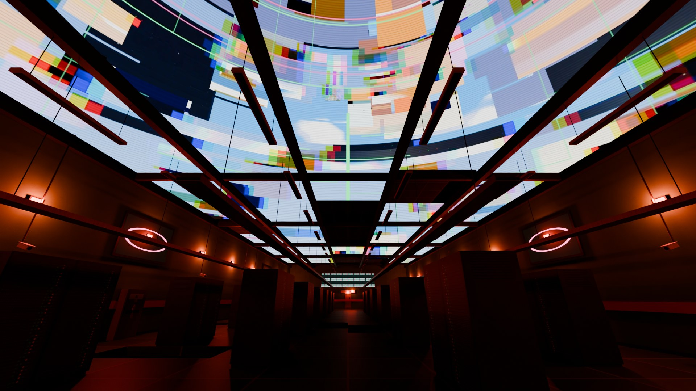

# registrar_hall: the phase-3 glitched sky (R3 backdrop)

`docs/BLENDER_AREAS.md` section 8: "Phase 3 needs a second sky backdrop for the arena, glitched". `docs/WORLD.md` adds: "the arena's sky and geometry glitch, like the four Overworld skies failing". The greybox (`docs/renders/secretops_greybox/README.md`) left it open: the 50 `CeilingPanel_<x>_<z>` objects over the field are what the page opens onto it.

| File | What it is |
|---|---|
| `world/backdrops/registrar_hall_glitch.webp` | the sky: a 4096 x 2048 equirectangular WebP, 374 KB, no EXIF or XMP chunk; middle column north (game -z), right-hand side east (game +x), top row the zenith |
| `tools/blender/build_secretops_sky.py` | builds it (`--stage image`, plain Python), checks it (`--stage check`) and renders the stills (`--stage stills`, Blender, on the arena's saved file without saving it) |
| `docs/renders/registrar_hall_sky/` | four stills: `1_up_east.jpg`, `2_up_north.jpg`, `3_north.jpg` (normal light) and `4_alarm.jpg` (the alarm set), each with 70% of the ceiling panels and some floor panels hidden, as mid-fight in phase 3 |






## Why a backdrop picture, and not a material or a GLB

The coordinator offered two options: an unbaked material, or a separate GLB. I chose a third, the R3 backdrop picture: an equirect, as the four Overworld skies are (`claude/blender-overworld-skies`).

- **The page already has the slot.** `shared/manifest.js` lets a scene name a `backdrop`: equirect pictures of what lies past the scene, `{day, night?}`.
- **It costs no geometry.** There is no mesh, no draw call and no bake. The arena is already over the draw-call budget because of its separate panels.
- **It looks right from every angle.** It shows through any opened panel, up to the zenith, with no seams against the arena's walls.
- **The arena is untouched.** Its GLB, its layout file and its lightmaps are unchanged.

How the page could use it:
- **Background:** set the arena's background to this picture when phase 3 starts, as the arena's `backdrop` or a phase-3 swap; hide `CeilingPanel_*` as the fight goes on.
- **Light:** the arena's lighting stays its own (its bake, normal or alarm). The sky adds no light, as in the stills, where it is seen by camera rays only.

## The picture

`--stage image` composes it with numpy from the four Overworld sky backdrops (clear day, sunset, night, painted). Those are procedural, the skies branch's own work, so there is nothing to license. The composition:

- **Torn sectors:** the four skies are cut into bearing sectors, and each horizontal band picks its own edges and its own sky.
- **Slid rows:** rows are slid sideways, more of them toward the zenith.
- **Blocks:** 260 blocks are copied out of place, posterised, channel-swapped or inverted.
- **Split colour:** the colour channels are split in some bands.
- **The arena's grid:** its green grid shows through in a checker of sectors.
- **Scanlines:** scanlines, with thin pink and green lines across.
- **Seams:** a pink seam due north from the horizon to 70 degrees, and a green one due east to 40 degrees.
- **The eye:** the Registrar's eye at the zenith, looking down through the open ceiling. It is a pink ring at 75 to 77 degrees elevation, a dark pupil from 84 degrees, and a green slit along the north-south line.
- **Below the horizon:** dimmed to between 0.45 and 0.15, so the pit and the walls stay the arena's.

The picture is capped at 0.965, so it never clips on the page, which draws a backdrop as it is.

## Gates

```
python tools/blender/build_secretops_sky.py --stage check
PASS  size       373930 bytes (at most 1000000)
PASS  shape      4096 x 2048 (2:1 equirect)
PASS  chunks     RIFF chunks ['VP8 '] (no EXIF, no XMP)
PASS  north seam (pink) column 2048: 99% of its pixels are the seam's colour; the mirrored bearing's column 0%
PASS  east seam (green) column 3072: 100% of its pixels are the seam's colour; the mirrored bearing's column 0%
PASS  eye        the pink ring round the zenith covers 100% of its rows (elevation 75 to 76.5 degrees)
PASS  brightness upper half as shown (linear, max channel): p50 0.451, p90 0.871, p99 0.956, max 1.000
SKY CHECK PASS
```

| Gate | Result |
|---|---|
| Orientation in the stills | The world maps the picture through a -90 degree turn (Blender's equirect centre faces +X; game north is Blender +Y). The eye's ring is overhead in `2_up_north.jpg`. |
| `check_layout` on the arena, in the stills run before anything is hidden | `PASS: 322 of 322 checks passed` |
| The arena's own files | `world/registrar_hall.json`, `.glb`, lightmaps and `.blend` are unchanged (`git diff` is empty) |
| Greybox `--check` | `GATES PASS` |
| `node --test shared/*.test.js` | 297 pass, 0 fail |
| Privacy grep | the WebP, the stills and the script: 0 hits |
