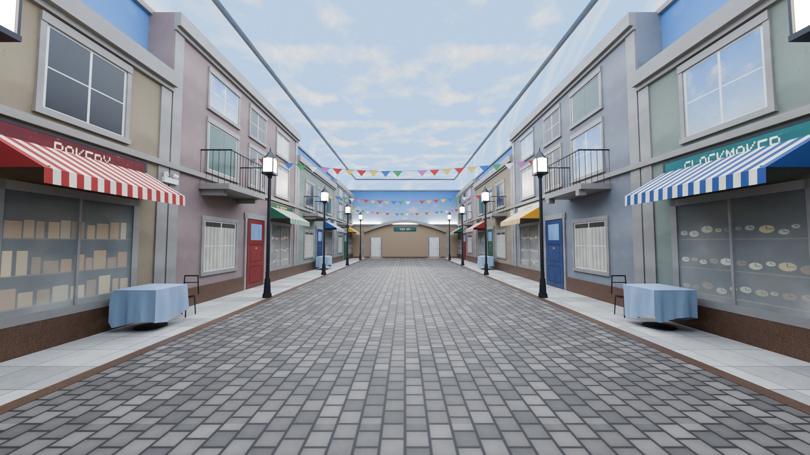
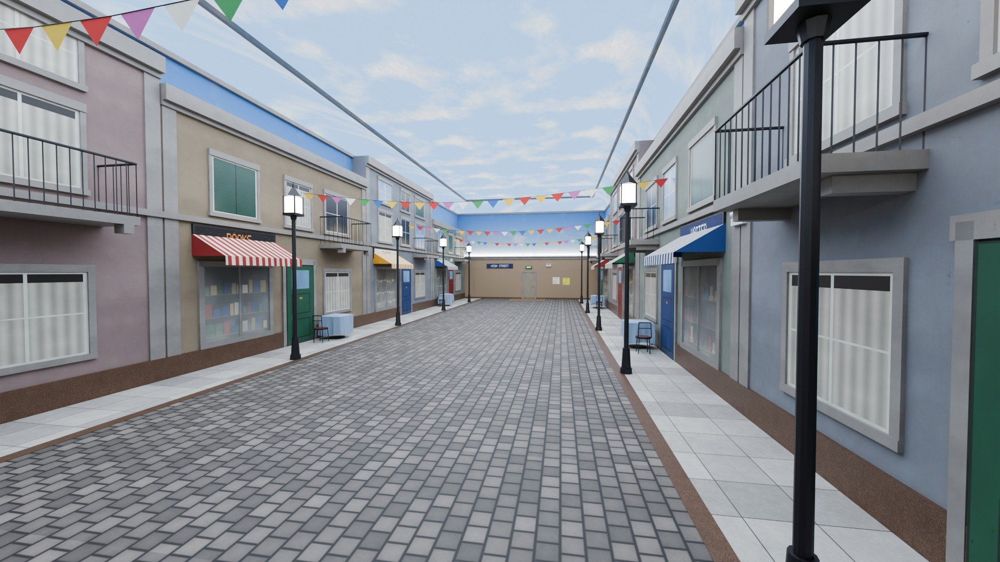
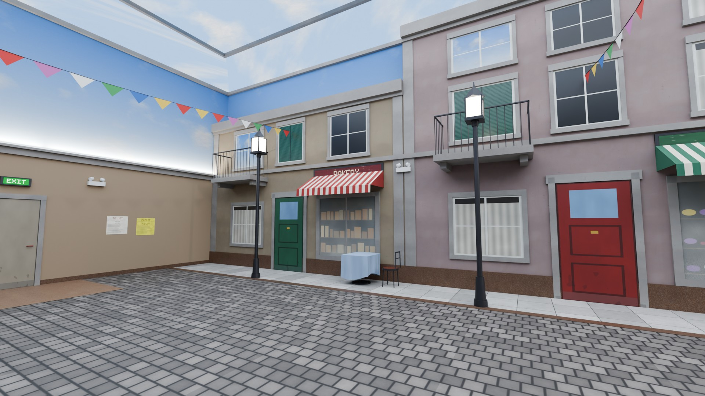

# scene_3012: the painted-sky street

Dressed and lit from the mall greybox (`docs/BLENDER_AREAS.md` section 3; the greybox is draft PR #110, `tools/blender/build_mall_greybox.py`). One of the mall's four painted-sky scenes: a dreamlike mall interior under a painted sky. The photo name is a label only; there are no reference photos, so everything follows the greybox's reading of the space and the written descriptions. Built in Blender 5.2.1 by `tools/blender/build_mall_sky.py` (one script for the four scenes, `--scene scene_3012`), baked twice (the day set and the emergency set on the same lightmap UVs) and exported as art only.

| File | What it is |
|---|---|
| `world/scene_3012.glb` | the art: 2.07 MB, 14300 triangles, 30 draw calls (one primitive per material, each door leaf its own node, origin at its hinge), textures WebP |
| `world/scene_3012.json` | the layout, written by `tools/blender/export_scene.py` from the `.blend`: the greybox's file, unchanged (the same JSON, key for key) |
| `world/lightmaps/scene_3012_0.webp`, `_1.webp` | the day set (second UV set, `TEXCOORD_1`): the material's `lightmap` |
| `world/lightmaps/scene_3012_2.webp`, `_3.webp` | the emergency set on the same UVs: `lightmap_night` |
| `blender/scenes/scene_3012.blend` | the saved scene (9.7 MB, Git LFS): `Art` (the unmerged pieces), `Doors` (the leaves), `Layout` (the `COL_` boxes and the empties, the greybox's names), `Export` (merged by material, with the lightmap UVs), `Standins`, `Lights_Day`, `Lights_Night`, `Lights_Always` |
| `tools/blender/build_mall_sky.py` | the re-runnable build; it imports the greybox model, so no coordinate of the layout is typed in |
| `blender/textures/mall_sky/` | the CC0 texture files (below), copied from the wings' and the kit's sets |
| `docs/renders/scene_3012/` | the three review stills (this folder) |

The shared tools are reused unchanged: `export_scene.py`, `check_layout.py`, `pack_scene.py`, `tools/webp_glb.py`. The other painted-sky scenes come from the same script, and their READMEs sit beside this one.

## What is in it

**The painted-sky street** (32 m by 12 m, 8 m to the sky; off `wing_cinema` by an unmarked door at the west end, two sky-hall doors at the east end).
- Eight house fronts on the greybox's boxes, in ochre, rose, mint and powder-blue stucco with stone quoins, a plinth, a string course and a cornice: each has a shop window under a striped awning with its display behind glass (BAKERY, FLORIST, HATTER, TOYS, CLOCKMAKER, SWEETS, BOOKS, TEA ROOM), a cottage window with net curtains under an iron balcony, sash windows above (net curtains, shutters, dark rooms, and some that show the painted sky inside the house), and the painted door on the greybox's door box that does not open.
- A cobbled road between pale flagged pavements and a dark kerb, terrazzo thresholds at the doors; ten cast-iron street lamps with lanterns (`Lamp_Emit`); the four cafe tables under dust sheets with bistro chairs; bunting strung across the street.
- The east end: a white arch between the two sky-hall doors with THIS WAY under its keystone; the west end: HIGH STREET by the way in, TO LET and PLEASE DO NOT TOUCH THE SKY notices.

**The sky, as in the kit's painted-sky hall.** The ceiling is the connector kit's painted sky (`painted_sky_pixels` from `tools/blender/build_kit.py` on `claude/blender-hotel-kit`: the same recipe, palette and soft brushed clouds), carried down a quarter-round cove on every side like a trompe-l'oeil vault, with a white moulding at the cove's foot and at the ceiling's edge. Above a moulded cornice the walls are the kit's sky mural (pale at the horizon, deep blue above). So the sky halls and these rooms read as one place. Below the cornice is the mall's own fabric, as in entrance and the wings: terrazzo in a dark border, beige plaster with terrazzo skirting, painted steel shutters under hand-painted signs, emergency fittings, EXIT over the way back to the wing. Faded and empty, a little wrong.

The mannequins are the page's: every `Spot_mannequin_<n>` is left clear (no dressing within 0.45 m that reaches from its floor to head height, the art of the greybox's own standing solids aside: a bench it sits on, the carousel's deck, the escalator's steps), and so is every link's `at` and `arrive` point.

## Light

| Set | Light | Maps | Material property |
|---|---|---|---|
| day | the day's sky light under the vault (a large soft area), the uplights in the cornice troughs, the floods high on the walls, the room's lamps (`Lamp_Emit` on), the painted sky's own glow | `scene_3012_0`, `scene_3012_1` | `lightmap`, `lightmap_intensity` |
| emergency | the emergency heads (`Emergency_Emit` on, `Lamp_Emit` off) and the painted sky's glow: the mall locked from 20:00 | `scene_3012_2`, `scene_3012_3` | `lightmap_night`, `lightmap_night_intensity` |

**The painted sky glows at all hours.** The ceiling, the coves and the walls' top band are `Sky_Glow`: emission only (base colour black), exported at strength 1 so the page shows the painted sky's own colours, unlit and unbaked, day and night. It is not in `ART_TOGGLES` and nothing switches it, so the room never goes fully dark; in the bakes it is a soft light source in both sets.

The toggled materials are entrance's, switched the same way by the clock: `Lamp_Emit` (strength 10) is on by day and off while the mall is locked; `Emergency_Emit` (strength 6) is on only while it is locked. `Sign_Exit` is emissive and always on. `Window_Lit` does not occur. So the mall's `setLightSet(lk ? "night" : "day")`, `artToggle("Emergency_Emit", lk)` and `artToggle("Lamp_Emit", !lk)` need nothing new.

| Map | Set | Holds | Density | Samples, GPU time | WebP |
|---|---|---|---|---|---|
| `scene_3012_0` | day | the shell: floors, walls below the cornice, the sky mural, borders | 58.8 px/m | 512, 35 s | 84 KB |
| `scene_3012_1` | day | everything in the room, and the door leaves | 28.5 px/m | 512, 45 s | 405 KB |
| `scene_3012_2` | night | the shell: floors, walls below the cornice, the sky mural, borders | 58.8 px/m | 768, 43 s | 79 KB |
| `scene_3012_3` | night | everything in the room, and the door leaves | 28.5 px/m | 768, 49 s | 409 KB |

Cycles on the rented GPU (OptiX), diffuse (direct and indirect, no colour), 8 px margin, OIDN. Faces nobody sees get no texels: the outer skin, faces flat on a floor or against a wall or inside another greybox solid, faces looking up from overhead or down from low down.

**Brightness, the hotel lobby's shoulder.** Each map is written as texel = G L / (C + G L) of the bake's light L, and every baked material's intensity is pi C, so the page shows texture x G L where the light is ordinary and rolls off toward texture x C under a lamp, never clipping. Day: G 2.4, C 1.3; emergency: G 3.0, C 1.1.

## Brightness, as the page shows it

Measured with `lab_display.py` (area-weighted samples over each baked material's triangles, the brightest channel; `>=1` is the share that clips). Day (`lightmap`):

```
material                m2           map       k    p50    p90    p99     >=1
Floor_Cobble         401.8  scene_3012_0  4.0841  0.030  0.165  0.212   0.00%
Sky_Mural            319.7  scene_3012_0  4.0841  0.471  0.605  0.711   0.00%
Trim_Paint           240.5  scene_3012_1  4.0841  0.195  0.249  0.282   0.00%
Facade_Blue          108.0  scene_3012_1  4.0841  0.044  0.218  0.256   0.00%
Facade_Rose          108.0  scene_3012_1  4.0841  0.040  0.229  0.264   0.00%
Floor_Pave            92.8  scene_3012_0  4.0841  0.357  0.441  0.485   0.00%
Facade_Mint           92.0  scene_3012_1  4.0841  0.039  0.202  0.235   0.00%
Facade_Ochre          92.0  scene_3012_1  4.0841  0.045  0.228  0.268   0.00%
Wall_Plaster          79.5  scene_3012_0  4.0841  0.234  0.261  0.266   0.00%
Window_Paint          70.8  scene_3012_1  4.0841  0.341  0.546  0.639   0.00%
Floor_Border          45.3  scene_3012_0  4.0841  0.077  0.124  0.184   0.00%
Door_Leaves           38.9  scene_3012_1  4.0841  0.109  0.452  0.523   0.00%
Metal_Dark            32.6  scene_3012_1  4.0841  0.018  0.053  0.066   0.00%
Glass_Clear           26.6  scene_3012_1  4.0841  0.455  0.531  0.548   0.00%
Shop_Display          26.6  scene_3012_1  4.0841  0.084  0.290  0.468   0.00%
Awning_Stripe         26.2  scene_3012_1  4.0841  0.189  0.701  0.830   0.00%
Floor_Terrazzo        16.3  scene_3012_0  4.0841  0.193  0.289  0.409   0.00%
Sign_Paint             8.7  scene_3012_1  4.0841  0.084  0.372  0.871   0.00%
Cloth_Sheet            5.1  scene_3012_1  4.0841  0.447  0.515  0.550   0.00%
Bunting                3.8  scene_3012_1  4.0841  0.000  0.505  0.752   0.00%
Plastic_White          1.2  scene_3012_1  4.0841  0.378  0.631  0.645   0.00%
Poster_Art             0.6  scene_3012_1  4.0841  0.628  0.688  0.735   0.00%
Bench_Wood             0.5  scene_3012_1  4.0841  0.091  0.134  0.178   0.00%
```

Emergency set (`lightmap_night`, the same measure on the night maps):

```
material                m2           map       k    p50    p90    p99     >=1
Floor_Cobble         401.8  scene_3012_2  3.4558  0.016  0.092  0.119   0.00%
Sky_Mural            319.7  scene_3012_2  3.4558  0.180  0.319  0.347   0.00%
Trim_Paint           240.5  scene_3012_3  3.4558  0.106  0.148  0.180   0.00%
Facade_Blue          108.0  scene_3012_3  3.4558  0.016  0.133  0.157   0.00%
Facade_Rose          108.0  scene_3012_3  3.4558  0.011  0.102  0.120   0.00%
Floor_Pave            92.8  scene_3012_2  3.4558  0.216  0.270  0.308   0.00%
Facade_Mint           92.0  scene_3012_3  3.4558  0.014  0.107  0.126   0.00%
Facade_Ochre          92.0  scene_3012_3  3.4558  0.012  0.102  0.125   0.00%
Wall_Plaster          79.5  scene_3012_2  3.4558  0.101  0.148  0.168   0.00%
Window_Paint          70.8  scene_3012_3  3.4558  0.185  0.313  0.371   0.00%
Floor_Border          45.3  scene_3012_2  3.4558  0.037  0.063  0.097   0.00%
Door_Leaves           38.9  scene_3012_3  3.4558  0.060  0.268  0.367   0.00%
Metal_Dark            32.6  scene_3012_3  3.4558  0.006  0.030  0.039   0.00%
Glass_Clear           26.6  scene_3012_3  3.4558  0.267  0.323  0.339   0.00%
Shop_Display          26.6  scene_3012_3  3.4558  0.038  0.130  0.215   0.00%
Awning_Stripe         26.2  scene_3012_3  3.4558  0.077  0.403  0.508   0.00%
Floor_Terrazzo        16.3  scene_3012_2  3.4558  0.107  0.167  0.244   0.00%
Sign_Paint             8.7  scene_3012_3  3.4558  0.043  0.192  0.492   0.00%
Cloth_Sheet            5.1  scene_3012_3  3.4558  0.280  0.351  0.387   0.00%
Bunting                3.8  scene_3012_3  3.4558  0.000  0.222  0.405   0.00%
Plastic_White          1.2  scene_3012_3  3.4558  0.328  0.729  0.750   0.00%
Poster_Art             0.6  scene_3012_3  3.4558  0.346  0.384  0.413   0.00%
Bench_Wood             0.5  scene_3012_3  3.4558  0.042  0.064  0.083   0.00%
```

`Sky_Glow`, `Lamp_Emit`, `Emergency_Emit` and `Sign_Exit` carry no lightmap.

Two low p50s are texels nobody sees, not dark surfaces: `Floor_Cobble` counts the road under the pavement strips (a decal 3 mm up covers it), and the `Facade_*` materials count the stucco behind the window panels and shop displays laid 1 cm in front of it. Where they show, the cobbles read at about 0.15 to 0.2 (a dark stone) and the stucco at about 0.2 to 0.27.

## Review stills (Cycles, 128 samples adaptive, OIDN, 1920 x 1080 JPEG, AgX, the day set)

| | |
|---|---|
| `1_arrival.jpg` (395 KB) | from the arrival point by the wing's door at eye height 1.6 m, facing the arrival's `face` |
| `2_wide.jpg` (375 KB) | the whole room |
| `3_detail.jpg` (350 KB) | a closer look |





Blender renders with Blender's lights; the page shows the lightmaps instead. A night still, a look up and a plan were rendered for the owner's sheet only.

## Sources and licences

| Texture | Used for | Source | Author (Poly Haven) | Licence |
|---|---|---|---|---|
| `terrazzo_tiles` diffuse, 1k | the floors (light), the borders, steps, skirting and planters (dark) | https://polyhaven.com/a/terrazzo_tiles | Amal Kumar | CC0 1.0 |
| `painted_metal_shutter` diffuse, 1k | the roller shutters | https://polyhaven.com/a/painted_metal_shutter | Charlotte Baglioni, Dario Barresi, Rico Cilliers | CC0 1.0 |
| `beige_wall_001` diffuse, 1k | the walls below the cornice, the gallery's soffit | https://polyhaven.com/a/beige_wall_001 | Dimitrios Savva, Rico Cilliers | CC0 1.0 |
| `plastered_wall_04` diffuse, 1k | the white trim, cornices and casings; the house fronts' stucco (tinted) | https://polyhaven.com/a/plastered_wall_04 | Rob Tuytel | CC0 1.0 |
| `dark_wood` diffuse, 1k | benches, the bandstand's and the carousel's decks, the kiosk, the trunks | https://polyhaven.com/a/dark_wood | Dario Barresi, Dimitrios Savva, Rico Cilliers | CC0 1.0 |
| `rough_linen` diffuse, 512 | the dust sheets over the street's cafe tables | https://polyhaven.com/a/rough_linen | colormass, Rico Cilliers | CC0 1.0 |
| `concrete_floor_02` diffuse, 1k | in the material list of two scenes, unused in the GLB | https://polyhaven.com/a/concrete_floor_02 | Rob Tuytel | CC0 1.0 |

All are Poly Haven files already in the repo's branches (the wings' `blender/textures/mall_wings/` and the kit's `blender/textures/kit/`), copied byte for byte; nothing new was downloaded. Everything else is own work made by `build_mall_sky.py`: all geometry, and the generated pictures drawn with numpy from fixed seeds: the painted skies (the kit's recipe), the sign atlas (entrance's 5 x 7 pixel font, hand-painted), the poster atlas (notices, holiday posters, the directory, the street's shop displays, windows of sky), the door leaves (unmarked, the kit's white panel door, painted house doors), the EXIT sign, the wall dust; and per scene the court's mosaic, awning stripes, cobbles, paving, house windows, bunting, rubber tiles, soft-play padding, netting, the ball pit, the carousel's painted parts, escalator treads. No Meshy, no Higgsfield, no purchase, no photograph.

## Budgets (measured)

| | Limit | Measured |
|---|---|---|
| `world/scene_3012.glb`, lightmaps aside | at most 8 MB | **2.07 MB** (`glb_inspect.py --budget tris=300000,mb=8`: pass) |
| triangles | at most 300 000 | **14300** (pass) |
| draw calls | at most 250 | **30** |
| textures | WebP | all `image/webp` (`tools/webp_glb.py`) |
| lightmaps | at most 4, 2048 x 2048, 8-bit WebP q90 | **4**: two day maps and their two emergency twins |

## Checks

- **Layout check** (`tools/blender/check_layout.py` on the `.blend`'s `Art`, through `--stage check`): PASS: 48 of 48 checks passed (46 colliders covered; STRAY: 115 tall solid mesh(es), each over a collider; 57 decor_* mesh(es) exempt; CLEAR: the spawn and every link point).
- **Mannequins and links clear** (the build's own check, same stage): KEEP PASS: 10 of 10 places clear.
- **Same layout:** `export_scene.py` writes `world/scene_3012.json` from the `.blend`; it equals the greybox's file (compared as JSON). `python tools/blender/build_mall_greybox.py --check .` still prints GATES PASS.
- `node tools/worlddoc.mjs check world/scene_3012.json`: OK world/scene_3012.json: 46 colliders, 3 doors, 1 markers, 3 links, 0 zones, 4 spots, 0 errors, 4 warnings (each says the scene or a link is new to the manifest).
- **Axes** (`--stage axes`): the marker at the arrival point comes out of the exporter where the game expects it (AXES PASS).
- `node --test shared/*.test.js`: 297 tests, 297 pass.
- **Privacy:** the `.blend` (decompressed), the GLB, the layout file, the lightmaps and the stills hold no user name, absolute path, session id or e-mail; the stills' JPEG comment and APP1 segments are stripped; the GLB's extras are only the four lightmap properties and the doors' properties.

## Rebuild

From the repo root, with Blender 5.2 and Python with Pillow:

```
blender -b --python tools/blender/build_mall_sky.py -- --scene scene_3012 --stage art,check --work <work>      # art, layout file, layout check
blender -b blender/scenes/scene_3012.blend --python tools/blender/build_mall_sky.py -- --scene scene_3012 --stage bake,export,axes --samples 512 --work <work>
blender -b blender/scenes/scene_3012.blend --python tools/blender/build_mall_sky.py -- --scene scene_3012 --stage render --work <work>   # --set night for the emergency set
python tools/blender/pack_scene.py scene_3012 --work <work>
```

## What the coordinator does to wire it in

1. Add `world/scene_3012.glb` and `world/scene_3012.json` to the scene's files in the manifest, with the greybox's links (listed in the greybox README).
2. Apply the lightmaps with `applyLightmaps` and the mall's clock toggles, as for entrance. `Sky_Glow` needs nothing: it is an ordinary emissive material.
3. Draw the mannequins at the `Spot_mannequin_<n>` places; swing the door leaves by name (`DoorLeaf_<id>` nodes, origin at the hinge).

## Open

- The page's view of the bake has not been seen in a browser; the first in-game screenshot is the first look at it under the page's shading, and at how the unlit `Sky_Glow` sits beside the baked mural.
- The sky-hall doors' far side is the kit's sky hall (`world/kit/sky_hall.glb`); its sky and this one share the recipe but not the bake.
