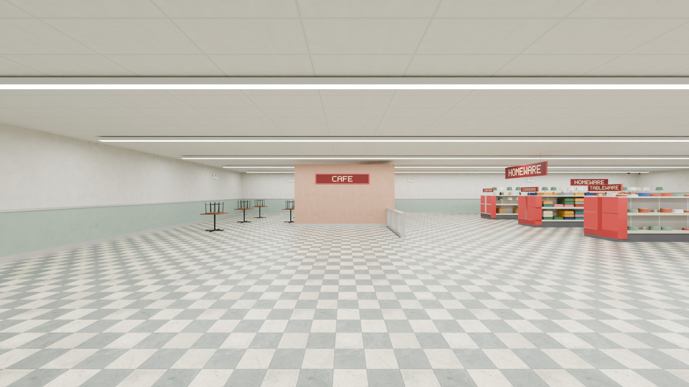
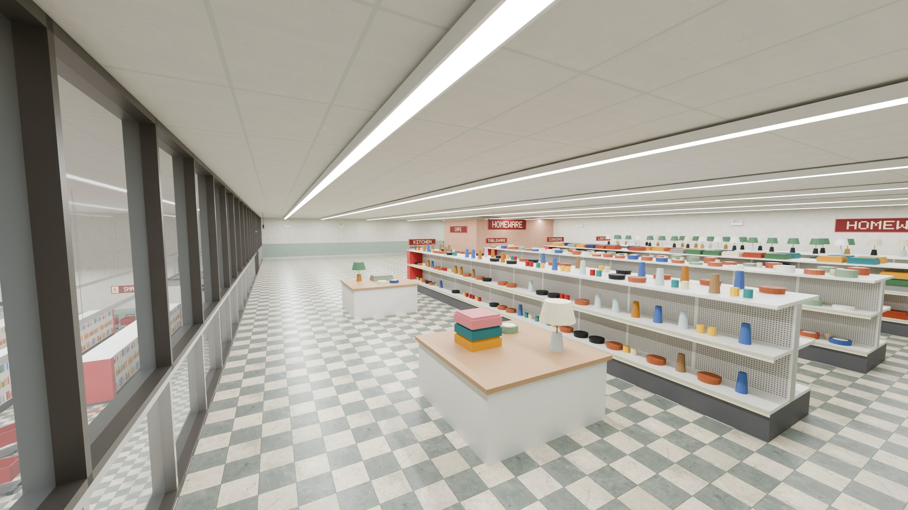
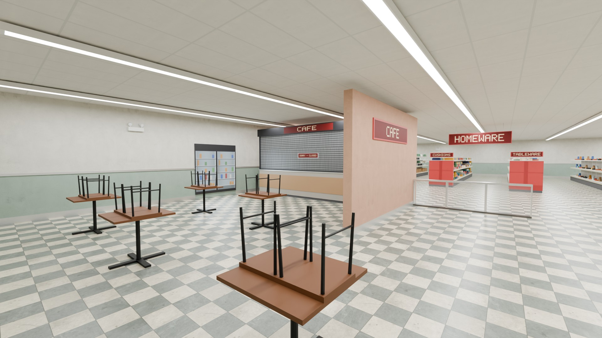

# second_floor: the grocery's mezzanine

The grocery's third scene (`docs/BLENDER_AREAS.md`, section 2, step 2: dress and light), built round the greybox (`claude/blender-grocery-greybox`, draft PR #108). A mezzanine over the west half of `aisles`: homeware, a closed café and a glass front looking down over the aisles. It uses part 1's `main_floor` look, so the store reads as one. Built in Blender 5.2.1 by `tools/blender/build_grocery_front.py --scene second_floor`, baked twice (day and night on the same lightmap UVs) and exported as art only. There are no reference photos.

| File | What it is |
|---|---|
| `world/second_floor.glb` | the art: 4.61 MB, 50296 triangles, 44 draw calls (one primitive per material, and the two glass door leaves as their own nodes), 40 materials, textures as WebP |
| `world/second_floor.json` | the layout, written by `tools/blender/export_scene.py` from the `.blend`: 38 colliders, 2 doors, 1 marker, 2 links, 5 spots. It is the greybox's file unchanged |
| `world/lightmaps/second_floor_0.webp`, `_1.webp` | the day set (`TEXCOORD_1`): the shell and the view down's shell, the fittings |
| `world/lightmaps/second_floor_2.webp`, `_3.webp` | the night set on the same UVs |
| `blender/scenes/second_floor.blend` | the saved scene (Git LFS), the same collections as `aisles.blend` |
| `tools/blender/build_grocery_front.py` | the re-runnable build for `aisles` and `second_floor` (it imports the greybox model) |
| `docs/renders/second_floor/` | the three review stills (this folder) |

The shared tools are used unchanged (`export_scene.py`, `check_layout.py`, `pack_scene.py`, `tools/webp_glb.py`); main_floor's three textures are read from `blender/textures/main_floor/` as they are.

## Review stills (Cycles, 128 samples adaptive, OIDN, 1920 x 1080 JPEG, AgX, exposure 0, the day set)

| | |
|---|---|
| `1_arrival.jpg` | the arrival point (-4.9, -22) just inside the glass doors, at eye height 1.6 m, facing its `face` (west), 75 degrees vertical |
| `2_wide.jpg` | homeware from the north-east corner, by the glazed front |
| `3_detail.jpg` | the closed café: the shutter down, CAFE over it, SORRY - CLOSED, the chairs up on the tables, the drinks fridge |





Night stills, the view down and a plan were rendered for the owner's sheet only.

## What is in it

The room is the greybox's 20 m by 30 m by 3.2 m mezzanine (x -24 to -4.2, z -44.2 to -14.2), its floor at y 0 (5 m above the aisles):

- **main_floor's look:** the checker tiles, the sage band under the steel rail, cream walls, the lay-in ceiling with surface strips (`Lamp_Emit`), white gondolas with pegboard spines, price rails and red end panels, red boards in the same lettering, the same EXIT sign.
- **Homeware:** the greybox's four low gondolas (1.5 m) with boards at 0.35 and 0.95 m and a full top shelf, each with a header card on its red end cap: LIGHTING (table lamps with linen, white and green drum shades, unlit, and boxed lamps), CUSHIONS (stacks in eight colours), TABLEWARE (stacks of plates in four glazes, mugs), KITCHEN (mugs, pans, vases, jars); a few gaps where the stock ran down. Two display tables (a light wood top on a white base) with cushions, a lamp, plates and folded towels. A HOMEWARE board hung over the cross walk and one on the west wall.
- **The closed café** in the south-west corner: terracotta partitions (CAFE also on the east face, toward the doors), the counter (laminate, a steel top, a wood band) with its steel roller shutter down, the shutter box with the CAFE board, a SORRY - CLOSED card on the shutter, a two-door drinks fridge still lit on the west wall, five tables with two chairs each upside down on them (legs up), a glass screen along the barrier.
- **The glass front:** a glass balustrade (steel posts, a steel handrail, glass) under a glazed screen in aluminium mullions up to the ceiling, the two glass doors (`DoorLeaf_glass_stairs`, `_escalator`) in aluminium frames, an EXIT sign hung inside over them.
- **The landing** outside the doors, railed in glass on three sides, with the stairs and the stopped escalator going down beyond its south rail.
- **The view down** (art only, all `decor_below_*`): the aisles 5 m below as `aisles` is dressed, simplified where far: the floor, walls and ceiling, the east gondolas with stocked shelves (a picture: the page fills the real ones), the red end caps, the wall shelving, the south wall's coolers (lit), the clearing's paint with eight plain red carts and the corral's three, the aisle boards and strips, the full stairs and escalator, the emergency fittings and the EXIT sign.
- **A bracket** for the page's camera head (`Spot_camhead_1`) and eight emergency fittings (`Emergency_Emit`).

The page draws the camera head, the cart by the glass (`Spot_cart_1`), the night threats (`Spot_monster_1`, `_2`) and whatever stands at the lookout (`Spot_lookout_1`); their spots are left clear.

## Light

| Set | Light | Maps | Material property |
|---|---|---|---|
| day | the strips (`Lamp_Emit` on), the aisles' strips below, the fridge and the coolers below, the EXIT signs | `second_floor_0`, `_1` | `lightmap`, `lightmap_intensity` |
| night | the emergency heads (`Emergency_Emit` on, `Lamp_Emit` off) here and below, the fridge's and the coolers' glow, the EXIT signs | `second_floor_2`, `_3` | `lightmap_night`, `lightmap_night_intensity` |

The page toggles `Lamp_Emit` (day) and `Emergency_Emit` (night) as in `aisles`; `Cooler_Lit` and `Sign_Glow` glow at every hour.

| Map | Set | Size | Materials | Density | Samples, GPU time | WebP |
|---|---|---|---|---|---|---|
| `second_floor_0` | day | 2048 | the shell, the cafe's walls, the view down's floor, walls and ceiling | 45.3 px/m | 512, 50 s | 104 KB |
| `second_floor_1` | day | 2048 | the fittings, the goods, the cafe, the view down's fittings, the two leaves | 29.9 px/m | 512, 72 s | 530 KB |
| `second_floor_2` | night | 2048 | as `second_floor_0` | the same UVs | 768, 99 s | 114 KB |
| `second_floor_3` | night | 2048 | as `second_floor_1` | the same UVs | 768, 80 s | 487 KB |

The same method as `aisles` (see its README): the shoulder texel = G L / (C + G L) with C 1.15 and intensity pi C; G set per set so the walls' median reads (day G 0.7, night G 9.3972); unseen and buried faces dropped (990 buried), thin faces laid on their neighbours' edges; 8 px margins on the shell's map, 4 px on the fittings'.

**Density:** the shell's map holds the room at 45.3 px/m (the ceiling 27.3) and the view down's shell at 9 to 18 px/m; the fittings' map holds 29.9 px/m (the goods 23, the view down's stock 15).

## Brightness, as the page shows it

Day (`lightmap`):

```
material                m2           map       k    p50    p90    p99     >=1
Below_Ceiling       1147.4 second_floor_0  3.6128  0.260  0.300  0.319   0.00%
Below_Floor         1139.3 second_floor_0  3.6128  0.122  0.358  0.442   0.00%
Below_Stock          723.5 second_floor_1  3.6128  0.262  0.326  0.402   0.00%
Below_Wall           700.2 second_floor_0  3.6128  0.219  0.328  0.406   0.00%
Floor_Tile           629.7 second_floor_0  3.6128  0.149  0.411  0.492   0.00%
Ceiling_Tile         614.1 second_floor_0  3.6128  0.252  0.291  0.311   0.00%
Shelf_Paint          590.8 second_floor_1  3.6128  0.404  0.556  0.562   0.00%
Paint_Palette        281.8 second_floor_1  3.6128  0.045  0.227  0.439   0.00%
EndCap_Red           154.1 second_floor_1  3.6128  0.112  0.269  0.296   0.00%
Wall_Paint           140.8 second_floor_0  3.6128  0.302  0.375  0.417   0.00%
Light_Housing        131.6 second_floor_1  3.6128  0.263  0.877  0.893   0.00%
Below_Lower          111.8 second_floor_0  3.6128  0.000  0.161  0.194   0.00%
Shelf_Back           102.5 second_floor_1  3.6128  0.132  0.203  0.240   0.00%
Shelf_Kick            87.7 second_floor_1  3.6128  0.000  0.049  0.054   0.00%
Wall_Lower            84.5 second_floor_0  3.6128  0.185  0.213  0.231   0.00%
Cafe_Wall             70.8 second_floor_0  3.6128  0.224  0.299  0.368   0.00%
Frame_Alu             53.8 second_floor_1  3.6128  0.050  0.076  0.087   0.00%
Trim_Steel            52.9 second_floor_0  3.6128  0.176  0.321  0.359   0.00%
Sign_Dept             35.7 second_floor_1  3.6128  0.084  0.454  0.529   0.00%
Esc_Clad              33.2 second_floor_1  3.6128  0.037  0.165  0.334   0.00%
Price_Rail            29.8 second_floor_1  3.6128  0.228  0.399  0.441   0.00%
Rail_Steel            21.6 second_floor_1  3.6128  0.231  0.405  0.491   0.00%
Metal_Dark            20.1 second_floor_1  3.6128  0.007  0.018  0.044   0.00%
Wood_Light            17.2 second_floor_1  3.6128  0.199  0.301  0.311   0.00%
Counter_Laminate      17.0 second_floor_1  3.6128  0.037  0.164  0.202   0.00%
Shutter_Steel         16.6 second_floor_1  3.6128  0.079  0.132  0.158   0.00%
Stair_Tread           13.1 second_floor_1  3.6128  0.022  0.041  0.053   0.00%
Soffit_Paint          11.3 second_floor_0  3.6128  0.001  0.015  0.186   0.00%
Cooler_Frame          10.4 second_floor_1  3.6128  0.026  0.028  0.031   0.00%
Counter_Top           10.0 second_floor_1  3.6128  0.001  0.271  0.289   0.00%
Esc_Tread              9.7 second_floor_1  3.6128  0.123  0.195  0.213   0.00%
Handrail_Black         3.1 second_floor_1  3.6128  0.008  0.015  0.016   0.00%
Plastic_White          2.7 second_floor_1  3.6128  0.307  0.440  0.478   0.00%
Plastic_Black          0.4 second_floor_1  3.6128  0.009  0.014  0.020   0.00%
```

Night (`lightmap_night`):

```
material                m2           map       k    p50    p90    p99     >=1
Below_Ceiling       1147.4 second_floor_2  3.6128  0.129  0.362  0.453   0.00%
Below_Floor         1139.3 second_floor_2  3.6128  0.038  0.196  0.564   0.00%
Below_Stock          723.5 second_floor_3  3.6128  0.076  0.252  0.466   0.00%
Below_Wall           700.2 second_floor_2  3.6128  0.140  0.347  0.592   0.00%
Floor_Tile           629.7 second_floor_2  3.6128  0.084  0.308  0.514   0.00%
Ceiling_Tile         614.1 second_floor_2  3.6128  0.134  0.252  0.477   0.00%
Shelf_Paint          590.8 second_floor_3  3.6128  0.105  0.323  0.625   0.00%
Paint_Palette        281.8 second_floor_3  3.6128  0.013  0.122  0.355   0.00%
EndCap_Red           154.1 second_floor_3  3.6128  0.025  0.328  0.492   0.00%
Wall_Paint           140.8 second_floor_2  3.6128  0.189  0.335  0.456   0.00%
Light_Housing        131.6 second_floor_3  3.6128  0.128  0.318  0.527   0.00%
Below_Lower          111.8 second_floor_2  3.6128  0.000  0.342  0.397   0.00%
Shelf_Back           102.5 second_floor_3  3.6128  0.041  0.170  0.406   0.00%
Shelf_Kick            87.7 second_floor_3  3.6128  0.000  0.037  0.082   0.00%
Wall_Lower            84.5 second_floor_2  3.6128  0.093  0.218  0.353   0.00%
Cafe_Wall             70.8 second_floor_2  3.6128  0.144  0.326  0.370   0.00%
Frame_Alu             53.8 second_floor_3  3.6128  0.026  0.058  0.104   0.00%
Trim_Steel            52.9 second_floor_2  3.6128  0.085  0.244  0.394   0.00%
Sign_Dept             35.7 second_floor_3  3.6128  0.050  0.234  0.699   0.00%
Esc_Clad              33.2 second_floor_3  3.6128  0.018  0.136  0.258   0.00%
Price_Rail            29.8 second_floor_3  3.6128  0.056  0.292  0.608   0.00%
Rail_Steel            21.6 second_floor_3  3.6128  0.135  0.271  0.475   0.00%
Metal_Dark            20.1 second_floor_3  3.6128  0.003  0.023  0.042   0.00%
Wood_Light            17.2 second_floor_3  3.6128  0.049  0.321  0.360   0.00%
Counter_Laminate      17.0 second_floor_3  3.6128  0.005  0.254  0.336   0.00%
Shutter_Steel         16.6 second_floor_3  3.6128  0.022  0.188  0.230   0.00%
Stair_Tread           13.1 second_floor_3  3.6128  0.011  0.037  0.053   0.00%
Soffit_Paint          11.3 second_floor_2  3.6128  0.001  0.010  0.074   0.00%
Cooler_Frame          10.4 second_floor_3  3.6128  0.032  0.043  0.052   0.00%
Counter_Top           10.0 second_floor_3  3.6128  0.001  0.071  0.228   0.00%
Esc_Tread              9.7 second_floor_3  3.6128  0.061  0.134  0.172   0.00%
Handrail_Black         3.1 second_floor_3  3.6128  0.006  0.012  0.014   0.00%
Plastic_White          2.7 second_floor_3  3.6128  0.329  0.777  0.897   0.00%
Plastic_Black          0.4 second_floor_3  3.6128  0.020  0.032  0.034   0.00%
```

By day nothing passes p90 0.88 or p99 0.90 (the strips' housings); the walls read at p50 0.302. At night the walls read at p50 0.189, the floor at 0.084: dark, lit in pools round the emergency heads, with the aisles' strips off below. Nothing clips.

## The layout

Nothing was added or moved: `world/second_floor.json` is the greybox's file, written again from the `.blend` and identical. Passable art is `decor_`: the chairs up on the tables, and everything in the view down. The drinks fridge stands 5 cm off the west wall.

`--stage check` (`tools/blender/check_layout.py` on `Art`): **PASS: 40 of 40 checks passed** (38 COVER, STRAY, CLEAR: the spawn clear within 0.28 m).

`node tools/worlddoc.mjs check world/second_floor.json`:

```
warning: scene second_floor is not in the world manifest yet: a new scene to add
  warning: link escalator_down: the manifest has no link from this door yet: a new link to add
  warning: link stairs_down: the manifest has no link from this door yet: a new link to add
OK world/second_floor.json: 38 colliders, 2 doors, 1 markers, 2 links, 0 zones, 5 spots, 0 errors, 3 warnings
```

`glb_inspect.py --budget tris=300000,mb=8`: `pass tris: 50296 triangles`, `pass mb: 4.39 MB`. The axes check (`--stage axes`): game (-4.9, 0.1, -22) is glTF (-4.9, 0.1, -22).

## Sources and licences

As `aisles`: main_floor's three CC0 textures (from Poly Haven's `floor_tiles_06`, `polystyrene`, `painted_plaster_wall`), read from `blender/textures/main_floor/`; nothing was downloaded. Everything else is own work, made by `build_grocery_front.py`: all geometry (the lamps, cushions, plates, chairs and carts too), and generated images drawn with numpy from fixed seeds: main_floor's pegboard, cooler interior and EXIT sign, the sign atlas, a palette of flat swatches for the goods, the roller shutter, and the stocked shelf of the view down. No Meshy, no Higgsfield, no paid service, no photograph.

## Rebuild

```
blender -b --python tools/blender/build_grocery_front.py -- --scene second_floor --stage art,bake,export,axes,render
blender -b blender/scenes/second_floor.blend --python tools/blender/build_grocery_front.py -- --scene second_floor --stage render --set night --work-stills
python tools/blender/pack_scene.py second_floor --work work/second_floor
```

## For the coordinator

- Add `world/second_floor.glb` and its links `stairs_down` and `escalator_down` (to `aisles`' `stairs_up` and `escalator_up`). `applyLightmaps` handles the four maps.
- Light set as `aisles`: night = `Lamp_Emit` off, `Emergency_Emit` on, `lightmap_night`.
- The two leaves are nodes `DoorLeaf_glass_stairs` and `DoorLeaf_glass_escalator`, origin at the hinge.
- The view down is art in this file, at y -5 to 3.5; the page needs nothing for it.

## Open

- The view down shows the aisles' stock as a picture and carts as plain red boxes on wheels, and does not change when the page moves the real carts in `aisles`.
- The glass reads a little milky in the view down (main_floor's `Window_Glass`, alpha 0.12, under a bright hall); the page draws it the same way.
