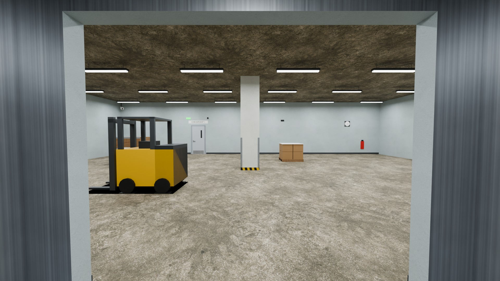
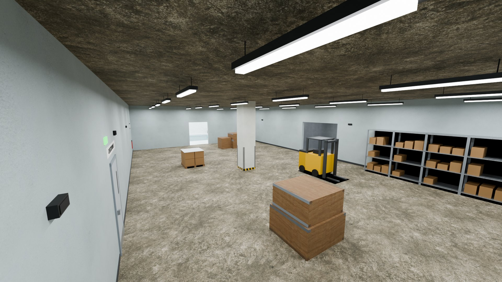
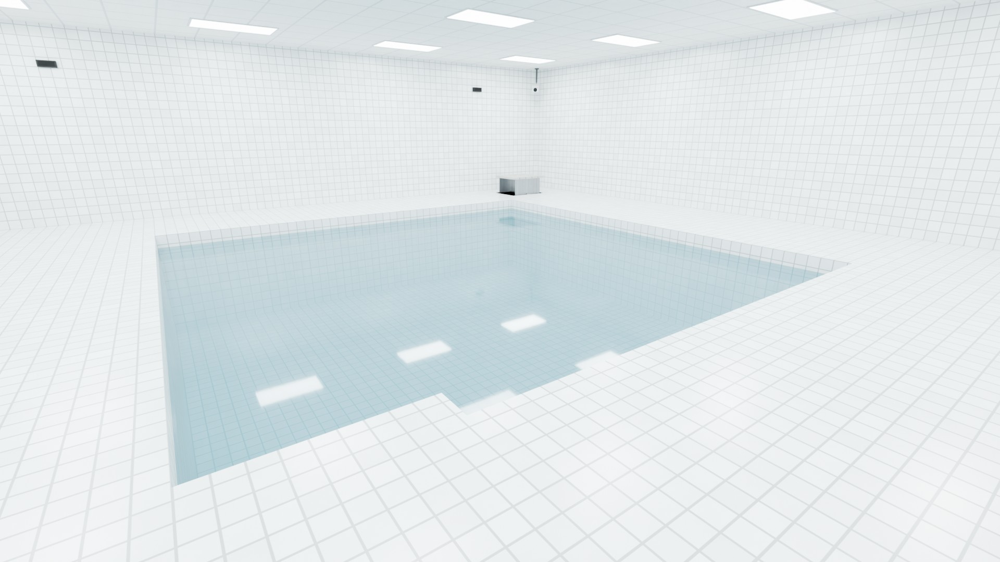
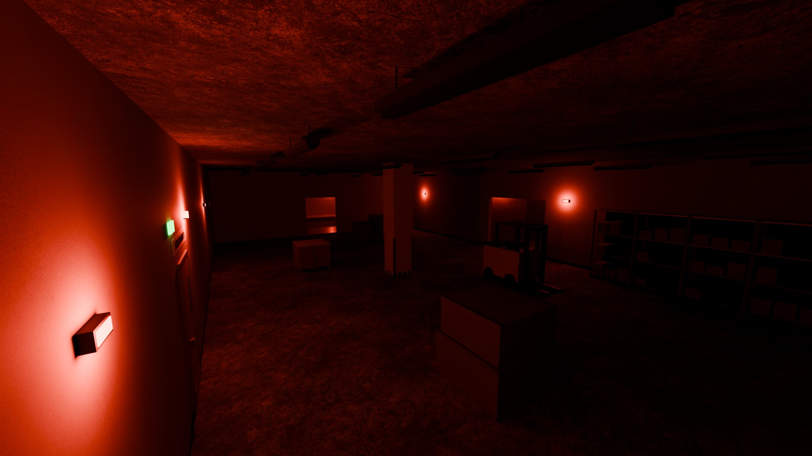
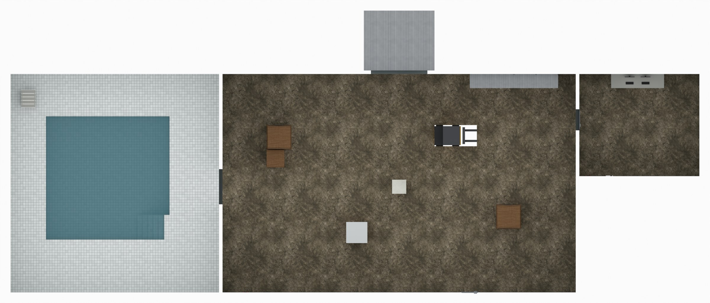

# service_entry: dressed and lit (Secret Operations, step 2)

The freight lift's steel car, a 4 m dock hall with a forklift, a pallet, crates, a long shelf and a pillar under caged battens; the pool room, white-tiled, with the 1.6 m pool the Intern's dive surfaces in (tiled steps, a water surface); and the guard office with a desk and two screens.

Built by `tools/blender/build_secretops_dress.py` around the greybox's layout (`tools/blender/build_secretops_greybox.py`): the layout objects are rebuilt from the same model, so `world/service_entry.json` is the greybox's file, unchanged. The method, the light sets, the removable parts and the sources are in `docs/renders/registrar_hall/README.md` (shared by all 13 scenes).

| File | What it is |
|---|---|
| `world/service_entry.glb` | the art only: 1.59 MB, 5550 triangles, 39 nodes drawn (35 meshes), 35 materials, WebP textures |
| `world/lightmaps/service_entry_0.webp`, `_1.webp` | the normal set (`lightmap`): the shell page and the props page |
| `world/lightmaps/service_entry_2.webp`, `_3.webp` | the alarm set (`lightmap_night`): the same two pages |
| `world/service_entry.json` | the layout, as the greybox wrote it: 50 colliders, 2 doors, 4 cameras, 3 links, 2 zones, 9 spots |
| `blender/scenes/service_entry.blend` | the saved scene (Git LFS): `Art` (Props, Separate, and Arch: one box per shell collider, for the layout check only), `Shell`, `Doors`, `Layout`, the two light collections, `Export` |
| `docs/renders/service_entry/` | `1_arrival.jpg`, `2_wide.jpg`, `3_detail.jpg` (normal light), `4_alarm.jpg` (the wide view in the alarm set), `plan.jpg`, `bake.json`, `caps.json` |







## Bake

| Map | Set | Page | Size | px/m | Gain G | Shown gain (caps) |
|---|---|---|---|---|---|---|
| `service_entry_0` | normal | shell | 2048 | 43.8 | 0.42842 | 0.9409 |
| `service_entry_1` | normal | props | 2048 | 100.3 | 0.42842 | 0.9409 |
| `service_entry_2` | alarm | shell | 2048 | 43.8 | 8.53994 | 1.2405 |
| `service_entry_3` | alarm | props | 2048 | 100.3 | 8.53994 | 1.2405 |

Cycles on the rented GPU (GPU), 512 samples, diffuse direct and indirect, OIDN, 8 px margin; 175 s for both sets. Texel = G L / (C + G L) with C = 1.2 and lightmap intensity pi C, G set so the median wall texel shows 0.34 (normal) or 0.26 (alarm) of its light; `caps.json` then scales each set's intensity so the walls show p50 0.22 (normal) or 0.155 (alarm) and caps any material that would pass p90 0.88 or p99 0.97.

## Brightness (`lab_display.py`, as the page shows it)

Normal set:

```
material                m2           map       k    p50    p90    p99     >=1
Wall_Service         305.9 service_entry_0  3.5471  0.127  0.154  0.173   0.00%
Ceiling_Concrete     286.8 service_entry_0  3.5471  0.018  0.036  0.060   0.00%
Floor_Concrete       272.4 service_entry_0  3.5471  0.062  0.127  0.210   0.00%
Wall_Tile            255.5 service_entry_0  3.5471  0.361  0.498  0.527   0.00%
Floor_Tile           147.6 service_entry_0  3.5471  0.473  0.541  0.566   0.00%
Ceiling_Tile         146.3 service_entry_0  3.5471  0.371  0.402  0.428   0.00%
Wall_Steel            49.7 service_entry_0  3.5471  0.066  0.103  0.177   0.00%
Steel                 38.1 service_entry_1  3.5471  0.018  0.136  0.187   0.00%
Cardboard             35.9 service_entry_1  3.5471  0.005  0.077  0.105   0.00%
Wood_Crate            34.8 service_entry_1  3.5471  0.040  0.078  0.118   0.00%
Steel_Dark            27.0 service_entry_1  3.5471  0.007  0.065  0.066   0.00%
Paint_Grey            17.7 service_entry_1  3.5471  0.012  0.059  0.100   0.00%
Lamp_Housing          14.9 service_entry_1  3.5471  0.500  0.500  0.511   0.00%
Floor_Steel           13.6 service_entry_0  3.5471  0.099  0.158  0.191   0.00%
Pillar_Paint          12.8 service_entry_1  3.5471  0.190  0.216  0.231   0.00%
Paint_Yellow           8.2 service_entry_1  3.5471  0.145  0.194  0.248   0.00%
Laminate               6.9 service_entry_1  3.5471  0.114  0.274  0.294   0.00%
Skirting               5.5 service_entry_1  3.5471  0.011  0.012  0.014   0.00%
Door_Steel             4.4 service_entry_1  3.5471  0.000  0.159  0.172   0.00%
Paint_Dark             4.4 service_entry_1  3.5471  0.003  0.007  0.008   0.00%
Plastic_White          3.0 service_entry_1  3.5471  0.200  0.349  0.358   0.00%
Door_Frame             2.9 service_entry_1  3.5471  0.049  0.093  0.106   0.00%
Plastic_Black          2.1 service_entry_1  3.5471  0.000  0.001  0.002   0.00%
Rubber                 2.0 service_entry_1  3.5471  0.000  0.001  0.001   0.00%
Hazard                 1.0 service_entry_1  3.5471  0.000  0.159  0.180   0.00%
Sign_Plate             0.8 service_entry_1  3.5471  0.176  0.291  0.304   0.00%
Fabric                 0.7 service_entry_1  3.5471  0.005  0.006  0.007   0.00%
Clock_Face             0.4 service_entry_1  3.5471  0.197  0.316  0.322   0.00%
Cam_Body               0.4 service_entry_1  3.5471  0.055  0.090  0.202   0.00%
Stripe_Red             0.4 service_entry_1  3.5471  0.106  0.119  0.125   0.00%
```

Alarm set (`lightmap_night`):

```
material                m2           map       k    p50    p90    p99     >=1
Wall_Service         305.9 service_entry_2  4.6766  0.110  0.240  0.497   0.00%
Ceiling_Concrete     286.8 service_entry_2  4.6766  0.041  0.127  0.296   0.00%
Floor_Concrete       272.4 service_entry_2  4.6766  0.052  0.131  0.261   0.00%
Wall_Tile            255.5 service_entry_2  4.6766  0.207  0.561  0.905   0.64%
Floor_Tile           147.6 service_entry_2  4.6766  0.193  0.591  0.717   0.00%
Ceiling_Tile         146.3 service_entry_2  4.3427  0.194  0.522  0.970   0.69%
Wall_Steel            49.7 service_entry_2  4.6766  0.162  0.287  0.476   0.00%
Steel                 38.1 service_entry_3  4.6766  0.009  0.080  0.231   0.00%
Cardboard             35.9 service_entry_3  4.6766  0.005  0.081  0.196   0.00%
Wood_Crate            34.8 service_entry_3  4.6766  0.031  0.090  0.153   0.00%
Steel_Dark            27.0 service_entry_3  4.6766  0.008  0.030  0.065   0.00%
Paint_Grey            17.7 service_entry_3  4.6766  0.007  0.048  0.135   0.00%
Lamp_Housing          14.9 service_entry_3  4.6766  0.000  0.140  0.531   0.00%
Floor_Steel           13.6 service_entry_2  4.6766  0.145  0.234  0.291   0.00%
Pillar_Paint          12.8 service_entry_3  4.6766  0.199  0.317  0.343   0.00%
Paint_Yellow           8.2 service_entry_3  4.6766  0.121  0.377  0.442   0.00%
Laminate               6.9 service_entry_3  4.6766  0.198  0.448  0.472   0.00%
Skirting               5.5 service_entry_3  4.6766  0.007  0.010  0.023   0.00%
Door_Steel             4.4 service_entry_3  4.6766  0.000  0.202  0.326   0.00%
Paint_Dark             4.4 service_entry_3  4.6766  0.002  0.006  0.008   0.00%
Plastic_White          3.0 service_entry_3  4.6766  0.221  0.318  0.431   0.00%
Door_Frame             2.9 service_entry_3  4.6766  0.025  0.107  0.269   0.00%
Plastic_Black          2.1 service_entry_3  4.6766  0.001  0.004  0.004   0.00%
Rubber                 2.0 service_entry_3  4.6766  0.000  0.001  0.001   0.00%
Hazard                 1.0 service_entry_3  4.6766  0.000  0.171  0.316   0.00%
Sign_Plate             0.8 service_entry_3  3.9405  0.166  0.861  0.970   0.00%
Fabric                 0.7 service_entry_3  4.6766  0.003  0.008  0.010   0.00%
Clock_Face             0.4 service_entry_3  4.6766  0.128  0.244  0.340   0.00%
Cam_Body               0.4 service_entry_3  4.6766  0.168  0.480  0.524   0.00%
Stripe_Red             0.4 service_entry_3  4.6766  0.068  0.102  0.132   0.00%
```

## Gates

```
check_layout (Blender): PASS: 57 of 57 checks passed
greybox --check: GATES PASS
layout JSON: IDENTICAL: world/service_entry.json is byte for byte the greybox's
worlddoc: OK world/service_entry.json: 50 colliders, 2 doors, 0 markers, 3 links, 2 zones, 9 spots, 0 errors, 3 warnings
glb_inspect: pass       tris: 5550 triangles, budget 300000 / pass       mb: 1.52 MB, budget 8
privacy: privacy grep: 15 files, 0 with hits
```

