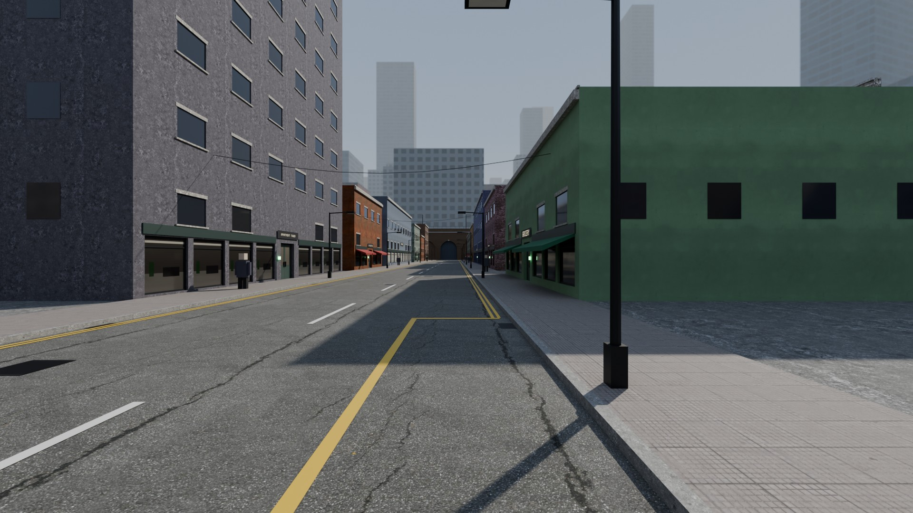
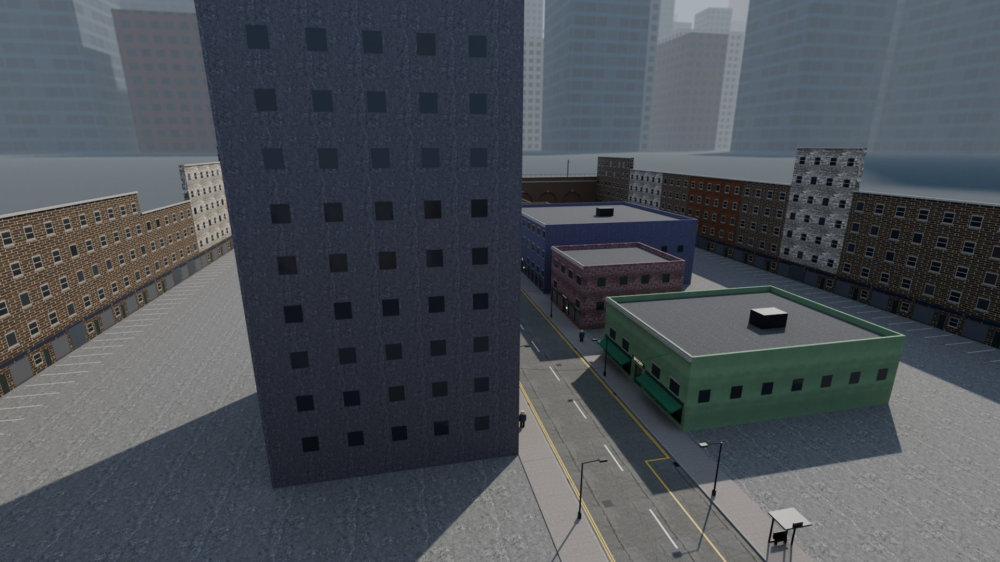
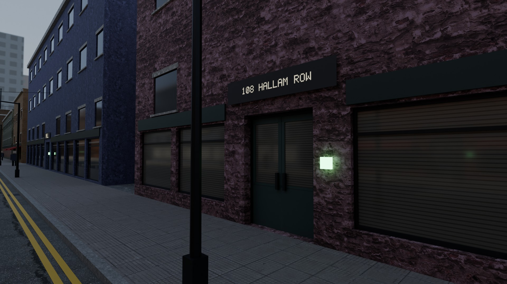
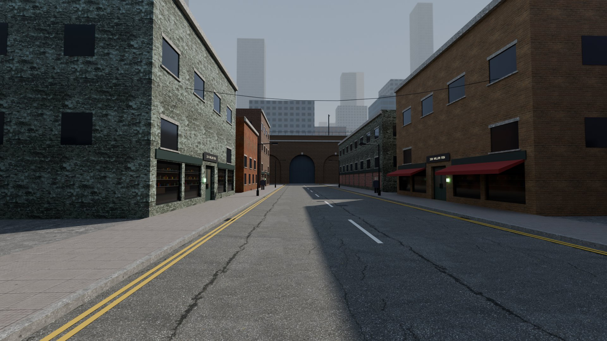
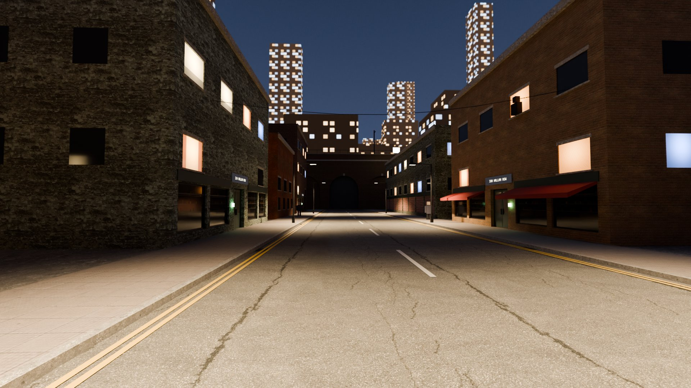

# street: Hallam Row

The seventh scene of the Blender plan (`docs/BLENDER.md`, "7. street"). A run-down street of brick and render, about 150 m long: eleven buildings on their fixed plots (the apartment tower, the grocery, the mall, the numbered shops and the fillers), shopfronts with recessed doors, stall risers, fascias and a few canvas awnings, sidewalks with kerbs, drains and manhole covers, double yellow lines and the bus stop's box, fourteen lamp posts, the bus shelter round its bench, phone lines across the street, and at the world's edge a row of back-street buildings on three sides and a brick railway viaduct with blind arches across the north end. Built in Blender 5.2.1 from `blender/layout/street.json` and `blender/layout/street_extra.json`, with an AO-only bake (the street has a day clock) and a day and a night backdrop of the city past both ends.

| File | What it is |
|---|---|
| `world/street.glb` | the art: 4.82 MB, 22 239 triangles, 41 draw calls, textures as WebP |
| `world/lightmaps/street_0.webp` .. `street_3.webp` | the baked ambient occlusion, four maps on the second UV set (`TEXCOORD_1`) |
| `world/backdrops/street_day.webp`, `street_night.webp` | the edge-of-world panoramas (R3), 4096 x 2048 equirect |
| `blender/scenes/street.blend` | the saved scene (0.8 MB, Git LFS): `Art` (the pieces), `Export` (merged by material, with the AO UVs), `Standins`, `Lights` |
| `tools/blender/build_street.py` | the re-runnable build (reads the layout; no hand-copied coordinates) |
| `tools/blender/street_extras.mjs` | writes `blender/layout/street_extra.json`: the window slots (`windowSlots`), the door's size, the PHARMACY sign, the ghost window, the watchers' windows and the pedestrians, from `shared/city.js` and `shared/anomalies.js` |
| `blender/textures/street/` | the build's textures, made by `--stage textures` from five downloaded and four repo CC0 maps, and the generated ones |
| `docs/renders/street/` | the review stills (this file's folder) |

## Review stills (Cycles on the rented GPU, 128 samples adaptive, OIDN, 1920 x 1080 JPEG, AgX)

| | |
|---|---|
| `1_arrival.jpg` | the arrival point (3.6, 4.0) on the bus stop's side, eye height 1.6 m, facing the link's `face` (north, -z), 75 degrees vertical |
| `2_wide.jpg` | the whole street from 26 m over the south end |
| `3_detail.jpg` | the door of 108 Hallam Row with the page's sign and green lamp (stand-ins) |
| `4_day.jpg` | by day, from the middle of the street to the viaduct, with the day backdrop |
| `5_night.jpg` | the same view at night: the lamp heads (`Lamp_Emit`) and the lit windows (`Window_Lit`) on, the night backdrop, exposure +2.2 |







These are Blender renders with Blender's sun, sky and a spot under each lamp head (stills only; the page lights the street itself). The page's own things show as stand-ins (see below). Camera rays see the backdrop picture, so the stills show what lies past the edge as the page will.

## Sources and licences

| Texture | Used for | Source | Author (Poly Haven) | Licence |
|---|---|---|---|---|
| `asphalt_02`: diffuse, 1k (downloaded) | the road (`road_asphalt.jpg`) | https://polyhaven.com/a/asphalt_02 | Rob Tuytel | CC0 1.0 |
| `square_concrete_pavers`: diffuse, 1k (downloaded) | the sidewalks (`sidewalk_slab.jpg`, made a neutral grey) | https://polyhaven.com/a/square_concrete_pavers | Amal Kumar | CC0 1.0 |
| `red_bricks_04`: diffuse, 1k (downloaded) | 41 and the filler at 106-116 (`brick_red.jpg`), the red edge rows | https://polyhaven.com/a/red_bricks_04 | Rob Tuytel | CC0 1.0 |
| `rough_plaster_brick`: diffuse, 1k (downloaded) | worn render over brick: 214, 108, the boarded filler (`render_patchy.jpg`, made near neutral and tinted), the render edge rows | https://polyhaven.com/a/rough_plaster_brick | Rob Tuytel | CC0 1.0 |
| `dark_brick_wall`: diffuse, 1k (downloaded) | 666 (`brick_dark.jpg`), the viaduct, the dark edge rows and their ground floors | https://polyhaven.com/a/dark_brick_wall | Dario Barresi, Dimitrios Savva | CC0 1.0 |
| `factory_brick` (in the repo: `blender/textures/factory_floor/brick_diff.jpg`) | 330 (`brick_yellow.jpg`) | https://polyhaven.com/a/factory_brick | Rob Tuytel | CC0 1.0 |
| `hangar_concrete_floor` (in the repo: `blender/textures/factory_floor/concrete_floor_diff.jpg`) | the tower and the mall, the kerbs, the yards, the roofs, the stone trim (`concrete.jpg`) | https://polyhaven.com/a/hangar_concrete_floor | Dimitrios Savva | CC0 1.0 |
| `plastered_wall_04` (in the repo: `blender/textures/galleries/`) | the painted fronts of the grocery and the pharmacy (`plaster.jpg`) | https://polyhaven.com/a/plastered_wall_04 | Rob Tuytel | CC0 1.0 |
| `dark_wood` (in the repo: `blender/textures/apartment/`) | the boards over the closed shop (`wood.jpg`, greyed) | https://polyhaven.com/a/dark_wood | Dario Barresi, Dimitrios Savva, Rico Cilliers | CC0 1.0 |

**5 Poly Haven textures were downloaded** (five 1k JPEG diffuse maps, 3.5 MB, from `dl.polyhaven.org`, with the asset and file lists read from `api.polyhaven.com` under a generic client name, no other data sent). The other four came from the repo, where earlier scenes put them. `build_street.py --stage textures --src <folder of the five downloads>` makes the files in `blender/textures/street/` (plain Python with numpy and Pillow; JPEG quality 88).

Everything else is own work, made by `build_street.py` from fixed seeds: all geometry; the edge rows' facades (two bays and one floor of the brick or render with painted windows, and a ground floor with a roller shutter, a door and a sign band); the shop glass (a dim shop, a lobby, whitewash, blinds); the lit windows' picture (warm curtains, a bare room, amber blinds, a television's blue); the drain grating; corrugated steel for the gates; the distant city's facades for the backdrops (day and night); and the stand-in signs in a 5 x 7 pixel font. No Meshy, no Higgsfield, no paid service, no photograph.

Tools: Blender 5.2.1 LTS (GPL) with Cycles (OptiX on the rented GPU box), OpenImageDenoise (Apache-2.0, through the compositor's Denoise node) and the glTF I/O add-on; Python with numpy and Pillow (the texture, WebP and backdrop steps).

## Budgets (measured)

`python studio/pipeline/glb_inspect.py world/street.glb --budget tris=300000,mb=8` (Pipelines-Plugin), exit code 0:

```
file       world\street.glb  (4.82 MB, Khronos glTF Blender I/O v5.2.40)
triangles  22239 drawn, in 41 mesh(es), 41 instance(s)
materials  38
textures   27, images: 17 (1024 x 1024 and smaller), all WebP
bbox       122.0 x 42.35 x 182.0 (x, y up, z), min [-61.0, -1.0, -151.0]
rig        0 skin(s); animations: none
requires   EXT_texture_webp
pass       tris: 22239 triangles, budget 300000
pass       mb: 4.82 MB, budget 8
```

| | Limit | Measured |
|---|---|---|
| `world/street.glb`, AO maps aside | at most 8 MB | **4.82 MB** (5.09 MB from Blender, then `tools/webp_glb.py`, geometry bytes asserted identical) |
| triangles | at most 300 000 | **22 239** |
| draw calls, merged by material | at most 250 | **41** (38 materials; the three watchers' panes are their own meshes) |
| textures | WebP | **17 images, all `image/webp`** |
| AO maps | at most 4, at most 2048 x 2048 | **4** (below) |
| displayed albedo | p90 at most about 0.8 | **0.65 at worst** (`Shelter_Glass`; the sunlit materials 0.10 to 0.62: the road 0.20, the sidewalk 0.28, the facades 0.19 to 0.47, the paint lines 0.62) |

| Map | Page | Texel density | WebP | What is on it |
|---|---|---|---|---|
| `street_0` | 2048 | 11.1 px/m | 134 KB | the ground: road, paint, kerbs, sidewalks, drains, the yards |
| `street_1` | 2048 | 11.7 px/m | 235 KB | the eleven buildings' facades (every face) and the roofs |
| `street_2` | 2048 | 13.9 px/m | 103 KB | the edge rows, the viaduct, the gates |
| `street_3` | 512 | 12.7 px/m | 28 KB | the doors, the boards, the awnings |

Bake: Cycles AO on the GPU, 256 samples, distance 7 m, 8 px margin, OIDN denoise; the four maps took 19, 35, 22 and 6 s. The maps hold linear AO (1 = open sky; the page loads them with `NoColorSpace`), and every baked material carries `aomap` (the map's path) and `aomap_intensity` 1.0 in its extras; no `lightmap` anywhere. Not baked, on purpose: `Window_Lit`, `Lamp_Emit` (emissive), `Shelter_Glass`, `Shop_Glass`, `Window_Dark` (glass), `Frame_Dark`, `Metal_Dark`, `Fascia_Paint` (near black: AO would not show), and `Trim_Stone` (a thousand small sills, lintels and copings whose islands crowded the buildings' page down to 8 px/m). The page sizes are fixed in `PAGES`; no AO island is longer than 30 m (the long pieces are cut, and pieces are welded only within themselves), which is what keeps the density up.

## The layout check

`blender -b blender/scenes/street.blend --python tools/blender/check_layout.py -- --scene street` (exit code 0; the 31 COVER lines shortened here to their sum):

```
layout check: scene street, 269 visible meshes, 31 colliders
PASS  COVER  Ground_Street: 97 mesh(es) cover it (238050 sample points, every one within 5 cm of art)
PASS  COVER  Building_tower .. Building_efill: 11 to 16 mesh(es) each, every sample point within 5 cm of art
PASS  COVER  Lamp_Street (x14): 4 mesh(es) cover each (387 sample points)
PASS  COVER  Bench_BusStop: 5 mesh(es) cover it (1050 sample points, every one within 5 cm of art)
PASS  COVER  Wall_W: 25, Wall_E: 27, Wall_N: 20, Wall_S: 21 mesh(es)
PASS  STRAY  112 tall solid mesh(es), each over a collider; 0 decor_* mesh(es) exempt
PASS  CLEAR  marker Spawn_bus (3.60, 4.00): clear within 0.28 m
PASS  CLEAR  marker Door_tower (-8.00, -19.00): a door in a wall's face; its walk-up spot (-7.69, -19.00) is clear within 0.28 m
PASS  CLEAR  marker Door_w41 (-8.00, -41.00): a door in a wall's face; its walk-up spot (-7.69, -41.00) is clear within 0.28 m
PASS  CLEAR  marker Door_w214 (-8.00, -95.00): a door in a wall's face; its walk-up spot (-7.69, -95.00) is clear within 0.28 m
PASS  CLEAR  marker Door_w666 (-8.00, -127.00): a door in a wall's face; its walk-up spot (-7.69, -127.00) is clear within 0.28 m
PASS  CLEAR  marker Door_grocery (8.00, -17.00): a door in a wall's face; its walk-up spot (7.69, -17.00) is clear within 0.28 m
PASS  CLEAR  marker Door_e108 (8.00, -41.00): a door in a wall's face; its walk-up spot (7.69, -41.00) is clear within 0.28 m
PASS  CLEAR  marker Door_mall (8.00, -67.00): a door in a wall's face; its walk-up spot (7.69, -67.00) is clear within 0.28 m
PASS  CLEAR  marker Door_e330 (8.00, -95.00): a door in a wall's face; its walk-up spot (7.69, -95.00) is clear within 0.28 m
PASS  CLEAR  BUS_STREET.at (6.20, 4.00): clear within 0.28 m
PASS  CLEAR  BUS_STREET.arrive (3.60, 4.00): clear within 0.28 m
PASS: 43 of 43 checks passed
```

**One change to the shared check, for the coordinator to review.** `world/street.json` puts each door's `Entrance` marker on its building's street face (x = +-8), inside the building's collider, so the unchanged CLEAR rule fails all eight doors whatever the art (it does with the colliders themselves as the art). `check_layout.py` now treats an `Entrance` marker that has a `width` as a door in a wall: it passes when the marker lies on the face of every collider that blocks it and the walker's spot one radius and 3 cm in front of it is clear of colliders and solid art. Every other point is checked as before, and `check_layout_test.py` passes unchanged (13 tests). It is its own commit, so it can be dropped or reworded.

The axes were checked once with a marker cube at the arrival point (`--stage axes`): game (3.6, 0.1, 4.0) is Blender (3.6, -4.0, 0.1) is glTF (3.6, 0.1, 4.0).

## The layout file

`world/street.json` is untouched (it is the code's, written by `tools/make_street.mjs`). `node tools/worlddoc.mjs check world/street.json`:

```
OK world/street.json: 31 colliders, 0 doors, 9 markers, 0 links, 0 zones, 0 spots, 0 errors, 0 warnings
```

## The backdrops (R3)

`world/backdrops/street_day.webp` (92 KB) and `street_night.webp` (242 KB), 4096 x 2048 equirect, rendered (`--stage backdrop`, Cycles, 96 samples adaptive, OIDN, AgX) from the middle of the world (0, 1.6, -60) with the playable area hidden: a city of several hundred blocks round Hallam Row (flats, brick, glass offices, render), taller towards a centre to the north, a church spire, chimneys and two tower cranes, hazed by distance, under a gradient sky; by night the walls go dark, about a third of the windows light up (warm, some cool), and the sky is navy with a sodium glow low down. The blocks rise 20 to 30 degrees near the sides, so they show over the edge rows (14 to 26 m, 60 m out). **The middle column faces north (-z) and the right-hand side east (+x)**: the stage renders three glowing markers first and asserts it (`ORIENT PASS: middle north (-z), right east (+x)`; the markers' columns 128 and 192 of 256). The lower half is a plain ground the scene's own ground hides.

## What the coordinator does to wire it in

1. `world/street.glb` is added to the `street` scene's files in `shared/farway.manifest.js` in this commit, with the two `pageScenes.street` lines in `shared/manifest.test.js` (the deepEqual of all page scenes, and the street's own test, line 201: both say the street now has its GLB). `node --test shared/`: 297 tests, 297 pass.
2. **The backdrops are not in the manifest yet.** The manifest has the place (`backdrop: {day, night}` on the scene), but `shared/manifest.test.js` line 190 asserts that the shipped manifest's street has no backdrop, so adding it needs a test change this commit does not make. To wire them: `backdrop: {day: "world/backdrops/street_day.webp", night: "world/backdrops/street_night.webp"}` on the `street` scene, and update that test and the `pageScenes` deepEqual.
3. The blockout steps aside already: `cityProps` checks `hasArt(CITY_SCENE)` and then draws only the door signs, status lamps and shutters, and the anomalies. `applyLightmaps` reads `aomap`: 29 meshes carry `TEXCOORD_1` and their 29 materials carry `aomap`, on four images; nothing carries `lightmap`.
4. The toggled materials: `Lamp_Emit` (the fourteen lamp lenses, emissive strength 6, warm), `Window_Lit` (the lit windows, emissive strength 2.2 times their picture), switched by `cityLook`'s `artToggle` calls. About half the window panes in the page's slots are `Window_Lit`, the rest `Window_Dark`, so the street is not lit window-for-window at night. The three watchers' panes are their own meshes, `Window_Watcher_wfill1`, `Window_Watcher_e330` and `Window_Watcher_tower`, in `Window_Lit`, exactly at the watchers' slots.
5. Run every suite one at a time, merge.

## What is left out because the page draws it

- **Each door's sign, status lamp and roller shutter**: the wall above each door is plain (no fascia or awning within 1.55 m of a door's centre line, and no window there: the page's slots already skip it), and a 1.6 m pier each side of each door carries the lamp. The doors are recessed 25 cm with their leaves at the back; the shutter comes down in front of the face. Stills only: `standin_sign_*` and `standin_lamp_*`.
- **The PHARMACY sign**: the two window slots on the pharmacy's first floor that the sign (3.4 x 0.64 m at y 4.2, z -67) would overlap, with 25 cm round it, are left as plain wall. Stand-in: `standin_sign_pharmacy`.
- **The pedestrians, the watchers and the ghost window**: stand-ins only, `standin_ped_*` (by day and night), `standin_night_watcher_*` and `standin_night_ghost_window` (night still only). Nothing of the art stands at the ghost window (12, 14, -142): the viaduct's face is 8 m behind it, and its top at 14.4 m.
- **The trash bins and the bus**: not built, not stood in.
- **The bus shelter** is art: the page draws it only without art. Its posts, back glass, east side panel and bench all stand inside the bench's collider (the shelter's back faces north, as the blockout's); the roof cantilevers over the bench above head height.

## Things to know

- **Axes and scale:** metres, y up; identity node transforms; the art lies inside the collision bounds (+5 cm), except what hangs over head height (cornices, sills, awnings from 1.82 m, lamp heads, wires, the viaduct's masts) and the roofs' parapets and plant above the colliders' tops.
- **Ground levels:** the collision floor is y 0. The road sits at -0.06 and the sidewalks at +0.06 (a 12 cm kerb), the yards behind the buildings at 0. A player floats 6 cm over the road and sinks 6 cm into the sidewalk.
- **Window panes** stand at the page's `windowSlots`, 1.6 x 1.3 m, 4 cm back in a 5 cm reveal. A slot the blockout runs past a building's end (the last one on the pharmacy and the mall) stops 15 cm short of the corner. The watchers stand 14 cm out from the slot, so in the art about 19 cm in front of the glass.
- **The edge walls** (`Wall_*`, 14 m, a metre thick) are rows of back-street buildings 14 to 26 m tall facing in, with gates, a depot gate where the road meets the south wall, and lit windows of their own; the north wall is the viaduct. Each piece carries a 1 cm sliver of the wall's back face so its box is the collider's (the layout check works on boxes).
- **The `.blend`** finds its textures by relative path (`//../textures/street/`). It holds no `Backdrop` collection (`--stage backdrop` builds it again), and no path, user name or e-mail (checked on an uncompressed copy).
- **`blender/layout/` is in `.gitignore`:** run `node tools/blender/dump_layout.mjs street` and `node tools/blender/street_extras.mjs` before a build.

## Rebuild

From the repo root, with node, Blender 5.2, and Python with numpy and Pillow:

```
node tools/blender/dump_layout.mjs street
node tools/blender/street_extras.mjs
python tools/blender/build_street.py --stage textures --src <folder with the five Poly Haven 1k diffuse JPEGs>     # only if the textures change
blender -b --python tools/blender/build_street.py -- --stage art,bake,export,axes,backdrop,render --work <work> --samples 256 --render-samples 128
python tools/blender/pack_scene.py street --work <work>                     # WebP AO maps and WebP textures -> world/
python tools/blender/build_street.py --stage pack-backdrops --work <work>    # WebP backdrops -> world/backdrops/
```

Any comma list of stages runs in order on the saved `.blend` (`blender -b blender/scenes/street.blend --python ... -- --stage bake`). This build ran each stage on a rented GPU (OptiX); `--device cpu` forces the CPU. Each stage took a few minutes there, most of it upload.

## Open

- The backdrops need the manifest entry and a test change (above).
- The light: the stills use Blender's sun and sky; how the page's own sun reads on these albedos is for the in-game check. The AO maps' strength is `aomap_intensity` 1.0 on every material; turn it down per material if the alleys read too dark.
- The yards behind the buildings are open, flat and empty (painted parking bays along the edge rows): anything standing there would need a collider, which is the code's.
