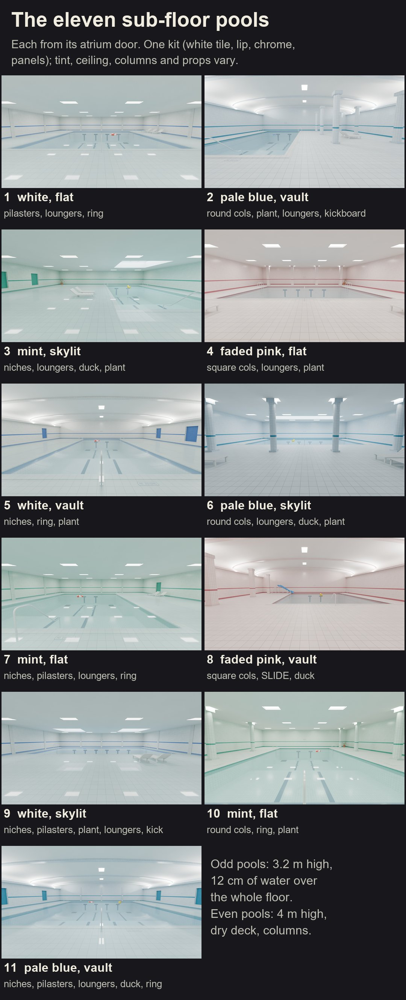

# The sub-floor pools: `sub_pool_01` to `sub_pool_11`

The hotel's eleven sub-floor pools (`docs/BLENDER_AREAS.md` section 1: "Eleven separate pool scenes, peaceful, each with one `Spot_puzzle`. They match B1's poolrooms (white tile, flooded) but are their own pools"), dressed and lit in Blender on the greybox's layout, each baked in soft, even light. One build script makes all eleven as a family: a shared kit, varied per pool.



| File | What it is |
|---|---|
| `world/sub_pool_NN.glb` | the art of pool NN, art only (table below) |
| `world/sub_pool_NN.json` | the layout, written by `tools/blender/export_scene.py` from the `.blend`: byte for byte what the greybox wrote (`build_hotel_greybox.py --preview`); nothing in the layout changed |
| `world/lightmaps/sub_pool_NN_0.webp`, `_1.webp` | the bake (second UV set, `TEXCOORD_1`): the shell (2048), the fittings, props and door leaf (1024) |
| `blender/scenes/sub_pool_NN.blend` | the saved scene (Git LFS): `Art` (the unmerged pieces), `Doors` (the leaf, origin at the hinge), `Layout` (the `COL_` boxes, zones and empties), `Export` (merged by material, with the lightmap UVs), `Lights` |
| `blender/textures/hotel_pools/` | the four textures all eleven share (generated here: tile with grout, deck tile, plaster, the sign atlas) |
| `tools/blender/build_hotel_pools.py` | the build for all eleven: the kit, the per-pool look (`LOOK`), the bake, the export, the stills; it imports the greybox model, so no coordinate of the layout is typed in |
| `docs/renders/sub_pool_NN/` | the three review stills of pool NN and `bake.json` (the bake's own report) |
| `docs/renders/sub_pools/` | this file, `brightness.txt` (the full brightness table, every pool and material), `overview.jpg` |

## The family

**The kit, in every pool:** white square glazed tile with grey grout (12.5 cm on the walls and in the basin, 25 cm on the deck); a raised tiled lip, 30 cm wide and 2 cm proud, with a bullnose over the basin's edge; a waterline band and a dado band at 1.2 m in the pool's accent colour, and an accent skirting; dark lane lines with T-ends on the deep and shallow floors and targets on the deep end's wall; a dark nosing stripe on every step; two chrome ladders at the deep end and a chrome handrail down the middle of the steps; recessed ceiling panels with chrome bezels (`Lamp_Emit`); the deep end's two drains and the two shut grates where the underwater ways go on (the greybox's `decor_Grate_*`); depth markers on the deck (1.2 M, 2.4 M), NO DIVING at the shallow end, DEEP END on the north wall and the pool's number (POOL N) beside the door; a painted steel door with a porthole.

**Varied per pool:**

| Pool | Basin, height | Tile | Ceiling | Structure | Props |
|---|---|---|---|---|---|
| 1 | 12 x 12 m, 3.2 m, flooded | white, cobalt accents | flat, 16 panels | pilasters (N, E, W) | three loungers, a float ring |
| 2 | 7 x 13 m, 4 m | pale blue, teal accents | barrel vault, cove lights, ribs | round columns | a dead plant, two loungers, a kickboard |
| 3 | 7 x 13 m, 3.2 m, flooded | mint, green accents | skylit: a 5 m light well | three niches (W) | two loungers, a rubber duck, a dead plant |
| 4 | 14 x 9 m, 4 m | faded pink, rose accents | flat, 16 panels | square columns | four loungers, a dead plant |
| 5 | 8 x 15 m, 3.2 m, flooded | white | barrel vault | five niches (E, W) | a float ring, a dead plant |
| 6 | 16 x 8 m, 4 m | pale blue | skylit: a 12 m strip | round columns | three loungers, a duck, a dead plant |
| 7 | 11 x 14 m, 3.2 m, flooded | mint | flat | pilasters (N, W, S), two niches (E) | two loungers, a float ring |
| 8 | 11 x 11 m, 4 m | faded pink | barrel vault | square columns | **the slide** (west deck, into the deep end), a duck |
| 9 | 18 x 9 m, 3.2 m, flooded | white | skylit: two wells | pilasters, two niches (S) | a dead plant, two loungers, a kickboard |
| 10 | 10 x 14 m, 4 m | mint | flat | round columns | a float ring, two dead plants |
| 11 | 14 x 14 m, 3.2 m, flooded | pale blue | barrel vault | pilasters (N, S), four niches | two loungers, a duck, a float ring |

The basins, the columns, the heights and the flooding are the greybox's; the tint, ceiling, niches, pilasters and props are this build's. Every prop's place is checked against the layout before Blender runs (`--stage plancheck`: on the deck, clear of the lip and markers, the columns, the puzzle spot by 1 m, the door's swing and the arrival point). The props are `decor_` (you walk through them), so the layout file stays the greybox's; see "Open".

**Shared across the eleven files:** the four textures are the same files (one tile texture tinted per pool through `baseColorFactor`, so the GLBs carry the same image bytes), and every kit piece (ladder, handrail, lip, drains, grates, panels, loungers, plant, toys, door leaf, signs) comes from one builder. Within a file, pieces are merged by material, so each GLB has one mesh per material (18 to 21) plus the door leaf.

## The water

- **Its own material, `Pool_Water`, never baked:** alpha blend, base colour (0.50, 0.80, 0.86), alpha 0.32, roughness 0.04, double-sided, no lightmap. That is B1's way (`M_Water` is alpha blend, kept see-through), only more lightly tinted: B1's is (0.20, 0.58, 0.68) at alpha 0.55.
- **One surface per pool:** the even pools have water in the basin only, at y -0.1 (the greybox's water line). The odd pools are flooded: 12 cm over the whole floor (the greybox's `Zone_water_deck`), so their water is one surface at y 0.12 across the room, basin included.
- **Baked as seen through clear water:** the water is hidden during the bake, so the basin's floor and walls, and the odd pools' deck, carry their light as if the water were clear. The tint comes only from the water drawn over them.
- **How the page should draw it:** as exported, after the opaque scene, with depth write off (three does this for a `transparent` material), and not through `applyLightmaps` (it has no `lightmap`). Because the page adds no lamp of its own in a baked scene, a lit `MeshStandardMaterial` water would go dark: draw `Pool_Water` unlit, as a `MeshBasicMaterial` with its colour and opacity (0.32), so it tints what is under it and does not darken it. The review stills show it in Cycles with its reflections; the page shows the tint without them.
- The toys float at the water line; the slide ends 12 cm over the water past the lip.

## Light

Soft, even light, as the plan asks for the pools. The light sources are the scene's own: the recessed panels (an area light in each, warm white, 95 W) on the flat ceilings; on the vaults, a lit strip in a tiled cove along each long wall throwing light up onto the vault (four 260 W area lights a side) and three lenses along the crown; in the skylit pools, a frosted pane at the top of each light well (`Sky_Glow`, cool daylight, an area light of 22 W per m2) and panels in the rest of the ceiling. The world is near black (underground).

`Lamp_Emit` (the panels, the lenses and the cove strips) is exported at strength 6, on as in the bake; the page switches it as in part 1. `Sky_Glow` (the skylight panes) is not one of the page's switched materials and stays lit.

Baked in Cycles on the rented GPU, 512 samples, diffuse direct and indirect, OIDN-denoised, 8 px margin. The faces never seen (the hidden corner quads that make the layout check's boxes whole, inside the walls and under the slab) are dropped before the bake.

## Brightness, as the page shows it

The page draws a baked material unlit, with no tone mapping: texture x base colour x texel x intensity / pi. The bake's light L is written with a shoulder, texel = G L / (C + G L), with `lightmap_intensity` = pi C, so the page shows about texture x G L where the light is ordinary and rolls off toward texture x C near a lamp, never clipping. C = 1.18 for all eleven (the white tile's brightest texel, 0.82, times C stays under 0.98). G is set per pool from its own bake (1.5 over the median light on the shell; 0.88 to 1.87, in `bake.json`), so every pool reads equally bright. Five small materials are capped: `Plastic_White` and `Toy_White` x 0.85, `Toy_Yellow`, `Signs` and `Chrome` x 0.9. The raw bake stays in the work folder, and `--stage encode --gain G` re-writes the maps without baking again.

Measured with the brief's `lab_display.py` (area-weighted, max channel) on every pool; the range over the eleven (full table in `brightness.txt`):

| Material | pools | p50 (lowest to highest) | p90 (highest) | p99 (highest) | clipped |
|---|---|---|---|---|---|
| `Ceiling_Paint` | 11 | 0.441 to 0.500 | 0.723 | 0.834 | 0 |
| `Tile_Wall` | 11 | 0.425 to 0.522 | 0.596 | 0.819 | 0 |
| `Tile_Deck` | 11 | 0.419 to 0.528 | 0.579 | 0.609 | 0 |
| `Tile_Pool` (the basin) | 11 | 0.472 to 0.615 | 0.689 | 0.724 | 0 |
| `Tile_Accent` | 11 | 0.206 to 0.286 | 0.317 | 0.334 | 0 |
| `Tile_Lip` | 11 | 0.490 to 0.561 | 0.610 | 0.641 | 0 |
| `Tile_Trim` | 10 | 0.316 to 0.482 | 0.834 | 0.858 | 0 |
| `Tile_Lane` | 11 | 0.105 to 0.136 | 0.145 | 0.149 | 0 |
| `Chrome` | 11 | 0.344 to 0.528 | 0.672 | 0.685 | 0 |
| `Plastic_White` | 8 | 0.275 to 0.418 | 0.528 | 0.557 | 0 |
| `Signs` | 11 | 0.445 to 0.537 | 0.584 | 0.651 | 0 |
| `Door_Paint` | 11 | 0.004 to 0.008 | 0.523 | 0.529 | 0 |
| `Slide_Blue` | 1 | 0.344 | 0.413 | 0.433 | 0 |
| toys (`Toy_*`) | 2 to 8 | 0.368 to 0.464 | 0.656 | 0.682 | 0 |
| `Pot_Clay`, `Plant_Dry` | 7 | 0.050 to 0.225 | 0.310 | 0.321 | 0 |
| `Grate_Iron`, `Glass_Dark` | 11 | 0.000 to 0.024 | 0.057 | 0.060 | 0 |

Every main surface has p90 under 0.73 and p99 under 0.86 (limits 0.9 and 0.98); the walls' p50 is 0.43 to 0.52 (at least 0.15 asked). Nothing clips. `Door_Paint`'s low p50 is the leaf's atrium side, which faces out of the room and is unlit here (half its area). The grates and the porthole glass are meant to be near black.

## Review stills (Cycles, 128 samples adaptive, OIDN, 1920 x 1080 JPEG, AgX, exposure log2(G) - 0.6)

For each pool, in `docs/renders/sub_pool_NN/`:

| | |
|---|---|
| `1_arrival.jpg` | the arrival point from the atrium (`Arrive_atrium`, (0, 8.7)) at eye height, facing the scene's `face` (north) |
| `2_wide.jpg` | the whole room from a high south corner, the one away from the basin |
| `3_detail.jpg` | the pool's own feature: loungers, the vault and columns, the niches, the slide, the light well, a plant |

The JPEG comment and APP1 segments are stripped. The build also writes a top-down plan per pool to the work folder (`4_plan.jpg`, ceiling cut away), used on the owner's sheets.

## Budgets (per pool, `glb_inspect.py --budget tris=300000,mb=8`: every pool passes both)

| Pool | GLB | materials | draw calls (primitives) | gain G | px/m (map 0 / 1) | lightmaps (WebP) | bake |
|---|---|---|---|---|---|---|---|
| `sub_pool_01` | 0.58 MB | 18 | 20 | 1.1849 | 46.9 / 64.7 | 97 + 124 KB | 41 s |
| `sub_pool_02` | 0.74 MB | 19 | 21 | 1.8733 | 37.9 / 68.7 | 186 + 144 KB | 40 s |
| `sub_pool_03` | 0.65 MB | 20 | 22 | 0.8847 | 50.1 / 47.3 | 89 + 131 KB | 46 s |
| `sub_pool_04` | 0.70 MB | 18 | 20 | 1.7176 | 43.4 / 51.2 | 144 + 155 KB | 83 s |
| `sub_pool_05` | 0.62 MB | 19 | 21 | 1.5911 | 38.2 / 93.5 | 126 + 125 KB | 59 s |
| `sub_pool_06` | 0.76 MB | 21 | 23 | 0.9837 | 41.9 / 37.9 | 137 + 142 KB | 74 s |
| `sub_pool_07` | 0.56 MB | 18 | 20 | 1.1642 | 44.4 / 71.4 | 93 + 126 KB | 98 s |
| `sub_pool_08` | 0.65 MB | 18 | 20 | 1.7475 | 35.8 / 70.4 | 167 + 129 KB | 87 s |
| `sub_pool_09` | 0.63 MB | 20 | 22 | 0.9208 | 41.9 / 43.1 | 98 + 123 KB | 96 s |
| `sub_pool_10` | 0.72 MB | 19 | 21 | 1.6846 | 45.0 / 73.8 | 139 + 140 KB | 76 s |
| `sub_pool_11` | 0.63 MB | 19 | 21 | 1.7608 | 32.4 / 78.1 | 146 + 138 KB | 72 s |

Triangles: 7 542 to 10 339 per pool. Textures: WebP through `tools/webp_glb.py` (geometry asserted unchanged). Map 0's density is 32 to 50 px/m (the vaults' larger ceilings are at the low end; the ceiling and the lane lines are packed at 0.6 of the density).

## Checks

```
python tools/blender/build_hotel_greybox.py --check .            GATES PASS (links 47 pairs; steps: highest rise 0.250 m; corridors: narrowest 1.60 m)
python tools/blender/build_hotel_pools.py --stage plancheck       PLANCHECK PASS (all eleven)
export_scene.py (each .blend) == the committed world/sub_pool_NN.json == build_hotel_greybox.py --preview   identical, all eleven
check_layout (Art), every pool                                    PASS: all checks, 23 to 33 a pool (COVER on every collider, STRAY, CLEAR)
node tools/worlddoc.mjs check world/sub_pool_NN.json              OK, 0 errors, each; 3 or 4 warnings, all "not in the manifest yet" (the scene and its links)
glb_inspect --budget tris=300000,mb=8                             pass, pass, each (table above)
node --test shared/*.test.js                                      297 pass, 0 fail
privacy grep (the script, textures, GLBs, lightmaps, stills, the eleven decompressed .blends)   clean
```

The layout check reads one box per object, and its COVER rule wants each collider's whole box within 5 cm of art. The pools' art is built face by face (only what is seen), so each wall, the deck and the ceiling also carry two 1 cm corner quads at their collider's corners, inside the walls or under the slab; the export drops them (`cull_hidden`).

## Sources and licences

| | Used for | Source | Licence |
|---|---|---|---|
| `tile_wall.png` (12.5 cm square tile, grout, bevel, mottling), `tile_deck.png` (25 cm, speckled), `plaster.png`, `signs.png` (POOL 1 to 11, depth markers, NO DIVING, DEEP END, SHALLOW in a 5 x 7 pixel face) | every surface | drawn by `build_hotel_pools.py --stage textures` (numpy, fixed seeds) | CC0 1.0 (this repo) |
| every mesh (the shell, lip, ladders, handrail, drains, grates, loungers, plant, toys, slide, door leaf) | | built by `build_hotel_pools.py` | CC0 1.0 (this repo) |

Nothing was downloaded or bought; no Meshy or Higgsfield model is used. B1 (`world/B1.glb`, `docs/renders/B1/`) was read for its tone and its water material only, and is unchanged.

## Rebuild

```
python tools/blender/build_hotel_pools.py --stage textures       (once; the four textures are committed)
python tools/blender/build_hotel_pools.py --stage plancheck
blender -b --factory-startup --python tools/blender/build_hotel_pools.py -- --scene all --stage art,bake,export,render --samples 512 --render-samples 128
python tools/blender/pack_scene.py sub_pool_NN --work work/sub_pool_NN        (each pool)
```

`--scene` takes `all`, one id or a list (`1,3,sub_pool_05`); one Blender runs them one after another. `art` writes `world/sub_pool_NN.json` and runs the layout check. Run on the rented GPU box from a slim copy (the build script, the greybox model, `export_scene.py`, `check_layout.py`, the textures, the layout files), with `--raw-dir` pointing at a folder kept between runs if the raw bake is to be re-encoded there. The whole run (art, bake, export, stills, all eleven) took about 35 minutes.

## For the coordinator

- **Manifest:** eleven hotel scenes, `{id: "sub_pool_NN", floorY: 0, files: ["world/sub_pool_NN.glb", "world/sub_pool_NN.json"]}`.
- **Links,** as the greybox's PAIRS: `atrium` (the atrium's `pool_NN`), `under_prev` / `under_next` between neighbours, and `sub_pool_11.under_b1` toward `lot.B1` (`hotel.sub_pools>lot.B1`). The underwater ways stay shut until swimming exists; their grates are drawn.
- **Water:** draw `Pool_Water` unlit, see "The water". The `Zone_water_*` zones are unchanged.
- **Lamps:** `Lamp_Emit` is on in the bake; `Sky_Glow` (pools 3, 6, 9) is a plain emissive material that should stay lit.
- **The door leaf** `DoorLeaf_atrium` is this GLB's own node (origin at the hinge), with its layout properties in the JSON only.

## Open

- **The props have no colliders.** Loungers, plants, the slide, ladders and handrails are `decor_`, so you walk through them; adding colliders would change the layout files, which this job keeps exactly the greybox's. If the owner wants them solid, the boxes go into the greybox's `pool(k)` and the JSONs are re-exported.
- **The slide** in pool 8 is set dressing; nothing in the game slides you down it.
- The atrium side of the door leaf is dark in the bake (nothing lights it here).
- The greybox's plans and stills (`docs/renders/hotel_greybox/`) still show the plain boxes.
