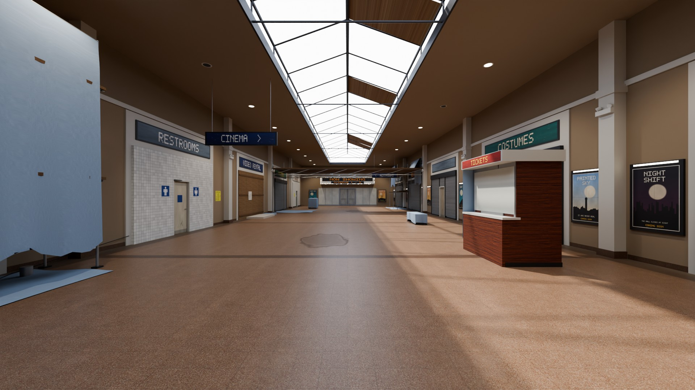
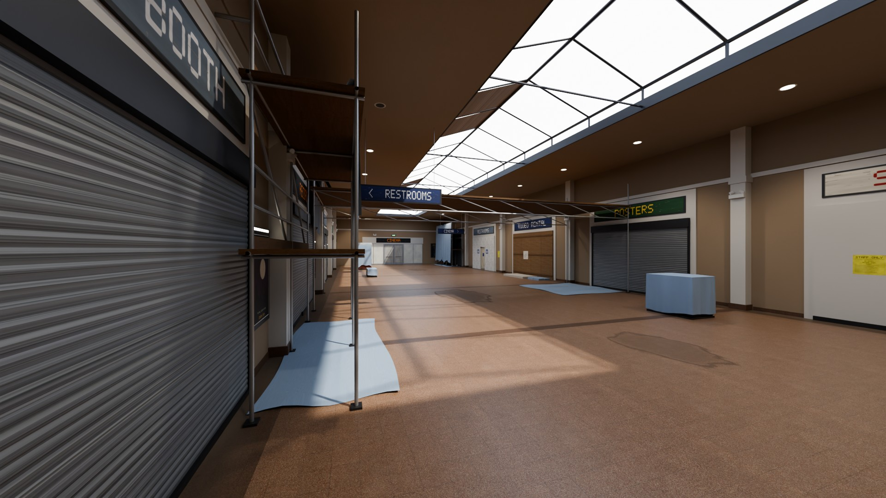
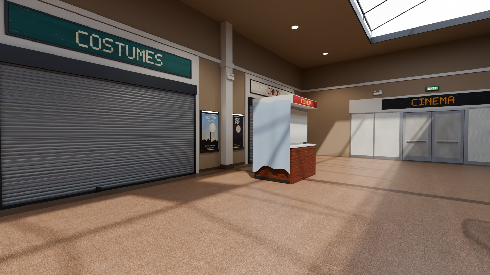

# wing_cinema: a mall concourse

Dressed and lit from the mall greybox (`docs/BLENDER_AREAS.md` section 3; the greybox is draft PR #110, `tools/blender/build_mall_greybox.py`). One of the three concourses off part 1's atrium (`entrance`), built to read as the same building: entrance's terrazzo in a dark border, its beige plaster in two shades, painted steel roller shutters under hand-painted fascia signs, plywood hoardings, tube scaffolding with dust sheets, a glazed skylight strip being repaired (a few broken panes boarded from inside), whitewashed glass; old, abandoned and halfway through a refit nobody finished. Built in Blender 5.2.1 by `tools/blender/build_mall_wings.py` (one script for the three wings, `--scene wing_cinema`), baked twice (the day set and the emergency set on the same lightmap UVs) and exported as art only. There are no reference photos; everything follows the written descriptions.

| File | What it is |
|---|---|
| `world/wing_cinema.glb` | the art: 2.91 MB, 22710 triangles, 32 draw calls (one primitive per material, and each door leaf its own node, origin at its hinge), textures WebP |
| `world/wing_cinema.json` | the layout, written by `tools/blender/export_scene.py` from the `.blend`. It is the greybox's file, unchanged (the same JSON, key for key) |
| `world/lightmaps/wing_cinema_0.webp`, `_1.webp` | the day set (second UV set, `TEXCOORD_1`): the material's `lightmap` |
| `world/lightmaps/wing_cinema_2.webp`, `_3.webp` | the emergency set on the same UVs: `lightmap_night` |
| `blender/scenes/wing_cinema.blend` | the saved scene (4.5 MB, Git LFS): `Art` (the unmerged pieces), `Doors` (the seven leaves), `Layout` (the `COL_` boxes and the empties, the greybox's names), `Export` (merged by material, with the lightmap UVs), `Standins` (the arrival marker), `Lights_Day`, `Lights_Night`, `Lights_Always` |
| `tools/blender/build_mall_wings.py` | the re-runnable build; it imports the greybox model, so no coordinate of the layout is typed in |
| `blender/textures/mall_wings/` | entrance's CC0 texture files (below), copied so this build does not depend on the entrance branch |
| `docs/renders/wing_cinema/` | the three review stills (this folder) |

The shared tools are reused unchanged: `export_scene.py`, `check_layout.py`, `pack_scene.py`, `tools/webp_glb.py`. The other two wings, `wing_books` and `wing_entertainment`, come from the same script.

## What is in it

**The cinema wing** (runs west from the atrium; turned 180 degrees). Five bays a side:
- North: ARCADE TOKENS, the RESTROOMS bay (white tiles either side of the restroom door, the man and woman pictograms, the RESTROOMS sign; it is the door to `mirror_bathroom`), VIDEO RENTAL boarded over, POSTERS, the STAFF ONLY door.
- South: CANDY, COSTUMES, the unmarked door between two shutters (to `scene_3012`), RECORDS, PHOTO BOOTH.
- **The poster-case row**: ten lit poster cases along the south wall between the bays, each with an invented film's poster (THE LONG HALL, NIGHT SHIFT, PAINTED SKY, RETURN TO FARWAY, DEEP END, SUMMER 99, NO EXIT), plus the greybox's two cases beside the cinema's doors.
- **The ticket kiosk** on the greybox's TicketKiosk collider: a wood-clad booth, its counter and ticket window facing the concourse, a TICKETS canopy, a dust sheet thrown over one end.
- The far end: the cinema's glass doors in a whitewashed glazed screen, the marquee over them (NOW SHOWING, SCREENS 1 - 5, a border of bulbs, a few dead).
- Blade signs: CINEMA >, < RESTROOMS. The popcorn cart and a bench under dust sheets; the scaffold bridge across the concourse at 4 m (a lattice beam under each edge of its deck).

Common to the three wings: the shell is the greybox's 40 m by 14 m, 6 m high hall. A terrazzo field in a dark border with a dark band across the hall at each pair of pilasters, terrazzo skirting; beige plaster to the fascia line and a darker shade above it, a painted band at 4.4 m; painted pilasters with terrazzo plinths. The skylight strip (36 m by 5 m) has a pitched glazed lantern of dirty wired glass with four broken panes boarded from inside. Twenty ceiling downlights either side of it, about a third of them dead. The atrium's glass doors at the near end in a whitewashed glazed screen (the wing is closed off for the works), with an EXIT sign and the wing's name over them and the mall directory beside them. Emergency fittings (twin heads) on every pilaster and over both ends' doors. The greybox's scaffolds are dressed as tube scaffolding (standards on base plates, ledgers, transoms, braces, guard rails, plank decks with toe boards, ties to the wall, a work lamp on the first one) with a dust sheet hung on or thrown over each. Drop cloths, paint tins, plasterboard, cement bags and a cable on the floor, kept off the walking lines.

The mannequins are the page's: every `Spot_mannequin_<n>` is left clear (no dressing within 0.45 m that reaches below head height; the art of the greybox's own solids, such as a sheeted kiddie ride, stays where the greybox put it), and so is every link's `at` and `arrive` point.

## Light

| Set | Light | Maps | Material property |
|---|---|---|---|
| day | the sun (from high in the south-west, the mall's sun as in entrance) and the sky through the skylight strip, the working downlights and the work lamp (`Lamp_Emit` on) | `wing_cinema_0`, `wing_cinema_1` | `lightmap`, `lightmap_intensity` |
| emergency | the emergency heads alone (`Emergency_Emit` on, `Lamp_Emit` off, no sky): the mall locked from 20:00 | `wing_cinema_2`, `wing_cinema_3` | `lightmap_night`, `lightmap_night_intensity` |

The toggled materials are entrance's, switched the same way by the clock: `Lamp_Emit` (strength 10: the downlights' lenses, the work lamp, the bulbs round the signs, the poster cases' strips) is on by day and off while the mall is locked; `Emergency_Emit` (strength 6: the emergency heads' lenses) is on only while it is locked. `Sign_Exit` (the EXIT sign) is emissive and always on. `Window_Lit` does not occur. So `cityLook`'s `setLightSet(lk ? "night" : "day")`, `artToggle("Emergency_Emit", lk)` and `artToggle("Lamp_Emit", !lk)` for the mall need nothing new.

| Map | Set | Holds | Density | Samples, GPU time | WebP |
|---|---|---|---|---|---|
| `wing_cinema_0` | day | the shell: floor, walls, ceiling, trim | 37.4 px/m (scaled: Ceiling_Paint 20.6, Decal_Dust 22.5) | 512, 74 s | 201 KB |
| `wing_cinema_1` | day | everything in it, and the door leaves | 30.8 px/m (scaled: Skylight_Glass 3.7) | 512, 60 s | 415 KB |
| `wing_cinema_2` | night | the shell: floor, walls, ceiling, trim | 37.4 px/m (scaled: Ceiling_Paint 20.6, Decal_Dust 22.5) | 768, 88 s | 156 KB |
| `wing_cinema_3` | night | everything in it, and the door leaves | 30.8 px/m (scaled: Skylight_Glass 3.7) | 768, 69 s | 288 KB |

Cycles on the rented GPU (OptiX), diffuse (direct and indirect, no colour), 8 px margin, OIDN. The skylight's panes are hidden while baking so the sun and the sky come in; their own texels are filled flat (bright by day, a dull glow at night). Faces nobody sees get no texels: the shell's outer skin, the joints between wall pieces, the wall behind each bay's front and fascia and behind the pilasters, faces flat against a wall or the floor, faces looking up from above 2.2 m or down from below 0.8 m.

**Brightness, the hotel lobby's shoulder.** Each map is written as texel = G L / (C + G L) of the bake's light L, and every baked material's intensity is pi C, so the page shows texture x G L where the light is ordinary and rolls off toward texture x C in the sun's patch, never clipping. Day: G 5.5, C 1.3; emergency: G 7, C 1.1 (`CURVE` in the build).

## Brightness, as the page shows it

Measured with `lab_display.py` (area-weighted samples over each material's triangles, the brightest channel; `>=1` is the share that clips). Day (`lightmap`):

```
material                m2           map       k    p50    p90    p99     >=1
Floor_Terrazzo       481.3 wing_cinema_0  4.0841  0.221  0.341  0.493   0.00%
Ceiling_Paint        418.2 wing_cinema_0  4.0841  0.192  0.236  0.375   0.00%
Metal_Dark           288.9 wing_cinema_1  4.0841  0.049  0.067  0.068   0.00%
Wall_Plaster         239.0 wing_cinema_0  4.0841  0.208  0.290  0.373   0.00%
Skylight_Glass       224.5 wing_cinema_1  2.8903  0.652  0.715  0.728   0.00%
Trim_Paint           203.6 wing_cinema_0  4.0841  0.377  0.570  0.722   0.00%
Wall_Upper           174.1 wing_cinema_0  4.0841  0.141  0.179  0.208   0.00%
Scaffold_Board       120.9 wing_cinema_1  4.0841  0.061  0.097  0.144   0.00%
Floor_Border         106.6 wing_cinema_0  4.0841  0.087  0.145  0.218   0.00%
Shutter_Metal         96.4 wing_cinema_1  4.0841  0.135  0.196  0.230   0.00%
Cloth_Sheet           90.1 wing_cinema_1  4.0841  0.397  0.535  0.603   0.00%
Decal_Dust            87.8 wing_cinema_0  4.0841  0.204  0.240  0.282   0.00%
Metal_Steel           52.5 wing_cinema_1  4.0841  0.150  0.338  0.475   0.00%
Hoarding_Ply          52.2 wing_cinema_1  4.0841  0.177  0.267  0.338   0.00%
Door_Leaves           40.3 wing_cinema_1  4.0841  0.310  0.486  0.722   0.00%
Sign_Paint            39.3 wing_cinema_1  4.0841  0.085  0.610  0.821   0.16%
Decal_Stain           30.9 wing_cinema_0  4.0841  0.000  0.079  0.087   0.00%
Glass_Whitewash       29.9 wing_cinema_1  4.0841  0.484  0.702  0.787   0.00%
Poster_Art            19.7 wing_cinema_1  4.0841  0.081  0.629  0.779   0.00%
Bench_Wood            18.7 wing_cinema_1  4.0841  0.030  0.112  0.183   0.00%
Tile_White            15.0 wing_cinema_1  4.0841  0.637  0.739  0.910   0.03%
Clutter_Paint          4.0 wing_cinema_1  4.0841  0.528  0.544  0.549   0.00%
Plastic_White          2.1 wing_cinema_1  4.0841  0.441  0.793  0.800   0.00%
```

Emergency set (`lightmap_night`, the same measure on the night maps):

```
material                m2           map       k    p50    p90    p99     >=1
Floor_Terrazzo       481.3 wing_cinema_2  3.4558  0.084  0.151  0.231   0.00%
Ceiling_Paint        418.2 wing_cinema_2  3.4558  0.034  0.046  0.118   0.00%
Metal_Dark           288.9 wing_cinema_3  3.4558  0.000  0.007  0.022   0.00%
Wall_Plaster         239.0 wing_cinema_2  3.4558  0.036  0.085  0.214   0.00%
Skylight_Glass       224.5 wing_cinema_3  1.9635  0.036  0.041  0.042   0.00%
Trim_Paint           203.6 wing_cinema_2  3.4558  0.063  0.154  0.327   0.00%
Wall_Upper           174.1 wing_cinema_2  3.4558  0.022  0.033  0.115   0.00%
Scaffold_Board       120.9 wing_cinema_3  3.4558  0.017  0.039  0.120   0.00%
Floor_Border         106.6 wing_cinema_2  3.4558  0.008  0.030  0.053   0.00%
Shutter_Metal         96.4 wing_cinema_3  3.4558  0.038  0.069  0.124   0.00%
Cloth_Sheet           90.1 wing_cinema_3  3.4558  0.101  0.226  0.321   0.00%
Decal_Dust            87.8 wing_cinema_2  3.4558  0.026  0.069  0.117   0.00%
Metal_Steel           52.5 wing_cinema_3  3.4558  0.034  0.165  0.332   0.00%
Hoarding_Ply          52.2 wing_cinema_3  3.4558  0.014  0.042  0.059   0.00%
Door_Leaves           40.3 wing_cinema_3  3.4558  0.000  0.140  0.166   0.00%
Sign_Paint            39.3 wing_cinema_3  3.4558  0.018  0.207  0.355   0.00%
Decal_Stain           30.9 wing_cinema_2  3.4558  0.000  0.034  0.038   0.00%
Glass_Whitewash       29.9 wing_cinema_3  3.4558  0.219  0.259  0.282   0.00%
Poster_Art            19.7 wing_cinema_3  3.4558  0.027  0.180  0.285   0.00%
Bench_Wood            18.7 wing_cinema_3  3.4558  0.008  0.036  0.098   0.00%
Tile_White            15.0 wing_cinema_3  3.4558  0.178  0.222  0.241   0.00%
Clutter_Paint          4.0 wing_cinema_3  3.4558  0.169  0.315  0.326   0.00%
Plastic_White          2.1 wing_cinema_3  3.4558  0.118  0.502  0.763   0.00%
```

By day the main surfaces are well under p90 0.9 and p99 0.98, and the walls read (lower plaster p50 about 0.2, upper about 0.14). Locked, the wing is dark by design, as entrance is: pools of cold light under the emergency heads, the floor between them dim. `Skylight_Glass` is filled flat. `Lamp_Emit`, `Emergency_Emit` and `Sign_Exit` carry no lightmap.

## Review stills (Cycles, 128 samples adaptive, OIDN, 1920 x 1080 JPEG, AgX, exposure 0, the day set)

| | |
|---|---|
| `1_arrival.jpg` (346 KB) | from the arrival point by the atrium's doors at eye height 1.6 m, facing the arrival's `face` (down the wing) |
| `2_wide.jpg` (346 KB) | the whole wing from the far end's corner, looking back to the atrium |
| `3_detail.jpg` (362 KB) | the wing's theme |





Blender renders with Blender's lights; the page shows the lightmaps instead. A night still, a second detail and a plan were rendered for the owner's sheet only.

## Sources and licences

| Texture | Used for | Source | Author (Poly Haven) | Licence |
|---|---|---|---|---|
| `terrazzo_tiles` diffuse, 1k | the floor (light) and its border, bands, skirting and plinths (dark) | https://polyhaven.com/a/terrazzo_tiles | Amal Kumar | CC0 1.0 |
| `painted_metal_shutter` diffuse, 1k | the roller shutters | https://polyhaven.com/a/painted_metal_shutter | Charlotte Baglioni, Dario Barresi, Rico Cilliers | CC0 1.0 |
| `plywood` diffuse, 1k | the hoardings, the boarded panes, the scaffold boards and battens | https://polyhaven.com/a/plywood | Rob Tuytel | CC0 1.0 |
| `beige_wall_001` diffuse, 1k | the walls (two shades) and the ceiling | https://polyhaven.com/a/beige_wall_001 | Dimitrios Savva, Rico Cilliers | CC0 1.0 |
| `dark_wood` diffuse, 1k | the cinema's kiosk, the dead ficus | https://polyhaven.com/a/dark_wood | Dario Barresi, Dimitrios Savva, Rico Cilliers | CC0 1.0 |
| `rough_linen` diffuse, 512 | the dust sheets, drop cloths, cement bags | https://polyhaven.com/a/rough_linen | colormass, Rico Cilliers | CC0 1.0 |
| `concrete_floor_02` diffuse, 1k | in the `.blend`'s material list only (not in the GLB) | https://polyhaven.com/a/concrete_floor_02 | Rob Tuytel | CC0 1.0 |

All seven are entrance's files (`blender/textures/entrance/` on `claude/blender-entrance-v2`), copied byte for byte; nothing new was downloaded. Everything else is own work made by `build_mall_wings.py`: all geometry, and the generated pictures drawn with numpy from fixed seeds: the sign atlas (entrance's 5 x 7 pixel font and hand-painted look, extended with B, J, Q, Z and a few marks), the poster atlas (invented film posters, the bookshop window, the arcade's mural, printed notices, the restroom pictograms, the directory), the door leaves (glass, staff, restroom, unmarked, site), the restroom tiles, the soft-play padding, the EXIT sign, the whitewash, the wired glass, the wall dust and the dried puddles. No Meshy, no Higgsfield, no purchase, no photograph.

## Budgets (measured)

| | Limit | Measured |
|---|---|---|
| `world/wing_cinema.glb`, lightmaps aside | at most 8 MB | **2.91 MB** (`glb_inspect.py --budget tris=300000,mb=8`: pass) |
| triangles | at most 300 000 | **22710** (pass) |
| draw calls | at most 250 | **32** |
| textures | WebP | all `image/webp` (`tools/webp_glb.py`) |
| lightmaps | at most 4, 2048 x 2048, 8-bit WebP q90 | **4**: two day maps and their two emergency twins |

## Checks

- **Layout check** (`tools/blender/check_layout.py` on the `.blend`'s `Art`, through `--stage check`): FAIL: 74 of 78 checks passed. The four failures are the two poster cases by the cinema's doors and their posters (Poster_Case, Poster_Case_2): see "Open".
- **Mannequins and links clear** (the build's own check, same stage): 13 of 13 places clear.
- **Same layout:** `export_scene.py` writes `world/wing_cinema.json` from the `.blend`; it is the greybox's file unchanged (compared as JSON). `python tools/blender/build_mall_greybox.py --check .` still prints GATES PASS.
- `node tools/worlddoc.mjs check world/wing_cinema.json`: OK, 0 errors (the six warnings say the scene and its links are new to the manifest).
- **Axes** (`--stage axes`): the marker at the arrival point comes out of the exporter where the game expects it.
- `node --test shared/*.test.js`: 297 tests, 297 pass.
- **Privacy:** the `.blend` (decompressed), the GLB's JSON, the lightmaps and the stills hold no user name, absolute path, session id or e-mail; the stills' JPEG comment and APP1 segments are stripped; the GLB's extras are only the four lightmap properties.

## Rebuild

From the repo root, with Blender 5.2 and Python with Pillow:

```
blender -b --python tools/blender/build_mall_wings.py -- --scene wing_cinema --stage art --work <work>      # art, layout file, layout check
blender -b blender/scenes/wing_cinema.blend --python tools/blender/build_mall_wings.py -- --scene wing_cinema --stage bake --samples 512 --work <work>
blender -b blender/scenes/wing_cinema.blend --python tools/blender/build_mall_wings.py -- --scene wing_cinema --stage export --work <work>
blender -b blender/scenes/wing_cinema.blend --python tools/blender/build_mall_wings.py -- --scene wing_cinema --stage render --work <work>   # --set night for the emergency set
python tools/blender/pack_scene.py wing_cinema --work <work>
```

## What the coordinator does to wire it in

1. Add `world/wing_cinema.glb` and `world/wing_cinema.json` to the scene's files in the manifest, with the greybox's links (the atrium's side of each is listed in the greybox README).
2. Apply the lightmaps with `applyLightmaps` and the mall's clock toggles, as for entrance.
3. Draw the mannequins at the `Spot_mannequin_<n>` places; swing the door leaves by name (`DoorLeaf_<id>` nodes, origin at the hinge; the layout file has their hinge, yaw and swing).

## Open

- **The two poster cases by the cinema's doors fail the layout check's STRAY rule.** The greybox's `Poster_Case` colliders are glass boxes on the end wall from y 0.6 to 2.4, 15 cm deep. The art fills them exactly, but the check accepts solid art below head height only over a collider that stands on the floor (starts below 0.5 m), so it reports `Poster_Case`, `Poster_Case_2` and their posters. The fix is one line in the greybox (`_cinema_end`: start both cases at y 0.0, as free-standing cases), then re-export the JSON; it was not made here because the layout was to be kept exactly. The coordinator or the owner can choose: change the two colliders, or accept the case art as it is.
- The page's view of the bake has not been seen in a browser; the first in-game screenshot from the arrival point is the first look at it under the page's shading.
- The doors stay closed in the art; when the page swings a leaf, what is behind it is the page's black background until the link loads the next scene.
- The atrium's side of the link (an opening in entrance's wall) is for the coordinator; entrance was not touched.
